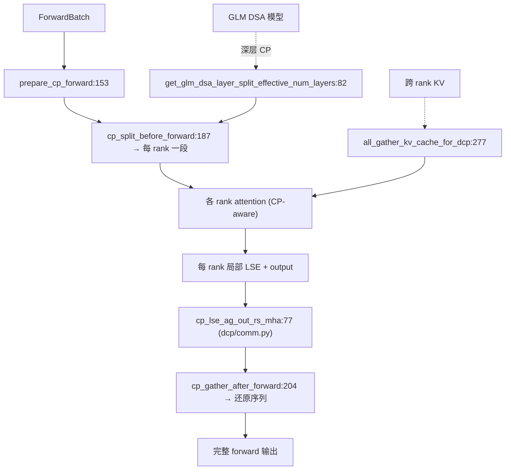

# 06.7 上下文并行 cp

## 定位

`layers/cp/` 与 `layers/dcp/` 实现 SGLang 的 Context Parallel（CP）与 Disaggregated CP（DCP）。CP 把一条长序列在序列维度切给多个 rank，每个 rank 只算自己那段 query 的 attention，再通过 all-gather/ReduceScatter 合并 LSE 与输出；DCP 配合 DSA / GLM 在分布式稀疏注意力下跨 rank 共享 KV 摘要。

## 职责

- `cp/base.py` 定义 `ContextParallelStrategy` ABC（`:87`）与 strategy 选择入口 `init_cp_strategy`（`:210`），支持 ZIGZAG / INTERLEAVE 两类策略。
- `cp/zigzag.py` / `cp/interleave.py` 实现具体策略：切 query、调整 KV 顺序、LSE 合并。
- `cp/utils.py` 提供 split/gather 辅助与 GLM DSA 专用 layer split；`cp/padding.py` 处理 token 对齐。
- `dcp/comm.py` 提供 `cp_lse_ag_out_rs_mha:77`、`all_gather_kv_cache_for_dcp:277` 等跨 rank 融合算子。
- `layers/utils/cp_utils.py` 提供 `ContextParallelMetadata:22`、`is_prefill_context_parallel_enabled:60`、`is_mla_prefill_cp_enabled:71`、`can_cp_split:86`、`cp_split_and_rebuild_data:128` 等高层入口。

## 关键类与函数

| 名称 | 定义位置 | 说明 |
|---|---|---|
| `ContextParallelStrategy` | `layers/cp/base.py:87` | strategy ABC |
| `ContextParallelStrategyKind` | `layers/cp/base.py:39` | strategy 类型枚举 |
| `CPAttentionBackendKind` | `layers/cp/base.py:66` | CP 注意力后端枚举 |
| `init_cp_strategy` | `layers/cp/base.py:210` | strategy 初始化 |
| `get_cp_strategy` | `layers/cp/base.py:239` | 取当前 strategy |
| `is_cp_enabled` / `is_zigzag` / `is_interleave` | `layers/cp/base.py:268` / `:272` / `:276` | 模式判定 |
| `ZigzagCPStrategy` / `ZigzagContextParallelMetadata` | `layers/cp/zigzag.py:96` / `:60` | Zigzag 策略 |
| `InterleaveCPStrategy` / `InterleaveContextParallelMetadata` | `layers/cp/interleave.py:47` / `:43` | Interleave 策略 |
| `get_glm_dsa_layer_split_effective_num_layers` | `layers/cp/utils.py:82` | GLM DSA 分层 |
| `enable_cp_v2` / `is_cp_v2_active` | `layers/cp/utils.py:127` / `:134` | CP v2 开关 |
| `prepare_cp_forward` | `layers/cp/utils.py:153` | forward 前置准备 |
| `cp_split_before_forward` / `cp_gather_after_forward` | `layers/cp/utils.py:187` / `:204` | 切/合实现 |
| `ContextParallelMetadata` | `layers/utils/cp_utils.py:22` | 高层 metadata |
| `is_prefill_context_parallel_enabled` / `is_mla_prefill_cp_enabled` | `layers/utils/cp_utils.py:60` / `:71` | prefill CP 判定 |
| `can_cp_split` / `cp_split_and_rebuild_data` | `layers/utils/cp_utils.py:86` / `:128` | 切分判定与执行 |
| `cp_lse_ag_out_rs_mha` | `layers/dcp/comm.py:77` | LSE all-gather + output reduce-scatter (MHA) |
| `all_gather_kv_cache_for_dcp` | `layers/dcp/comm.py:277` | DCP KV cache all-gather |

## 子模块树

- `layers/cp/`
  - `base.py` — strategy ABC 与全局入口
  - `zigzag.py` / `interleave.py` — 具体策略
  - `utils.py` — GLM DSA 与 CP v2 辅助
  - `padding.py` — token 对齐
- `layers/dcp/`
  - `comm.py` — LSE / KV cache 跨 rank 融合算子
  - `layout.py` / `metadata.py` / `planner.py` — DCP 布局与计划
- `layers/utils/cp_utils.py` — `ContextParallelMetadata` 与高层入口

## 数据流 / 控制流

`prepare_cp_forward` 在每次 forward 前判定是否启用 CP 并写好 metadata；`cp_split_before_forward` 把 query/position 等按 strategy 切到各 rank。Attention 算完后，`cp_lse_ag_out_rs_mha` 先 all-gather 局部 LSE 做 log-sum-exp 归一，再 reduce-scatter 输出，最后 `cp_gather_after_forward` 把序列重建。DCP 在此基础上额外 `all_gather_kv_cache_for_dcp` 把 KV cache 跨 rank 拉到本地，配合稀疏 indexer 选块。

## 交叉引用

- 上游: [`08.7 上下文并行 cp/dcp`](../08-distributed/08.7-context-parallel-cp-dcp.md) — 全局并行编排
- 上游: [`04.1 ModelRunner`](../04-model-execution/04.1-model-runner.md) — forward 前置调用
- 下游: [`06.3.3 稀疏注意力后端`](06.3.3-attn-sparse-backends.md) — DSA/GLM 与 CP 联动
- 下游: [`08.5 通信算子`](../08-distributed/08.5-comm-ops.md) — all-gather / reduce-scatter

## 进一步阅读

- 源码: `python/sglang/srt/layers/cp/`、`python/sglang/srt/layers/dcp/`、`python/sglang/srt/layers/utils/cp_utils.py`
- strategy ABC: `python/sglang/srt/layers/cp/base.py:87`
- 融合算子: `python/sglang/srt/layers/dcp/comm.py:77`、`:277`
