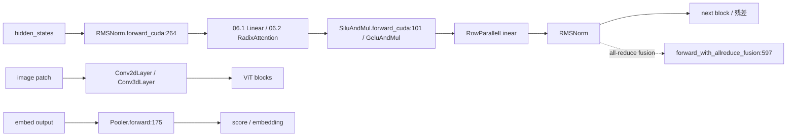

# 06.8 norm/activation/conv/pooler

## 定位

本页汇集 06 子系统中那些"小而通用"的 `nn.Module`/`MultiPlatformOp`：归一化、激活、卷积、池化。它们被几乎每个 Transformer layer 用于残差前后的 RMSNorm 与 MLP 中间 SiLU/GELU，并由多模态模型用于 ViT 前的 conv 与 embed 后的 pooler。

## 职责

- `RMSNorm` / `LayerNorm` / `Gemma*` / `RMSNormWithoutScale` 提供各硬件平台（cuda/hip/aiter/npu/musa/xpu/cpu）的归一化实现，`RMSNorm.forward_with_allreduce_fusion` 把 all-reduce 融合到 norm 内。
- `SiluAndMul` / `GeluAndMul` / `NewGELU` / `ReLU2` / `QuickGELU` / `XIELU` / `ScaledActivation` 提供激活函数；都继承 `MultiPlatformOp`。
- `Conv2dLayer` / `Conv3dLayer` 用于 ViT patch embed 与视频处理器。
- `PoolingType` / `Pooler` / `CrossEncodingPooler` 服务于嵌入/rerank 类请求的池化输出。

## 关键类与函数

| 名称 | 定义位置 | 说明 |
|---|---|---|
| `RMSNorm` | `layers/layernorm.py:216` | 主 RMSNorm，`forward_cuda:264` / `forward_with_allreduce_fusion:597` |
| `LayerNorm` | `layers/layernorm.py:610` | 标准 LayerNorm，`forward_cuda:629` |
| `GemmaRMSNorm` | `layers/layernorm.py:694` | Gemma 系列 RMSNorm |
| `Gemma3RMSNorm` | `layers/layernorm.py:872` | Gemma3 |
| `Gemma4RMSNorm` | `layers/layernorm.py:905` | Gemma4 |
| `RMSNormWithoutScale` | `layers/layernorm.py:983` | 无缩放 RMSNorm |
| `SiluAndMul` | `layers/activation.py:89` | SiLU 门控，`forward_cuda:101` |
| `GeluAndMul` | `layers/activation.py:143` | GELU 门控 |
| `NewGELU` | `layers/activation.py:190` | 新 GELU |
| `ReLU2` | `layers/activation.py:200` | ReLU^2 |
| `QuickGELU` | `layers/activation.py:214` | QuickGELU |
| `XIELU` | `layers/activation.py:230` | XIELU |
| `ScaledActivation` | `layers/activation.py:334` | 带缩放激活（Gemma2 etc.） |
| `get_act_fn` | `layers/activation.py:385` | 激活函数 factory |
| `Conv2dLayer` | `layers/conv.py:101` | 2D 卷积，`forward_cuda:201` |
| `Conv3dLayer` | `layers/conv.py:207` | 3D 卷积，`forward_cuda:316` |
| `PoolingType` | `layers/pooler.py:20` | 池化类型枚举 |
| `Pooler` | `layers/pooler.py:159` | 池化器，`forward:175` |
| `CrossEncodingPooler` | `layers/pooler.py:204` | 跨编码池化器（rerank） |

## 子模块树

- `layers/layernorm.py` — RMSNorm/LayerNorm/Gemma*/RMSNormWithoutScale
- `layers/activation.py` — SiLU/GELU 系列 + `get_act_fn`
- `layers/conv.py` — Conv2dLayer / Conv3dLayer
- `layers/pooler.py` — Pooler 体系
- `layers/sparse_pooler.py` — 稀疏路由下的池化
- `layers/utils/common.py` — `PPMissingLayer`（pipeline 缺层占位）

## 数据流 / 控制流

`RMSNorm` 在每个 transformer block 前后调用；启用 all-reduce 融合时走 `forward_with_allreduce_fusion`，把 TP 行并行的 reduce 直接合并进 norm kernel，省一次跨 rank 通信。激活函数主要用在 gated MLP（`SiluAndMul` 把 gate 与 up 按元素相乘）。Conv 在 ViT patch embed 使用；Pooler 在 embed/rerank API 把序列池化成单向量。

## 交叉引用

- 下游: [`06.1 Linear`](06.1-linear.md) — `forward_with_allreduce_fusion` 与行并行 Linear 联动
- 下游: [`06.13 LayerCommunicator`](06.13-layer-communicator.md) — all-reduce 融合
- 相关: [`06.4.1 MoE 模块与流程`](06.4.1-moe-module-flow.md) — MoE 内部用 `SiluAndMul`
- 相关: [`06.3.4 线性注意力后端`](06.3.4-attn-linear-backends.md) — `Mixer2RMSNormGated` 与 Gated RMSNorm

## 进一步阅读

- 源码: `python/sglang/srt/layers/layernorm.py`、`activation.py`、`conv.py`、`pooler.py`
- RMSNorm: `python/sglang/srt/layers/layernorm.py:216`
- Activation: `python/sglang/srt/layers/activation.py:89`
