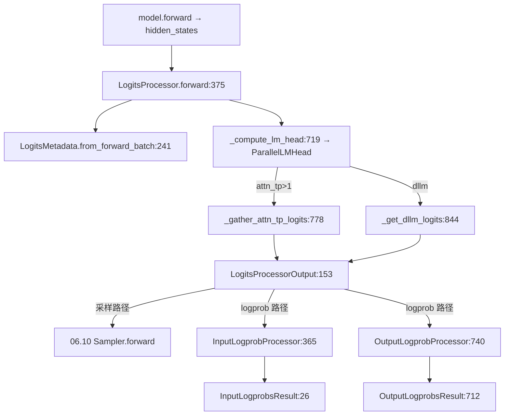

# 06.9 logits/logprob

## 定位

`LogitsProcessor` 与 `LogprobProcessor` 是 [`04.1 ModelRunner`](../04-model-execution/04.1-model-runner.md) 在 `forward` 之后衔接采样的两个 `nn.Module`：前者把 `model.forward` 产出的 hidden states 过 `ParallelLMHead` 得到 logits，后者在 logits 上计算 top-k / token-id logprobs。

## 职责

- `LogitsProcessor.forward` 接收 hidden states 与 `LogitsMetadata`，按是否 `skip_all_gather` 决定本地算 lm_head 或跨 attn_tp 组 all-gather；支持 spec v2 多步 logits 与 dllm 压缩 logits。
- `LogitsMetadata.from_forward_batch` 把 `ForwardBatch` 的 batch 分布、序列长度聚合到张量形态；`compute_dp_attention_metadata` 处理 DP attention 路径的 metadata。
- `LogitsProcessorOutput` 输出 logits、hidden states 与 next token（如果 greedy）。
- `InputLogprobProcessor` / `OutputLogprobProcessor` 计算 prompt token 与输出 token 的 logprobs，分阶段（`LogprobStage`）流水化。

## 关键类与函数

| 名称 | 定义位置 | 说明 |
|---|---|---|
| `LogitsProcessorOutput` | `layers/logits_processor.py:153` | lm_head 输出 |
| `LogitsMetadata` | `layers/logits_processor.py:202` | 张量化 metadata，`from_forward_batch:241` |
| `LogitsProcessor` | `layers/logits_processor.py:325` | 处理器本体，`forward:375` |
| `LogitsProcessor._compute_lm_head` | `layers/logits_processor.py:719` | LM head 调用 |
| `LogitsProcessor._gather_attn_tp_logits` | `layers/logits_processor.py:778` | attn_tp all-gather |
| `LogitsProcessor._get_dllm_logits` | `layers/logits_processor.py:844` | dllm 压缩 logits |
| `should_apply_lm_head_quant_method` | `layers/logits_processor.py:73` | 决定是否对 lm_head 量化 |
| `LogprobStage` | `layers/logprob_processor.py:20` | logprob 计算阶段枚举 |
| `InputLogprobsResult` | `layers/logprob_processor.py:26` | prompt logprob 结果容器 |
| `OutputLogprobsResult` | `layers/logprob_processor.py:712` | 输出 logprob 结果容器 |
| `InputLogprobProcessor` | `layers/logprob_processor.py:365` | 输入 logprob 处理器 |
| `OutputLogprobProcessor` | `layers/logprob_processor.py:740` | 输出 logprob 处理器 |
| `get_top_logprobs` / `get_token_ids_logprobs` | `layers/logprob_processor.py:80` / `:150` | 通用入口 |
| `get_top_logprobs_chunk` / `get_token_ids_logprobs_chunk` | `layers/logprob_processor.py:159` / `:231` | 分块计算 |
| `compute_spec_v2_logprobs` | `layers/logprob_processor.py:300` | 投机 spec v2 logprob |

## 子模块树

- `layers/logits_processor.py` — lm head + gather + dllm
- `layers/logprob_processor.py` — TopN / token-id logprob + spec v2 path
- 与之协作：[`06.11 ParallelLMHead`](06.11-vocab-embedding-lmhead.md)(forKey-head matmul)、[`06.10 Sampler`](06.10-sampler-layer.md)(for next token)

## 数据流 / 控制流

`LogitsProcessor.forward` 先 `from_forward_batch` 取 metadata，做 `_preprocess_logits`/LM head，需要时跨 attn_tp all-gather。结果交给 `ModelRunner.sample`（采样）或 `compute_logprobs_only`（logprob 路径）。两个 logprob processor 按 `LogprobStage` 阶段在 logits / next-token logits 上算 top-N 与指定 token 的 logprob，并以分块（`*_chunk`）方式避免峰值显存。

## 交叉引用

- 上游: [`04.1 ModelRunner`](../04-model-execution/04.1-model-runner.md) — `sample` / `compute_logprobs_only`
- 下游: [`06.10 Sampler 层`](06.10-sampler-layer.md) — 消费 logits
- 下游: [`06.11 ParallelLMHead`](06.11-vocab-embedding-lmhead.md) — LM head 实现
- 相关: [`11.4 Sampler 层`](../11-sampling-control/11.4-sampler-layer.md) — 上层语义
- 相关: [`10.4 verify-sampling`](../10-speculative/10.4-verify-sampling.md) — spec v2 logprobs

## 进一步阅读

- 源码: `python/sglang/srt/layers/logits_processor.py`、`python/sglang/srt/layers/logprob_processor.py`
- LogitsProcessor: `python/sglang/srt/layers/logits_processor.py:325`
- Logprob 入口: `python/sglang/srt/layers/logprob_processor.py:365`、`:740`
