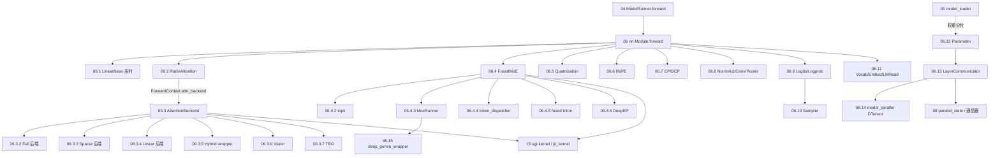

# 06 Layers

## 定位

子系统 06 是 SGLang 中所有 `nn.Module` 构建块的归宿。它接收 [`04 模型执行`](../04-model-execution/index.md) 中 `ModelRunner.forward` 调用的张量化 `ForwardBatch`，在 `model.forward` 内部逐层执行注意力、MoE、Linear、Norm、Embedding 等算子，最终把 hidden states 交给 `LogitsProcessor` 与 `Sampler`。本子系统是连接"调度/执行控制面"与"内核/硬件执行面（[`15 内核与硬件`](../15-kernels-hardware/index.md)）"的中间层。

## 职责

- 提供注意力模块 `RadixAttention` 与可插拔的注意力后端抽象 `AttentionBackend`，统一支持 full / sparse / linear / hybrid / vision / TBO 等几十种后端。
- 提供 `FusedMoE` 模块及其 dispatch / runner / topk / token dispatcher 子管线，覆盖 DeepEP、Mooncake、Nixl、FlashInfer、Ascend、Mori、MegaMoE 等 A2A 路由后端。
- 提供量化框架（`quantization/`），按 schema 暴露 `LinearMethodBase` / `FusedMoEMethodBase` 与 FP8/FP4/AWQ/GPTQ/Marlin/INT4/ModelOpt/BnB 等具体 scheme。
- 提供线性层（`LinearBase` 系列）、RotaryEmbedding、`RMSNorm`/`SiluAndMul`/`Conv2dLayer`/`Pooler`、`VocabParallelEmbedding`/`ParallelLMHead`、`LogitsProcessor`/`LogprobProcessor`、`Sampler`。
- 通过 `parameter.py`、`model_parallel.py`(DTensor TP)、`LayerCommunicator`、`deep_gemm_wrapper/`、`cp/`/`dcp/` 提供权重分片加载、TP/DP/EP/CP 通信融合与 JIT FP8/FP4 grouped-GEMM 门面。

## 子系统边界图

## 注意力后端插桩流程

```mermaid
flowchart LR
    Args["16 ServerArgs.attention_backend"] --> ABS["_resolve_attention_backend_strs"]
    ABS --> REG["attention_registry.ATTENTION_BACKENDS"]
    REG -->|"factory"| BF["_build_backend_from_str"]
    BF --> WRAP["attn_backend_wrapper 装配 hybrid/aux 钩子"]
    WRAP --> SET["attention_backend_setup.build_attention_backends"]
    SET --> MRinit["ModelRunner.init_attention_backends:818"]
    MRinit --> CTX["ForwardContext.attn_backend"]
    CTX -.每 forward.-> RA["RadixAttention.forward:122"]
    RA -->|"dispatch by AttentionType"| BFwd["backend.forward/forward_decode/forward_extend"]
    BFwd --> KER["15 kernels"]
```

SGLang 通过 `attention_registry.ATTENTION_BACKENDS` 字典把字符串名（如 `flashinfer` / `trtllm_mla` / `fa3` / `triton` 等）映射到 factory 函数；`build_attention_backends` 在 `ModelRunner.init_attention_backends` 中解析字符串、调用 factory 构造主后端与 decode 后端，再用 `attn_backend_wrapper` 包装 hybrid（GDN/Mamba2/ShortConv/KDA/Lightning）与 aux hidden 捕获。每次 `model.forward` 进入 `ForwardContext` 后，`RadixAttention` 通过 `get_attn_backend()` 拿到当批后端实例，按 `AttentionType` 调用其 `forward` / `forward_decode` / `forward_extend`。

## 子系统内导航

| 编号 | 页面 | 一句话定位 |
|---|---|---|
| 06.1 | [Linear](06.1-linear.md) | `LinearBase`/`ColumnParallelLinear`/`RowParallelLinear` 等 TP 线性层与 quant delegate |
| 06.2 | [RadixAttention 模块](06.2-radix-attention-module.md) | 注意力模块本体与 `unified_attention_with_output` 自定义 op |
| 06.3.1 | [注意力后端抽象](06.3.1-attn-backend-abstraction.md) | `AttentionBackend` ABC 与 `attention_registry` 工厂注册 |
| 06.3.2 | [全注意力后端](06.3.2-attn-full-backends.md) | FlashInfer/MLA/TRT-LLM/Flash/FlashMLA/Triton/Wave/Aiter/AMX/XPU 等 |
| 06.3.3 | [稀疏注意力后端](06.3.3-attn-sparse-backends.md) | DSA/DSV4/NSA/MiniMax/Hybrid |
| 06.3.4 | [线性注意力后端](06.3.4-attn-linear-backends.md) | GDN/KDA/Lightning/ShortConv + Mamba2 |
| 06.3.5 | [混合注意力 wrapper](06.3.5-attn-hybrid-wrapper.md) | `HybridLinearAttnBackend` 与 hybrid 装配 |
| 06.3.6 | [视觉注意力](06.3.6-attn-vision.md) | `VisionAttention` 与各硬件子类 |
| 06.3.7 | [TBO](06.3.7-attn-tbo.md) | `TboAttnBackend` 两批 overlap |
| 06.4.1 | [MoE 模块与流程](06.4.1-moe-module-flow.md) | `FusedMoE.forward` dispatch→core→combine→all-reduce |
| 06.4.2 | [MoE topk](06.4.2-moe-topk.md) | `TopK`/`TopKOutput`/waterfill/hash |
| 06.4.3 | [MoE runner](06.4.3-moe-runner.md) | `MoeRunner` + Triton/Ascend/DeepGemm/Humming/Aiter/Marlin/FlashInfer |
| 06.4.4 | [MoE token dispatcher](06.4.4-moe-token-dispatcher.md) | A2A 路由：DeepEP/Mooncake/Nixl/FlashInfer/Mori/MegaMoE |
| 06.4.5 | [MoE fused triton](06.4.5-moe-fused-triton.md) | Marlin path + `invoke_fused_moe_kernel` |
| 06.4.6 | [MoE DeepEP](06.4.6-moe-deepep.md) | DeepEP NORMAL/LOW_LATENCY/AUTO 与 cuda graph 集成 |
| 06.5 | [量化](06.5-quantization.md) | 各 schema 的 linear & MoE weight methods + configs |
| 06.6 | [旋转位置编码](06.6-rotary-embedding.md) | RoPE 变体与 `get_rope` factory |
| 06.7 | [上下文并行 cp](06.7-context-parallel-cp.md) | `cp/`/`dcp/` 与 `ContextParallelMetadata` |
| 06.8 | [norm/activation/conv/pooler](06.8-norm-activation-conv-pooler.md) | `RMSNorm`/`SiluAndMul`/`Conv2dLayer`/`Pooler` |
| 06.9 | [logits/logprob](06.9-logits-logprob.md) | `LogitsProcessor`/`LogprobProcessor` |
| 06.10 | [Sampler 层](06.10-sampler-layer.md) | `Sampler.forward` 与各 sample backend |
| 06.11 | [Vocab/Embedding/LMHead](06.11-vocab-embedding-lmhead.md) | `VocabParallelEmbedding`/`ParallelLMHead` |
| 06.12 | [Parameter](06.12-parameter.md) | `BasevLLMParameter` 体系与 TP 权重加载 |
| 06.13 | [LayerCommunicator](06.13-layer-communicator.md) | TP/DP/EP scatter-gather reduce-scatter 融合 |
| 06.14 | [model_parallel(DTensor)](06.14-model-parallel-dtensor.md) | Native `torch.distributed` TP DTensor |
| 06.15 | [deep_gemm_wrapper](06.15-deep-gemm-wrapper.md) | JIT FP8/FP4 grouped-GEMM 门面 |

## 交叉引用

- 上游: [`04 模型执行`](../04-model-execution/index.md) — `ModelRunner` 调用 `model.forward` 与 `init_attention_backends`
- 上游: [`05 模型加载`](../05-model-loading/index.md) — `model_loader` 用 `Parameter`/`LinearMethodBase` 创建权重
- 下游: [`15 内核与硬件`](../15-kernels-hardware/index.md) — 注意力/MoE/DeepGEMM 内核实现
- 依赖: [`07 KV Cache`](../07-kv-cache/index.md) — 注意力后端持有 `token_to_kv_pool`
- 依赖: [`08 分布式与并行`](../08-distributed/index.md) — TP/EP/CP 通信
- 相关: [`11 采样与解码控制`](../11-sampling-control/index.md) — `Sampler`/Grammar 在 logits 上交汇
- 相关: [`10 投机解码`](../10-speculative/index.md) — MultiStepDraftBackend 复用注意力后端
- 相关 skill: `.claude/skills/large-class-style`、`.claude/skills/add-sgl-kernel`、`.claude/skills/add-jit-kernel`

## 进一步阅读

- 源码: `python/sglang/srt/layers/`
- 量化基类: `python/sglang/srt/layers/quantization/base_config.py:126`
- 注意力注册表: `python/sglang/srt/layers/attention/attention_registry.py:30`
