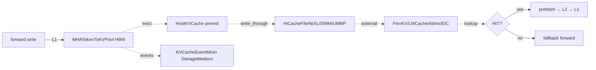

# 07.1 缓存层级总览

## 定位

本页给出 KV Cache 子系统的"四级缓存"心智模型，作为 07.2–07.13 各页的总目录索引。所有具体实现（设备池、Radix 树、host 池、storage 后端、external 连接器）都是这四级的实例化。

## 四级模型

| 层级 | 介质 | 角色 | 主要类 |
|---|---|---|---|
| L1 device | GPU HBM | forward 直接读写的物理张量 | `MHATokenToKVPool` / `MLATokenToKVPool` / `HybridLinearKVPool` |
| L2 host | CPU pinned / hugepage | write-through 与 L1 驱逐回收带，PD 传输暂存 | `HostKVCache` / `MHATokenToKVPoolHost` / `MLATokenToKVPoolHost` |
| L3 local/remote storage | 本地 SSD / NVMe-oF / 远端文件 | 冷 KV 卸载，单实例 HiCache 的载体 | `HiCacheFile` / `HiCacheNixl` / `UMBPStore` / `HiCacheSiMM` |
| L4 external pools | 跨集群 KV 服务 | 多实例共享、远程命中 | `FlexKVConnector` / `LMCRadixCache` / `AibrixKVCache` / `EIC` |

L1 由 [`07.6 内存池`](07.6-memory-pools.md) 描述；L2 装配见 [`07.9 HiCache`](07.9-hicache.md) 与 [`07.6`](07.6-memory-pools.md) 的 host 池小节；L3/L4 后端见 [`07.10 存储后端`](07.10-storage-backends.md)。

## 职责

- 定义每层的命中粒度（page/layer/token）与一致性契约。
- 提供 `match_prefix` 命中后从任意更冷层"取回"的接口（host_value、storage prefetch）。
- 通过 [`07.12 KV events`](07.12-kv-events.md) 的 `StorageMedium` 枚举（GPU/CPU/DISK/EXTERNAL）发布变更。

## 关键类与函数

| 名称 | 定义位置 | 说明 |
|---|---|---|
| `KVCache` | `mem_cache/memory_pool.py:1295` | L1 设备池 ABC，定义 page/layer 抽象 |
| `HostKVCache` | `mem_cache/pool_host/base.py:81` | L2 host 侧 ABC |
| `HiCacheStorage` | `mem_cache/hicache_storage.py:141` | L3/L4 存储后端 ABC，定义 `batch_get/batch_set` |
| `HiCacheStorageConfig` | `mem_cache/hicache_storage.py:27` | 层级配置：路径、size、compress 等 |
| `PoolName` | `mem_cache/hicache_storage.py:58` | 命名池标识，跨 L2/L3 复用 |
| `StorageMedium` | `disaggregation/kv_events.py:82` | KV 事件介质枚举，四级各占一项 |
| `KVCacheEventMixin` | `mem_cache/events.py:34` | 发布 store/remove/all-cleared 带介质标签 |

## 数据流 / 控制流

写路径：forward 把 KV 写入 L1，Radix 树节点记录 `value`；evict 时若节点被备份，把 `value` 拷到 L2 host pinned（`host_value`）并清空 L1；HiCache 控制器在 write-through 阶段把 L2 持久化到 L3。读路径：`match_prefix` 命中后若 `node.value is None`（已被 L1 驱逐），控制器从 L2 或 L3 取回 page，回填 L1 再让 forward 继续。

## 交叉引用

- 上游: [`07.6 内存池`](07.6-memory-pools.md) — L1 设备池与 L2 host 池具体类
- 上游: [`07.9 HiCache`](07.9-hicache.md) — L2/L3 装配与控制器
- 上游: [`07.10 存储后端`](07.10-storage-backends.md) — L3/L4 后端实现
- 相关: [`07.2 BasePrefixCache`](07.2-base-prefix-cache-registry.md) — 选择哪一棵树覆盖哪些层
- 相关: [`07.12 KV events`](07.12-kv-events.md) — 介质标签贯穿事件流

## 进一步阅读

- 源码: `python/sglang/srt/mem_cache/`、`python/sglang/srt/mem_cache/pool_host/`、`python/sglang/srt/mem_cache/storage/`
