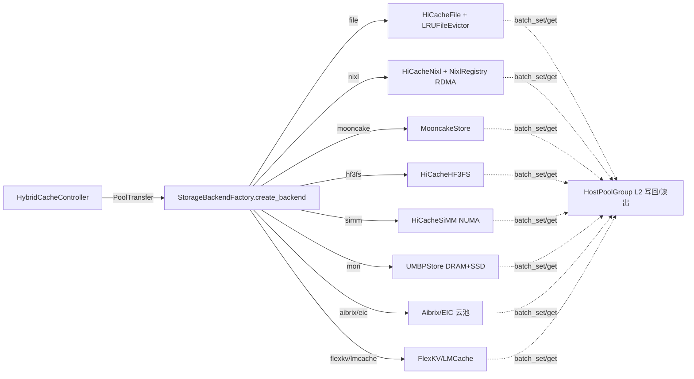

# 07.10 存储后端

## 定位

`StorageBackendFactory` 是 07 子系统对四级缓存中 L3/L4 的"插件管理器"。所有跨进程/跨节点/持久化的 KV 存储后端都以 `HiCacheStorage` 子类形式注册到工厂，由 [`07.9 HiCache`](07.9-hicache.md) 在初始化期按 `--hicache-storage-backend` 选择。每个后端负责把 page 化的 KV 通过 `batch_get`/`batch_set` 与本地或远端介质交互。

## 职责

- `StorageBackendFactory.register_backend`：把 `(name, module_path, class_name)` 注册到全局表，允许外部包侧效式注册。
- `StorageBackendFactory.create_backend`：按 `HiCacheStorageConfig.backend_name` 工厂化创建实例。
- 所有后端实现 `HiCacheStorage`（[`07.9`](07.9-hicache.md)）：`register_mem_pool_host` / `batch_get_v2` / `batch_set_v2` / `warmup` / `reset`。
- 后端覆盖：本地文件、NIXL（GPU 直接 RDMA）、Mooncake、HF3FS、Aibrix、EIC、SiMM、UMBP/Mori、FlexKV、LMCache。

## 关键类与函数

| 名称 | 定义位置 | 说明 |
|---|---|---|
| `StorageBackendFactory` | `mem_cache/storage/backend_factory.py:16` | 工厂类：`register_backend:44`、`create_backend:66` |
| `HiCacheFile` | `mem_cache/hicache_storage.py:352` | 本地文件后端（默认） |
| `LRUFileEvictor` | `storage/file/lru_file_evictor.py:56` | 文件 LRU 淘汰器 |
| `HiCacheNixl` | `storage/nixl/hicache_nixl.py:69` | NIXL RDMA 直接存储后端 |
| `NixlRegistry` | `storage/nixl/nixl_registry.py:31` | NIXL agent + 内存类型注册 |
| `MooncakeStore` | `storage/mooncake_store/mooncake_store.py:313` | Mooncake KV store 后端 |
| `HiCacheHF3FS` | `storage/hf3fs/storage_hf3fs.py:184` | 3FS 高吞吐存储后端 |
| `FlexKVConnector` | `storage/flexkv/flexkv_connector.py` | FlexKV 外部池连接器（`_flexkv_factory` 见 [`07.2`](07.2-base-prefix-cache-registry.md)） |
| `LMCRadixCache` | `storage/lmcache/lmc_radix_cache.py` | LMCache 包装的 RadixCache |
| `AibrixKVCacheStorage` | `storage/aibrix_kvcache/aibrix_kvcache_storage.py:26` | Aibrix 云原生 KV 后端 |
| `EICStorage` | `storage/eic/eic_storage.py:156` | EIC 后端 |
| `HiCacheSiMM` | `storage/simm/hicache_simm.py:131` | SiMM NUMA-aware 本地存储 |
| `UMBPStore` | `storage/umbp/umbp_store.py:227` | UMBP/Mori 本地+SSD 后端 |

## 子模块树

- `mem_cache/storage/backend_factory.py` — 工厂与默认注册
- `storage/file/` — 本地文件 + `LRUFileEvictor`
- `storage/nixl/` — NIXL（`hicache_nixl.py` / `nixl_registry.py` / `nixl_routing.py` / `nixl_cleaner.py`）
- `storage/mooncake_store/` — Mooncake
- `storage/hf3fs/` — HF3FS（含 3FS 客户端与 usrbio 优化路径）
- `storage/flexkv/` — FlexKV 连接器与自定义 radix cache
- `storage/lmcache/` — LMCache
- `storage/aibrix_kvcache/` — Aibrix
- `storage/eic/` — EIC
- `storage/simm/` — SiMM
- `storage/umbp/` — UMBP / Mori

## 数据流 / 控制流

控制器把 `CacheOperation` 中的 `PoolTransfer` 列表交给后端，每个 `PoolTransfer` 携带 `name`(pool) / `keys` / `host_indices`。后端按 `name` 找到 host 池句柄，把数据按 page 写到/读出介质，再把命中页号回填到 `PoolTransferResult`。`HiCacheFile` 与 `UMBPStore` 是本机路径，`HiCacheNixl`/`MooncakeStore`/`HiCacheHF3FS` 走 RDMA 或高速网络，`Aibrix`/`EIC`/`FlexKV` 是外部服务，`LMCache` 是单层外部 radix 缓存（替代而非补充 RadixCache）。

## 交叉引用

- 上游: [`07.9 HiCache`](07.9-hicache.md) — 工厂的消费方
- 上游: [`07.6 内存池`](07.6-memory-pools.md) — host 池为 `register_mem_pool_host` 的目标
- 相关: [`09 PD 分离`](../09-disaggregation/index.md) — NIXL/Mooncake 同时作为 PD 传输底座
- 相关: [`02 server api`](../02-server-api/index.md) — `--hicache-storage-backend` 等 CLI
- 相关: [`16 配置`](../16-config-runtime/index.md) — `HiCacheStorageConfig` 来源

## 进一步阅读

- 源码: `python/sglang/srt/mem_cache/storage/` 各子目录的 `README.md`
