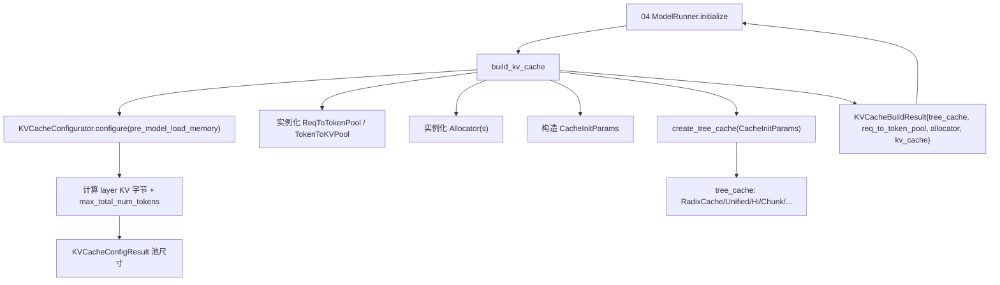

# 07.11 KV configurator/builder

## 定位

`KVCacheConfigurator` 与 `build_kv_cache` 是 07 子系统对外的"装配入口"：在 [`04 ModelRunner`](../04-model-execution/04.1-model-runner.md) 初始化期，给定 `ServerArgs`、`ModelConfig` 与可用 GPU/CPU 内存，计算设备池/host 池尺寸、hybrid SWA/Mamba/draft reserve，并构造 [`07.6 内存池`](07.6-memory-pools.md)、[`07.7 Allocators`](07.7-allocators.md) 与 `CacheInitParams`，最后调 [`07.2 create_tree_cache`](07.2-base-prefix-cache-registry.md) 产出树。它把"如何切分 GPU 内存"这个跨多个子系统的决策集中化。

## 职责

- 计算每层 KV 字节数（按 dtype、KV cache dtype fp8/fp4、MLA 维度等）。
- 推导 `start_size` / `KV_cache_size` / `max_total_num_tokens`，叠加 hybrid SWA/Mamba 与 draft worker reserve。
- 实例化 `ReqToTokenPool` / `TokenToKVPool` / allocator，构造 `CacheInitParams`。
- 对 `enable_hierarchical_cache` / `enable_lmcache` / `enable_flexkv` / draft worker 做对应分支处理。
- 把结果打包成 `KVCacheBuildResult`（含 `tree_cache` / `req_to_token_pool` / `token_to_kv_pool_allocator` / `kv_cache`）。

## 关键类与函数

| 名称 | 定义位置 | 说明 |
|---|---|---|
| `KVCacheConfigResult` | `mem_cache/kv_cache_configurator.py:122` | msgspec struct：池尺寸与配置结果 |
| `_InitializedPools` | `mem_cache/kv_cache_configurator.py:134` | 实例化的设备/host 池描述 |
| `_PoolSizes` | `mem_cache/kv_cache_configurator.py:141` | 池尺寸中间结构 |
| `KVCacheConfigurator` | `mem_cache/kv_cache_configurator.py:155` | 主类，含 `configure` |
| `KVCacheConfigurator.configure` | `mem_cache/kv_cache_configurator.py:200` | 主入口：尺寸计算 + 池构造 |
| `calculate_mla_kv_cache_dim` | `mem_cache/kv_cache_configurator.py:1716` | MLA 紧凑 KV 维度推导 |
| `_get_dsv4_compress_state_dtypes` | `mem_cache/kv_cache_configurator.py:76` | DeepSeek V4 压缩 state dtype |
| `_should_enable_lazy_compaction` | `mem_cache/kv_cache_configurator.py:91` | 是否启用延迟压缩 |
| `KVCacheBuildResult` | `mem_cache/kv_cache_builder.py:12` | 装配产物 struct |
| `get_draft_kv_pool` | `mem_cache/kv_cache_builder.py:54` | 取/构造 draft worker 的 KV 池 |
| `maybe_register_hicache_draft` | `mem_cache/kv_cache_builder.py:73` | 给 draft 路径注册 HiCache layer counter |
| `build_kv_cache` | `mem_cache/kv_cache_builder.py:130` | 顶层入口：Configurator → 池 → CacheInitParams → `create_tree_cache` |

## 子模块树

- `mem_cache/kv_cache_configurator.py` — 尺寸计算与池选择（>1700 行）
- `mem_cache/kv_cache_builder.py` — 顶层装配入口与 draft 处理
- 与 [`07.2 registry`](07.2-base-prefix-cache-registry.md) 的 `CacheInitParams` 配套

## 数据流 / 控制流

`configure` 先按 `pre_model_load_memory` 估总可用，再按 attention 类型（MHA/MLA/DSA/Hybrid）和 KV dtype 推每层字节数；hybrid 模型在此分发到 full/swa/mamba lane 的尺寸分量（draft worker reserve、SWA window reserve、Mamba state buffer 都在此时切出）。`build_kv_cache` 拿到 `KVCacheConfigResult` 后实例化具体池类与 allocator（按 page_size、is_hybrid_ssm/swa、FP4 等分支），构造 `CacheInitParams` 并交 `create_tree_cache` 选最终树，再统一回包给 `ModelRunner`。

## 交叉引用

- 上游: [`04.1 ModelRunner`](../04-model-execution/04.1-model-runner.md) — `initialize` 调 `build_kv_cache`
- 上游: [`04.6 池与图配置器`](../04-model-execution/04.6-pool-graph-config.md) — ModelRunner 侧的薄封装
- 下游: [`07.6 内存池`](07.6-memory-pools.md) — 所有池类被它实例化
- 下游: [`07.2 BasePrefixCache/registry`](07.2-base-prefix-cache-registry.md) — `create_tree_cache` 选择最终树
- 相关: [`10.2 draft worker`](../10-speculative/10.2-draft-worker-runner.md) — `get_draft_kv_pool` / `maybe_register_hicache_draft`
- 相关: [`16.1 ServerArgs`](../16-config-runtime/16.1-server-args-port-args.md) — 主要输入参数
- 相关 skill: `.claude/skills/sglang-runtime-context`、`.claude/skills/large-class-style`

## 进一步阅读

- 源码: `python/sglang/srt/mem_cache/kv_cache_configurator.py`、`python/sglang/srt/mem_cache/kv_cache_builder.py`
