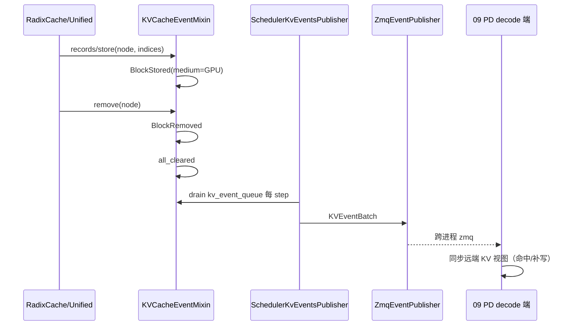

# 07.12 KV events

## 定位

KV events 是 07 子系统对"缓存层变更"的统一事件流：当一棵 [`07.3 RadixCache`](07.3-radix-cache.md) / [`07.4 UnifiedRadixCache`](07.4-unified-radix-cache.md) / [`07.5 专用缓存`](07.5-specialty-caches.md) 写入/移除一批 KV page，或全部清空时，由 `KVCacheEventMixin` 发布带 `StorageMedium` 介质标签的事件。`SchedulerKvEventsPublisher` 在 [`03 Scheduler`](../03-orchestration/03.4.1-scheduler-structure.md) 中订阅事件内存队列，再通过 [`09 PD 分离`](../09-disaggregation/index.md) 的 `EventPublisher` 跨进程广播，成为 PD KV 迁移和外部 KV 池一致的源头。

## 职责

- 在每次 `insert`/`evict`/`reset` 时构造 `KVCacheEvent`（`BlockStored`/`BlockRemoved`/`AllBlocksCleared`），带 `medium`（GPU/CPU/DISK/EXTERNAL）。
- 把事件入 `kv_event_queue`，由 publisher 在 step 边界排空。
- 跨进程通过 `disaggregation/kv_events.py` 的 `ZmqEventPublisher` 或外部 `EventPublisher` 发布。
- PD 端消费事件以同步远端 KV 池视图，与 [`07.10 存储后端`](07.10-storage-backends.md) 的外部 pool 后端协同保持一致。

## 关键类与函数

| 名称 | 定义位置 | 说明 |
|---|---|---|
| `KVCacheEventMixin` | `mem_cache/events.py:34` | 事件 mixin；`records`、`remove`、`all-cleared` 三类方法 |
| `StorageMedium` | `disaggregation/kv_events.py:82` | 介质枚举：GPU/CPU/DISK/EXTERNAL |
| `BlockStored` | `disaggregation/kv_events.py:108` | "KV block 已写入"事件 |
| `BlockRemoved` | `disaggregation/kv_events.py:117` | "KV block 已移除"事件 |
| `AllBlocksCleared` | `disaggregation/kv_events.py:122` | 全清事件 |
| `KVEventBatch` | `disaggregation/kv_events.py:126` | 批事件载体 |
| `EventPublisher` | `disaggregation/kv_events.py:130` | 发布器 ABC |
| `NullEventPublisher` | `disaggregation/kv_events.py:157` | 空实现（未启用 PD 时） |
| `ZmqEventPublisher` | `disaggregation/kv_events.py:167` | ZMQ 发布实现 |
| `EventPublisherFactory` | `disaggregation/kv_events.py:445` | 工厂，按 `KVEventsConfig` 选 backend |
| `SchedulerKvEventsPublisher` | `managers/scheduler_components/kv_events_publisher.py:45` | Scheduler 侧适配器，串接 mixn 队列与 publisher |
| `KVEventsConfig` | `disaggregation/kv_events.py:405` | pydantic 配置 |

## 子模块树

- `mem_cache/events.py` — mixin 与 record 数据结构
- `disaggregation/kv_events.py` — 跨进程事件协议与 publisher
- `managers/scheduler_components/kv_events_publisher.py` — Scheduler 侧适配器
- 消费点: `managers/scheduler.py`（[`03.4.1`](../03-orchestration/03.4.1-scheduler-structure.md)）构造与每步 drain

## 数据流 / 控制流

每棵 cache 树在 init 时根据 `CacheInitParams.enable_kv_cache_events` 决定是否启用 mixin。`SchedulerKvEventsPublisher` 在 Scheduler init 时由 `kv_events` 配置创建，每 step 末 drain `tree_cache.kv_event_queue`，把事件按 batch 发给 `ZmqEventPublisher`。介质标签贯穿全链：device 写入发 `GPU`，host 落盘发 `CPU`，storage 后端发 `DISK`/`EXTERNAL`，PD 端按介质决定是否补取/写入。

## 交叉引用

- 上游: [`07.3 RadixCache`](07.3-radix-cache.md) — 事件源
- 下游: [`09.7 KV events bridge`](../09-disaggregation/09.7-kv-events-bridge.md) — PD 端消费
- 相关: [`07.9 HiCache`](07.9-hicache.md) — 多层搬运借介质标签
- 相关: [`07.10 存储后端`](07.10-storage-backends.md) — 外部 pool 后端依赖事件流保持视图一致
- 相关: [`03.4.1 Scheduler`](../03-orchestration/03.4.1-scheduler-structure.md) — 持有 publisher 实例
- 相关: [`17.3 FPM`](../17-observability-ops/17.3-forward-pass-metrics.md) — 部分事件供 FPM 统计

## 进一步阅读

- 源码: `python/sglang/srt/mem_cache/events.py`、`python/sglang/srt/disaggregation/kv_events.py`、`python/sglang/srt/managers/scheduler_components/kv_events_publisher.py`
