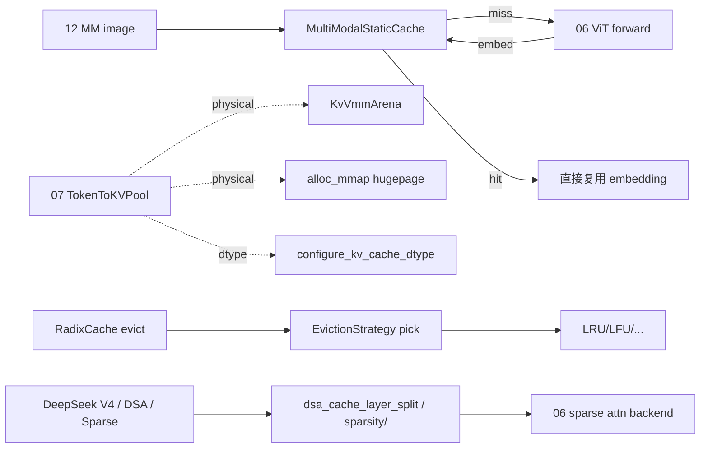

# 07.13 MM cache / 稀疏 / mmap / vmm

## 定位

本页收集 07 子系统中"非 KV 树主体"的辅助内存设施：VLM 多模态 embedding cache、稀疏注意力算法编排、CUDA VMM/mmap 物理 backing、KV cache dtype 选择、evict 策略与 DeepSeek V4 / DSA / HiSparse 专用池层切分。它们为 [`07.6 内存池`](07.6-memory-pools.md)、[`06 Layers`](../06-layers/index.md) 与 [`12 多模态`](../12-multimodal/index.md) 提供底层支持。

## 职责

- `MultiModalStaticCache`：缓存 VLM 视觉 embedding，避免同图像重复编码。
- `sparsity/`：稀疏注意力调度框架（`SparseCoordinator` + algorithm），含 `quest` / `deepseek_dsa` 算法。
- `KvVmmArena` / `alloc_mmap`：CUDA VMM 与 hugepage mmap 物理 backing。
- `configure_kv_cache_dtype`：FP8 / FP4 dtype 选择。
- `EvictionStrategy` 家族：LRU/LFU/FIFO/MRU/FILO/Priority/SLRU。
- DeepSeek V4 / HiSparse / DSA layer split：压缩 state 与.sparse 池的 layer 切分工具。

## 关键类与函数

| 名称 | 定义位置 | 说明 |
|---|---|---|
| `MultimodalCache` | `mem_cache/multimodal_cache.py:11` | VLM 缓存 ABC |
| `MultiModalStaticCache` | `mem_cache/multimodal_cache.py:76` | 静态 VLM embedding cache |
| `KvVmmArena` | `mem_cache/kv_vmm_backing.py:100` | CUDA VMM arena（reserve/commit/close） |
| `KvVmmBufferOwner` | `mem_cache/kv_vmm_backing.py:298` | 增量 backing 与 buffer owner |
| `alloc_mmap` | `mem_cache/mmap_allocator.py:66` | hugepage mmap 张量分配 |
| `configure_kv_cache_dtype` | `mem_cache/kv_cache_dtype.py:22` | FP8/FP4 选择 |
| `EvictionStrategy` | `mem_cache/evict_policy.py:10` | 策略 ABC |
| `LRUStrategy` / `LFUStrategy` / `FIFOStrategy` / `MRUStrategy` / `FILOStrategy` / `PriorityStrategy` / `SLRUStrategy` | `mem_cache/evict_policy.py:16` / `:21` / `:26` / `:31` / `:36` / `:41` / `:49` | 七种策略实现 |
| `SparseCoordinator` | `mem_cache/sparsity/core/sparse_coordinator.py` | 稀疏调度器 |
| `base_algorithm` / `quest_algorithm` / `deepseek_dsa` | `mem_cache/sparsity/algorithms/` | 稀疏算法 |
| `DeepSeekV4MemoryPool` 相关 | `mem_cache/deepseek_v4_memory_pool.py` | DSv4 压缩 state 池 |
| `DSACacheLayerSplit` 相关 | `mem_cache/dsa_cache_layer_split.py` | DSA layer 共享切分 |
| `HiSparseMemoryPool` 相关 | `mem_cache/hisparse_memory_pool.py` | HiSparse 池 |

## 子模块树

- `mem_cache/multimodal_cache.py` — VLM 静态缓存
- `mem_cache/sparsity/` — 稀疏注意力调度 + 算法
  - `core/sparse_coordinator.py`、`factory.py`、`backend/`、`algorithms/{base,quest,deepseek_dsa}.py`
- `mem_cache/kv_vmm_backing.py` — CUDA VMM arena
- `mem_cache/mmap_allocator.py` — hugepage mmap
- `mem_cache/kv_cache_dtype.py` — KV dtype 选择
- `mem_cache/evict_policy.py` — evict 策略
- `mem_cache/deepseek_v4_memory_pool.py` / `hisparse_memory_pool.py` / `dsa_cache_layer_split.py` — 专用切分

## 数据流 / 控制流

VLM 侧：`MultiModalStaticCache` 按 image hash 索引，避免同图像多请求时重复跑 ViT；命中即直接把 embedding 拼进 input ids。KV 物理 backing：`KvVmmArena` 用 CUDA VMM 预留大段地址空间按需 commit，对超大池友好；`alloc_mmap` 用 hugepage 给 host pinned 池提供低碎片物理内存。dtype 选择决定 device 池是用 fp8（`MHATokenToKVPool` 的 `store_qkv` 变体）还是 fp4（`MHATokenToKVPoolFP4`）。evict 策略由 `CacheInitParams.eviction_policy` 字符串映射到 `EvictionStrategy` 子类，被 [`07.3 RadixCache`](07.3-radix-cache.md) 在每次 evict 调用。

## 交叉引用

- 上游: [`07.6 内存池`](07.6-memory-pools.md) — VMM/mmap/dtype 给池提供物理支持
- 上游: [`07.3 RadixCache`](07.3-radix-cache.md) — 消费 `EvictionStrategy`
- 下游: [`12 多模态`](../12-multimodal/index.md) — `MultiModalStaticCache` 主体
- 下游: [`06.3.3 sparse attn`](../06-layers/06.3.3-attn-sparse-backends.md) — sparsity 算法的消费方
- 相关: [`15.5 platforms`](../15-kernels-hardware/15.5-platforms.md) — VMM/mmap 与 platform hook
- 相关 skill: `.claude/skills/env-var-conventions`

## 进一步阅读

- 源码: `python/sglang/srt/mem_cache/multimodal_cache.py`、`kv_vmm_backing.py`、`mmap_allocator.py`、`kv_cache_dtype.py`、`evict_policy.py`、`sparsity/`
