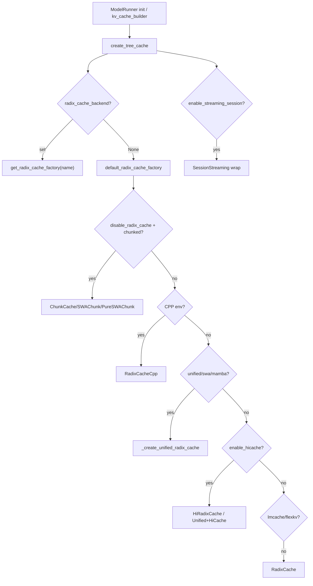

# 07.2 BasePrefixCache 与 registry

## 定位

`BasePrefixCache` 是 07 子系统对所有"按前缀 token 复用 KV"的缓存树（Radix / Unified / Chunk / HiRadix / Specialty）定义的抽象层。`registry.py` 提供选择链 `create_tree_cache`，让 [`04 ModelRunner`](../04-model-execution/04.1-model-runner.md) 在初始化时按 `server_args` 与模型架构挑出唯一一棵树。它是 L1 设备池、L2/L3 HiCache 与各类 hybrid 变体的统一入口。

## 职责

- 定义 `match_prefix` / `insert` / `evict` / `inc_lock_ref` / `init_load_back` 的 Protocol。
- 通过 `CacheInitParams` 把设备池、page_size、TP/PP/CP cache group、eviction policy、metrics/events 开关打包传给具体树。
- 选择链覆盖：Radix → Unified → CppRadix → Chunk → PureSWA → HiRadix → HiMamba → Unified+HiCache → LMCache → FlexKV → Session streaming 包装。
- 允许外部包通过 `register_radix_cache_backend` 注入 `--radix-cache-backend` 工厂。

## 关键类与函数

| 名称 | 定义位置 | 说明 |
|---|---|---|
| `PrefixCacheTrait` | `mem_cache/base_prefix_cache.py:35` | 树必须实现的 Protocol |
| `MatchPrefixParams` | `mem_cache/base_prefix_cache.py:43` | match 入参（token ids、crash worker、security id 等） |
| `InsertParams` | `mem_cache/base_prefix_cache.py:54` | insert 入参（slots、tokens、device medium 等） |
| `EvictParams` | `mem_cache/base_prefix_cache.py:84` | evict 入参（num_tokens、 evict_layer） |
| `BasePrefixCache` | `mem_cache/base_prefix_cache.py:211` | ABC，集中匹配结果归零等工具方法 |
| `CacheInitParams` | `mem_cache/cache_init_params.py:18` | 装配上下文，含 tree_components、TTL、Mamba extra buffer 等 |
| `register_radix_cache_backend` | `mem_cache/registry.py:54` | 外部后端注册入口 |
| `default_radix_cache_factory` | `mem_cache/registry.py:79` | 内置选择链（disable→Chunk、cpp→Cpp、unified/swa/mamba→Unified、hicache→HiRadix/Unified+Hi） |
| `_create_unified_radix_cache` | `mem_cache/registry.py:163` | 选择 component（FULL/SWA/MAMBA）并可选挂 HiCache |
| `create_tree_cache` | `mem_cache/registry.py:196` | 顶层入口，先验 `--radix-cache-backend` 再走 default，最后包装 session streaming |

## 子模块树

- `mem_cache/base_prefix_cache.py` — ABC + Param/Result dataclass
- `mem_cache/cache_init_params.py` — tree 装配参数包
- `mem_cache/registry.py` — 选择链与外部注册表

## 数据流 / 控制流

选择优先级由 `default_radix_cache_factory` 顺次 if-elif 决定：disable 模式 → Chunk 系；`SGLANG_EXPERIMENTAL_CPP_RADIX_TREE` → Cpp；`SGLANG_ENABLE_UNIFIED_RADIX_TREE` 或 hybrid SWA/Mamba → Unified；`enable_hierarchical_cache` → 普通 MHA/MLA 走 HiRadix，hybrid/DSA 走 Unified+HiCache；`enable_lmcache`/`enable_flexkv` 走对应外部；最后落回经典 RadixCache。所有候选都返回 `BasePrefixCache`，再由 `create_tree_cache` 视 `enable_streaming_session` 加一层 session 包装。

## 交叉引用

- 上游: [`07.11 KV configurator/builder`](07.11-kv-configurator-builder.md) — `build_kv_cache` 调 `create_tree_cache`
- 下游: [`07.3 RadixCache`](07.3-radix-cache.md) / [`07.4 UnifiedRadixCache`](07.4-unified-radix-cache.md) / [`07.5 专用缓存`](07.5-specialty-caches.md) — 被选中的具体实现
- 相关: [`07.9 HiCache`](07.9-hicache.md) — `enable_hierarchical_cache` 分支
- 相关: [`16 配置`](../16-config-runtime/index.md) — `--radix-cache-backend` / `--enable-hierarchical-cache` 来源
- 相关 skill: `.claude/skills/sglang-runtime-context`

## 进一步阅读

- 源码: `python/sglang/srt/mem_cache/base_prefix_cache.py`、`python/sglang/srt/mem_cache/registry.py`、`python/sglang/srt/mem_cache/cache_init_params.py`
