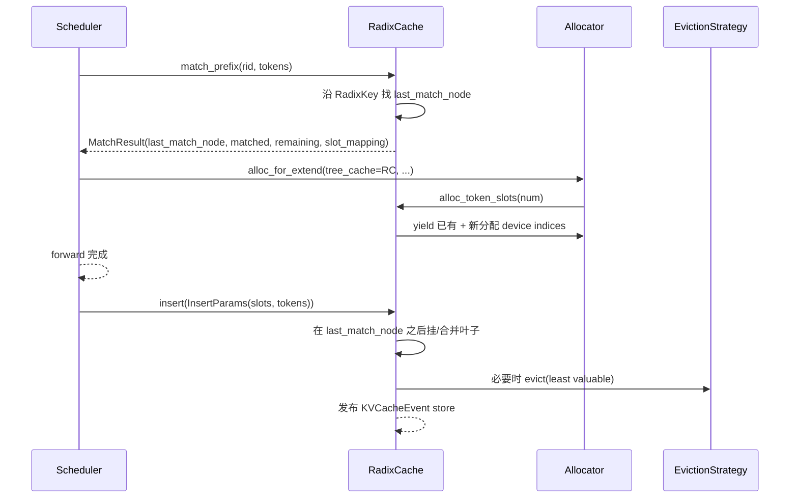

# 07.3 RadixCache

## 定位

`RadixCache` 是 SGLang 默认的"分页 Radix 树"前缀缓存实现，覆盖标准 MHA / MLA 模型的 L1 设备层。它是 [`07.4 UnifiedRadixCache`](07.4-unified-radix-cache.md) 的对照基线，也是 [`07.9 HiCache`](07.9-hicache.md) 中 `HiRadixCache` 的父类。`Scheduler` 在准入与 `process_batch_result` 中调用它做 match/insert/evict，[`04 ModelRunner`](../04-model-execution/04.1-model-runner.md) 在 forward 中通过 allocator 间接读它产出的 `out_cache_loc`。

## 职责

- 以 `RadixKey`（token 序列）为边组织 Radix 树，复用同 prefix 的 KV slot。
- `match_prefix`：返回命中节点、复用长度、剩余 tokens、`last_match_node` 与 `slot_mapping`（device 介质）。
- `insert`：把新完成的 token KV slot 写入树，按 page_size 合并叶子。
- `evict` / `evictable_size`：依据 `EvictionStrategy`（LRU/LFU/FIFO/...）回收 device slot。
- `inc_lock_ref` / `dec_lock_ref`：保护运行中 batch 引用的节点不被驱逐。
- 通过 `KVCacheEventMixin` 发布 store/remove/all-cleared；通过 `SessionRadixCacheMixin` 支持会话隔离。

## 关键类与函数

| 名称 | 定义位置 | 说明 |
|---|---|---|
| `RadixKey` | `mem_cache/radix_cache.py:60` | radix 树的边 key，含 token 序列与 page uuid |
| `TreeNode` | `mem_cache/radix_cache.py:217` | 树节点；`children`/`parent`/`key`/`value`/`host_value`/`lock_ref`/`priority`/`hash_value`/`host_ref_counter` |
| `TreeNode.protect_host` | `mem_cache/radix_cache.py:253` | HiCache 用于禁止 host_value 驱逐 |
| `RadixCache` | `mem_cache/radix_cache.py:280` | 主类，继承 `SessionRadixCacheMixin` + `KVCacheEventMixin` + `BasePrefixCache` |
| `RadixCache.match_prefix` | `mem_cache/radix_cache.py` | 实现 `MatchPrefixParams` 契约 |
| `RadixCache.insert` | `mem_cache/radix_cache.py` | 把 slot 列表挂到树 |
| `RadixCache.evict` | `mem_cache/radix_cache.py` | 调用 `EvictionStrategy` 与 allocator free |
| `RadixCache.inc_lock_ref` | `mem_cache/radix_cache.py` | 引用计数，调度批持有 |

## 子模块树

- `mem_cache/radix_cache.py` — RadixKey/TreeNode/RadixCache 主体
- 被 `mem_cache/hiradix_cache.py:75` 的 `HiRadixCache` 子类化（[07.9](07.9-hicache.md)）
- 被 `mem_cache/radix_cache_cpp.py:35` 的 `RadixCacheCpp` 以 C++ 后端等价替换（[07.5](07.5-specialty-caches.md)）

## 数据流 / 控制流

match 阶段沿 token 序列下行 Radix 树至最长前缀，返回已收集的 device indices；剩余 token 由 `alloc_for_extend` 在 [`07.8`](07.8-batch-allocation.md) 中新申请并写入 `req_to_token_pool`。forward 结束后 `insert` 把新叶子挂在 `last_match_node`，并将超出 budget 的叶子通过 `evict` 通知 allocator free。`lock_ref` 在 batch 运行期持有，`host_ref_counter` 在 HiCache write-through/prefetch 期持有，二者皆 0 时节点进 LRU 候选。

## 交叉引用

- 上游: [`07.2 BasePrefixCache`](07.2-base-prefix-cache-registry.md) — 选择 RadixCache 的 default 分支
- 下游/被依赖: [`07.7 Allocators`](07.7-allocators.md) — `alloc_token_slots` 协作
- 下游: [`07.9 HiCache`](07.9-hicache.md) — `HiRadixCache` 子类化并扩展 host/storage
- 相关: [`07.5 专用缓存`](07.5-specialty-caches.md) — `RadixCacheCpp` / `SWARadixCache` 等
- 相关: [`07.12 KV events`](07.12-kv-events.md) — `KVCacheEventMixin` 来自此模块
- 相关: [`03.4.1 Scheduler`](../03-orchestration/03.4.1-scheduler-structure.md) — 调用方

## 进一步阅读

- 源码: `python/sglang/srt/mem_cache/radix_cache.py`
- 类 docstring: `python/sglang/srt/mem_cache/radix_cache.py:280`
