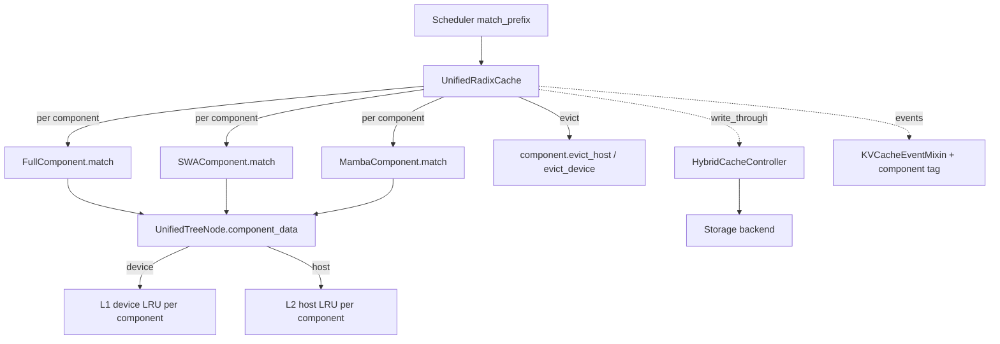

# 07.4 UnifiedRadixCache

## 定位

`UnifiedRadixCache` 是为"混合注意力模型"设计的统一缓存树：一棵树中同时承载多套逻辑 KV 状态（Full / SWA / Mamba state），并通过 component 化的 LRU 与 evict 协议保证每条 component 独立淘汰。它由 [`07.2 registry`](07.2-base-prefix-cache-registry.md) 在 `SGLANG_ENABLE_UNIFIED_RADIX_TREE` 或 hybrid SWA/Mamba/DSA 模型时选中，也是 DeepSeek V3.2 / GLM-5.1 等模型挂载 HiCache 的默认基础（`init_hicache`）。

## 职责

- 在 `UnifiedTreeNode` 中以 `component_data: list[ComponentData]` 索引每个 `ComponentType`（FULL/SWA/MAMBA），各自持 device/host slot。
- 维护多个 `UnifiedLRUList`（每 component device + host 各一），LRU 指针数组下标 = `component_type * 2 + host_flag`。
- 把 insert/evict/match 拆解为 per-component 行为：`FullComponent` / `SWAComponent` / `MambaComponent`。
- 支持 write-through 与 prefetch（`_OngoingWriteThrough`、`write_through_pending_id`），向 [`07.9 HiCache`](07.9-hicache.md) 暴露 host 状态。
- 通过 `KVCacheEventMixin` 发布带 component 标签的事件。

## 关键类与函数

| 名称 | 定义位置 | 说明 |
|---|---|---|
| `ComponentType` | `unified_cache_components/tree_component.py:31` | int enum：FULL=0、SWA=1、MAMBA=2 |
| `ComponentData` | `unified_cache_components/tree_component.py:62` | 单 component 的 value/host_value/indices |
| `TreeComponent` | `unified_cache_components/tree_component.py:106` | component 策略 ABC：insert/evict_host/match/alloc |
| `FullComponent` | `unified_cache_components/full_component.py:35` | Full MHA/MLA 分量 |
| `SWAComponent` | `unified_cache_components/swa_component.py:42` | 滑窗注意力分量 |
| `MambaComponent` | `unified_cache_components/mamba_component.py:41` | SSM state 分量 |
| `UnifiedTreeNode` | `mem_cache/unified_radix_cache.py:79` | 节点；`component_data` 列表 + 双倍 LRU 指针 |
| `UnifiedLRUList` | `mem_cache/unified_radix_cache.py:137` | per-component LRU，含 device + host 双链 |
| `UnifiedRadixCache` | `mem_cache/unified_radix_cache.py:306` | 主类，含 `init_hicache`、write/prefetch 调度 |
| `_OngoingWriteThrough` | `mem_cache/unified_radix_cache.py:279` | 进行中写回任务的 NamedTuple |

环境开关：`SGLANG_ENABLE_UNIFIED_RADIX_TREE`（见 [`16.4 environ`](../16-config-runtime/16.4-environ.md)）。

## 子模块树

- `mem_cache/unified_radix_cache.py` — 主树实现
- `mem_cache/unified_cache_components/` — component 抽象与三实现
  - `tree_component.py` — `TreeComponent`/`ComponentType`/`ComponentData`/`EvictLayer`/`CacheTransferPhase`
  - `full_component.py` — Full 分量
  - `swa_component.py` — SWA 分量（与 [`07.5 SWARadixCache`](07.5-specialty-caches.md) 同源语义）
  - `mamba_component.py` — Mamba 分量
  - `README.md` — 设计说明

## 数据流 / 控制流

每次 match 把请求按 token 序列下行到 `UnifiedTreeNode`，再对每个启用的 component 调用 `TreeComponent.match` 收集 device indices。insert 把新 slot 写入对应 `ComponentData`，并触发可选 write-through（host pool + storage backend）。LRU 按 component 维度独立，保证 `SWA`/`Mamba`/`Full` 因访问模式不同互不污染。`init_hicache` 会通过 `attach_hybrid_pool_to_unified_cache` 把 [`07.9`](07.9-hicache.md) 的 `HostPoolGroup` 与 `HybridCacheController` 接到 `cache_controller` 字段。

## 交叉引用

- 上游: [`07.2 registry`](07.2-base-prefix-cache-registry.md) — `_create_unified_radix_cache` 选择此树
- 下游: [`07.9 HiCache`](07.9-hicache.md) — `attach_hybrid_pool_to_unified_cache` 装配
- 相关: [`07.5 专用缓存`](07.5-specialty-caches.md) — 非 component 化的 SWA/Mamba 单树
- 相关: [`07.7 Allocators`](07.7-allocators.md) — `MultiEndedAllocator` / `UnifiedMamba/SWA` 与此树配对
- 相关: [`06.3.5 hybrid wrapper`](../06-layers/06.3.5-attn-hybrid-wrapper.md) — 消费 component 数据
- 相关 skill: `.claude/skills/env-var-conventions`

## 进一步阅读

- 源码: `python/sglang/srt/mem_cache/unified_radix_cache.py`、`python/sglang/srt/mem_cache/unified_cache_components/`
- 设计: `python/sglang/srt/mem_cache/unified_cache_components/README.md`
