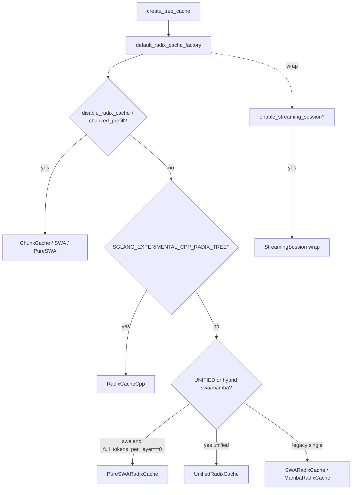

# 07.5 专用缓存

## 定位

本页汇集 [`07.2 registry`](07.2-base-prefix-cache-registry.md) 选择链中所有"非通用 Radix/Unified"的分支实现：SWA / Mamba / PureSWA / Chunk / CppRadix / Session。它们要么针对某类模型架构做单独优化，要么在不启用 Radix 时退化成"按 chunk 顺序缓存"的占位实现。

## 职责

- `SWARadixCache` / `MambaRadixCache`：在 hybrid 模型尚未切到 Unified 时提供单分量树（legacy 路径）。
- `PureSWARadixCache`：纯滑窗注意力模型（`full_tokens_per_layer == 0`）的退化 Radix。
- `ChunkCache` / `SWAChunkCache` / `PureSWAChunkCache`：`disable_radix_cache + chunked_prefill` 时的 fallback。
- `RadixCacheCpp`：C++ 后端等价替换，环境开关 `SGLANG_EXPERIMENTAL_CPP_RADIX_TREE`。
- `SessionRadixCacheMixin`：以 `rid` 为附加维度隔离会话的复用，铺在所有上述树上。

## 关键类与函数

| 名称 | 定义位置 | 说明 |
|---|---|---|
| `SWARadixCache` | `mem_cache/swa_radix_cache.py:343` | 单分量 SWA 树，自带 LRU 实现（兼容老 hybrid SWA 路径） |
| `MambaRadixCache` | `mem_cache/mamba_radix_cache.py:433` | 单分量 SSM 树，按 state slot 而非 token page 组织 |
| `PureSWARadixCache` | `mem_cache/pure_swa_radix_cache.py` | 纯 SWA 模型（无双 full 分量） |
| `ChunkCache` | `mem_cache/chunk_cache.py:35` | 顺序块缓存，复用 chunked prefill 已生成的 slot |
| `SWAChunkCache` | `mem_cache/chunk_cache.py:115` | hybrid SWA chunk fallback |
| `PureSWAChunkCache` | `mem_cache/chunk_cache.py:142` | 纯 SWA chunk fallback |
| `RadixCacheCpp` | `mem_cache/radix_cache_cpp.py:35` | C++ radix 树实现，性能对照实验 |
| `SessionRadixCacheMixin` | `mem_cache/session_radix_cache.py:23` | 会话隔离 mixin，给所有树加 `rid` 维度 |

环境开关：`SGLANG_EXPERIMENTAL_CPP_RADIX_TREE`（[`16.4 environ`](../16-config-runtime/16.4-environ.md)）。

## 子模块树

- `mem_cache/swa_radix_cache.py` — 单分量 SWA
- `mem_cache/mamba_radix_cache.py` — 单分量 Mamba
- `mem_cache/pure_swa_radix_cache.py` — 纯 SWA
- `mem_cache/chunk_cache.py` — 三种 Chunk 变体
- `mem_cache/radix_cache_cpp.py` — C++ 后端绑定
- `mem_cache/cpp_radix_tree/` — C++ 源码与构建
- `mem_cache/session_radix_cache.py` — session mixin

## 数据流 / 控制流

这些变体只在缓存层与匹配协议上与 [`07.3 RadixCache`](07.3-radix-cache.md) 不同：`SWARadixCache` 把 `value` 视为滑窗 slot 集合，`MambaRadixCache` 把节点值视为 SSM state（单 slot），`ChunkCache` 完全跳过 Radix 命中，仅记录"上一个 chunk 的末尾 slot"以便下一个 chunk 续写。`RadixCacheCpp` 与 `RadixCache` 同语义但树结构与查找在 C++ 中实现，供大并发场景验证性能。`SessionRadixCacheMixin` 在所有树的 key 拼接 `session_id`，使跨会话不复用。

## 交叉引用

- 上游: [`07.2 registry`](07.2-base-prefix-cache-registry.md) — 这些类的选择条件
- 相关: [`07.3 RadixCache`](07.3-radix-cache.md) — 通用版与 HiRadix 父类
- 相关: [`07.4 UnifiedRadixCache`](07.4-unified-radix-cache.md) — hybrid 模型首选
- 相关: [`07.7 Allocators`](07.7-allocators.md) — SWA/Mamba allocator 与对应单分量树配对
- 相关: [`14 会话状态`](../14-session-state/index.md) — SessionRadixCacheMixin 与 SessionController 协作

## 进一步阅读

- 源码: `python/sglang/srt/mem_cache/swa_radix_cache.py`、`mamba_radix_cache.py`、`pure_swa_radix_cache.py`、`chunk_cache.py`、`radix_cache_cpp.py`、`session_radix_cache.py`、`cpp_radix_tree/`
