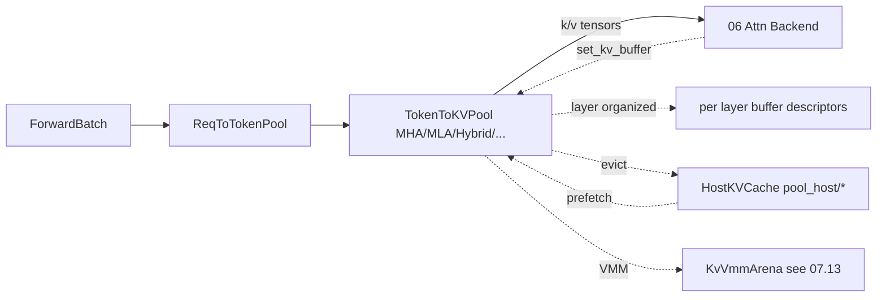

# 07.6 内存池

## 定位

本页描述 07 子系统的"L1 设备池"与"L2 host 池"两套物理张量容器。设备池为 `ForwardBatch` 提供 forward 读写所需的 KV 张量与`req→token`索引；host 池为 HiCache 提供 pinned 内存回收带。它们由 [`04 ModelRunner`](../04-model-execution/04.1-model-runner.md) 持有，并经 [`07.7 Allocators`](07.7-allocators.md) 释放/分配。

## 职责

- 维护 `ReqToTokenPool`：以 req 为粒度记录每个 token 在 KV 池的索引。
- 维护 `TokenToKVPool` 家族：MHA / MLA / DSA / FP4 / PageMajor / NoOp / HybridLinear / KOnly / Sparse 等不同 attention state 的物理张量。
- 提供 `KVWriteLoc`/`KvBufferDesc` 抽象，让 attention backend 用统一接口写 KV。
- 提供 `HostKVCache` 抽象，让 host 池与 device 池形状一致以支持零拷贝/卸载。

## 关键类与函数（设备池）

| 名称 | 定义位置 | 说明 |
|---|---|---|
| `ReqToTokenPool` | `mem_cache/memory_pool.py:242` | req→token slot 索引表 |
| `MambaPool` | `mem_cache/memory_pool.py:315` | Mamba state 专用 req→slot 表 |
| `HybridReqToTokenPool` | `mem_cache/memory_pool.py:880` | Hybrid 模型的组合 req 池（full + ssm lane） |
| `KVCache` | `mem_cache/memory_pool.py:1295` | 设备 KV 池 ABC：`get_kv_buffer`/`set_kv_buffer`/`layer_disp` 等 |
| `MHATokenToKVPool` | `mem_cache/memory_pool.py:1416` | 标准 MHA 池（k/v 张量布局） |
| `NoOpMHATokenToKVPool` | `mem_cache/memory_pool.py:2508` | NoOp 实现（CPU/offload 测试用） |
| `MHATokenToKVPoolFP4` | `mem_cache/memory_pool.py:2622` | FP4 量化池 |
| `PageMajorMHATokenToKVPool` | `mem_cache/memory_pool.py:2776` | page-major 布局，对齐 paged attention |
| `HybridLinearKVPool` | `mem_cache/memory_pool.py:2930` | Hybrid 模型 full + linear lane 池 |
| `MLATokenToKVPool` | `mem_cache/memory_pool.py:3239` | MLA（DeepSeek）紧凑 KV 池 |
| `MLATokenToKVPoolFP4` | `mem_cache/memory_pool.py:3509` | MLA FP4 量化池 |
| `DSATokenToKVPool` | `mem_cache/memory_pool.py:3649` | DeepSeek V3.1 DSA 共享 KV 池 |
| `MHATokenToKOnlyPool` | `mem_cache/memory_pool.py:3978` | 仅 K 池（特定架构） |
| `MiniMaxSparseKVPool` | `mem_cache/memory_pool.py:4065` | MiniMax 稀疏 KV 池 |

## 关键类与函数（host 池）

| 名称 | 定义位置 | 说明 |
|---|---|---|
| `HostKVCache` | `mem_cache/pool_host/base.py:81` | L2 host 池 ABC，定义 `get_kv_buffer`/`set_kv_buffer`/`alloc_page` |
| `MHATokenToKVPoolHost` | `mem_cache/pool_host/mha.py:66` | MHA host 池，与 device 等形 |
| `MLATokenToKVPoolHost` | `mem_cache/pool_host/mla.py:51` | MLA host 池 |
| `HostPoolGroup` | `mem_cache/pool_host/common.py` | 多 host 池聚合 + sidecar 注册 |
| `DSAIndexerPoolHost` | `mem_cache/pool_host/` | DSA 索引 host 暂存 |
| `DeepSeekV4PagedHostPool` / `DeepSeekV4StateHostPool` | `mem_cache/pool_host/` | DeepSeek V4 压缩/状态 host 池 |
| `HiSparseHostPool` | `mem_cache/pool_host/hisparse.py` | HiSparse host 侧 |

## 子模块树

- `mem_cache/memory_pool.py` — 设备池全部家族
- `mem_cache/memory_pool_host.py` — host 池入口与工厂
- `mem_cache/pool_host/` — host 池实现
  - `base.py`、`common.py` — ABC 与 HostPoolGroup
  - `mha.py`、`mla.py`、`hisparse.py` — 各架构 host 池

## 数据流 / 控制流

forward 期 attention backend 通过 `ForwardContext` 拿到 `kv_pool`，按 layer 取 `KvBufferDesc` 写新 token 的 K/V；同时 `ForwardBatch.out_cache_loc` 把 `req→slot` 写回 `ReqToTokenPool`。淘汰时 RadixCache/HiCache 把 `node.value` 拷到 `HostKVCache.host_value` 再清 device。host 池的形状与 device 池一一匹配，跨介质搬运只需 `cudaMemcpyAsync`。

## 交叉引用

- 上游: [`07.7 Allocators`](07.7-allocators.md) — 释放/分配设备 slot
- 上游: [`07.11 KV configurator/builder`](07.11-kv-configurator-builder.md) — 池尺寸与构造
- 下游: [`06.3.1 Attn backend`](../06-layers/06.3.1-attn-backend-abstraction.md) — 读 `get_kv_buffer`
- 相关: [`07.9 HiCache`](07.9-hicache.md) — host 池由 `hybrid_pool_assembler` 装配
- 相关: [`04.1 ModelRunner`](../04-model-execution/04.1-model-runner.md) — 持有并初始化池
- 相关: [`07.13 mmap/vmm`](07.13-mm-cache-sparsity-mmap-vmm.md) — 物理 backing

## 进一步阅读

- 源码: `python/sglang/srt/mem_cache/memory_pool.py`、`python/sglang/srt/mem_cache/pool_host/`
