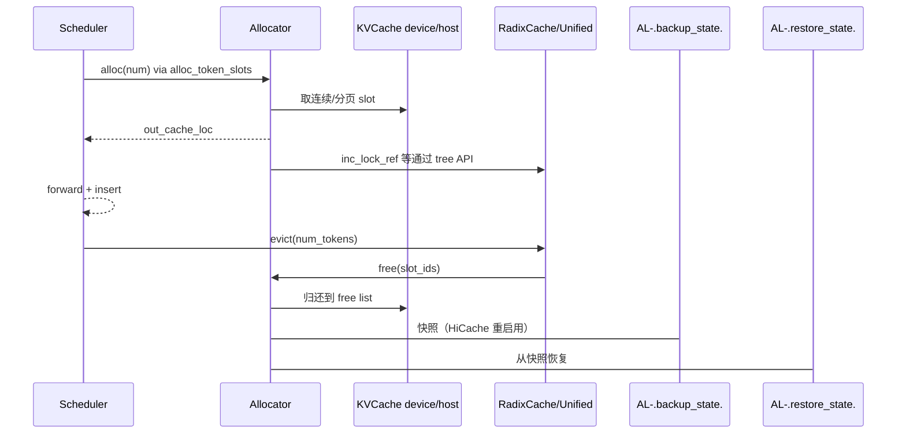

# 07.7 Allocators

## 定位

Allocators 是 [`07.6 内存池`](07.6-memory-pools.md) 之上的"slot 分发器"：它们把底层 `KVCache` 的连续物理 slot 流转给 [`07.3 RadixCache`](07.3-radix-cache.md) / [`07.4 UnifiedRadixCache`](07.4-unified-radix-cache.md) 与 [`07.8 批分配`](07.8-batch-allocation.md)。每个 cache 树持有一个 allocator，HiCache 也会包一层复用其 backup/restore 能力。

## 职责

- `BaseTokenToKVPoolAllocator` ABC：定义 `alloc`/`free`/`backup_state`/`restore_state`/`backuped_size`。
- `PagedTokenToKVPoolAllocator`：page 粒度分配，配合 page-size > 1 的 paged attention。
- `TokenToKVPoolAllocator`：token 粒度分配（默认 page_size=1 的 RadixCache）。
- `SWATokenToKVPoolAllocator` / `PureSWATokenToKVPoolAllocator`：滑窗池分配器，按 window 内 slot 发放。
- `MambaSlotAllocator`：SSM state slot 分配（按 state 而非 token）。
- `HiSparseTokenToKVPoolAllocator` / `DeepSeekV4HiSparseTokenToKVPoolAllocator`：稀疏池分配器，与 DSA/DeepSeekV4 压缩 host 池配对。
- `MultiEndedAllocator`：在 `UnifiedKVPool` 上按 sub-pool 名做"多端"分配，供 hybrid 模型 full / mamba / swa lane 共享一池；可绑 peer、支持 grow 与 backup/restore。
- `UnifiedMambaTokenToKVPoolAllocator` / `UnifiedSWATokenToKVPoolAllocator`：把 `MultiEndedAllocator` 组合成 hybrid 树用的复合分配器。

## 关键类与函数

| 名称 | 定义位置 | 说明 |
|---|---|---|
| `BaseTokenToKVPoolAllocator` | `mem_cache/allocator/base.py:27` | ABC：alloc/free/backup/restore/schedulable_available_size |
| `PagedTokenToKVPoolAllocator` | `mem_cache/allocator/paged.py:105` | page 粒度；含 `alloc_extend_naive:45` 工具 |
| `TokenToKVPoolAllocator` | `mem_cache/allocator/token.py:28` | token 粒度（page=1 的常见 Radix 路径） |
| `SWATokenToKVPoolAllocator` | `mem_cache/allocator/swa.py:20` | SWA 池，按窗口 slot 流转 |
| `PureSWATokenToKVPoolAllocator` | `mem_cache/allocator/swa.py:410` | 纯 SWA 模型专用 |
| `MambaSlotAllocator` | `mem_cache/allocator/mamba.py:30` | SSM state slot 分配器 |
| `HiSparseTokenToKVPoolAllocator` | `mem_cache/allocator/hisparse.py:15` | 稀疏池（与 [`07.13`](07.13-mm-cache-sparsity-mmap-vmm.md) 的稀疏算法协作） |
| `DeepSeekV4HiSparseTokenToKVPoolAllocator` | `mem_cache/allocator/hisparse.py:276` | DeepSeek V4 压缩 host 池稀疏分配 |
| `MultiEndedAllocator` | `mem_cache/multi_ended_allocator.py:99` | UnifiedKVPool sub-pool 分配，含 grow/peer/backup |
| `UnifiedMambaTokenToKVPoolAllocator` | `mem_cache/multi_ended_allocator.py:1665` | full + mamba sub-pool 复合 |
| `UnifiedSWATokenToKVPoolAllocator` | `mem_cache/multi_ended_allocator.py:1951` | full + swa sub-pool 复合 |

## 子模块树

- `mem_cache/allocator/base.py` — ABC 与公共逻辑
- `mem_cache/allocator/token.py` — 标准分配
- `mem_cache/allocator/paged.py` — page 分配
- `mem_cache/allocator/swa.py` — SWA / PureSWA
- `mem_cache/allocator/mamba.py` — SSM state
- `mem_cache/allocator/hisparse.py` — 稀疏 / DeepSeekV4
- `mem_cache/multi_ended_allocator.py` — `MultiEndedAllocator` 与 `Unified*` 复合

## 数据流 / 控制流

alloc 路径：`alloc_token_slots` 把请求转给 allocator，allocator 从其 free-list / 下层 pool 取 slot，返回 device indices。free 路径在 RadixCache evict 时触发。`MultiEndedAllocator` 的关键特性是 sub-pool 共享：多个 allocator 通过 `bind_peer` 联通，free 时不立即归还下层 pool，而是回到 peer 可见的 free list，使 hybrid 模型在 full/mamba/swa lane 间动态借还。`backup_state`/`restore_state` 用于 HiCache 在 L2/L3 换层后重建引用视图。

## 交叉引用

- 上游: [`07.6 内存池`](07.6-memory-pools.md) — allocator 操作的 `KVCache`/`HostKVCache`
- 上游: [`07.8 批分配`](07.8-batch-allocation.md) — `alloc_token_slots` 的调度方
- 下游: [`07.3 RadixCache`](07.3-radix-cache.md) / [`07.4 UnifiedRadixCache`](07.4-unified-radix-cache.md) — 持有 allocator
- 下游: [`07.9 HiCache`](07.9-hicache.md) — backup/restore 在 HiCache 重启中复用
- 相关: [`10.3 spec 分配`](../10-speculative/10.3-spec-utils-allocation.md) — draft 路径有自己的 allocator 选择

## 进一步阅读

- 源码: `python/sglang/srt/mem_cache/allocator/`、`python/sglang/srt/mem_cache/multi_ended_allocator.py`
