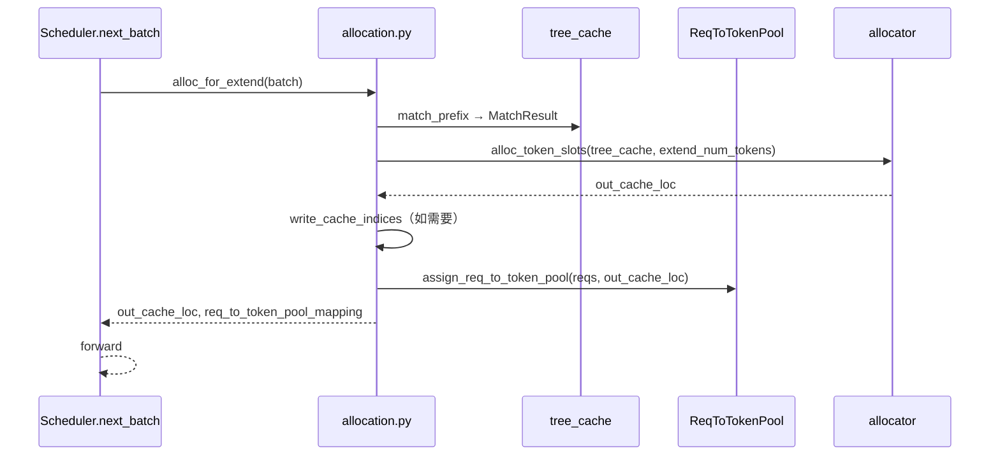

# 07.8 批分配

## 定位

`allocation.py` 是 [`03 Scheduler`](../03-orchestration/03.4.1-scheduler-structure.md) 在每个 step 调用 07 子系统的"批级入口"：它把当前 `ScheduleBatch` 中所有请求的内存需求翻译成对 [`07.3 RadixCache`](07.3-radix-cache.md) 命中、[`07.7 Allocators`](07.7-allocators.md) 分配与 `ReqToTokenPool` 注册的组合调用，输出 `out_cache_loc` 与 `req_to_token_pool_mapping`，供 [`04 ModelRunner`](../04-model-execution/04.1-model-runner.md) 在 forward 中写 KV。`allocation_sizing.py` 给出 config 派生的尺寸常量。

## 职责

- `alloc_for_extend`：prefill 模式，先 `match_prefix`，再对剩余 tokens `alloc_token_slots`，最后 `assign_req_to_token_pool`。
- `alloc_for_decode`：decode 模式，每请求发放固定 `token_per_req` 个 slot，回填 `req_to_token_pool`。
- `alloc_for_spec_decode`：投机解码目标 batch，按 `num_needed_tokens` 一次性 alloc + 写回 index table。
- `alloc_token_slots`：通用 slot 申请，内部 dispatch 到 tree_cache 的 allocator。
- `assign_req_to_token_pool`：把 cache_loc 写到 `ReqToTokenPool`，含 NPU/CPU 多后端 dispatch。
- `write_cache_indices`：批量把 forward 输出 KV 写入 cache 池指定 indices 的工具。
- `get_alloc_len_per_decode` / `get_alloc_reserve_per_decode`：从 `ServerArgs` 派生每 step decode 的预期长度与 reserve。

## 关键类与函数

| 名称 | 定义位置 | 说明 |
|---|---|---|
| `write_cache_indices` | `mem_cache/allocation.py:55` | 把 KV 写到指定 cache indices 的工具 |
| `get_last_loc` | `mem_cache/allocation.py:104` | 计算 `req_to_token` 末尾 loc（CPU/torch 双实现） |
| `alloc_token_slots` | `mem_cache/allocation.py:146` | 通用 slot 申请入口 |
| `alloc_paged_token_slots_extend` | `mem_cache/allocation.py:188` | paged extend 专用 |
| `alloc_req_slots` | `mem_cache/allocation.py:252` | 申请 `ReqToTokenPool` 行 |
| `_alloc_page_size` | `mem_cache/allocation.py:294` | 计算本 batch page_size |
| `alloc_for_extend` | `mem_cache/allocation.py:303` | extend 模式批分配主体 |
| `alloc_paged_token_slots_decode` | `mem_cache/allocation.py:388` | paged decode 专用 |
| `alloc_for_decode` | `mem_cache/allocation.py:440` | decode 模式批分配主体 |
| `assign_req_to_token_pool` | `mem_cache/allocation.py:498` | 把 cache_loc 写回 `ReqToTokenPool` |
| `assign_req_to_token_pool_func` | `mem_cache/allocation.py:532` | 多后端 dispatch（CPU/torch/sgl_kernel） |
| `alloc_for_spec_decode` | `mem_cache/allocation.py:575` | 投机解码批分配 |
| `get_alloc_len_per_decode` | `mem_cache/allocation_sizing.py:9` | config → 每 step decode 长度 |
| `get_alloc_reserve_per_decode` | `mem_cache/allocation_sizing.py:37` | config → 每 step decode reserve |

## 子模块树

- `mem_cache/allocation.py` — 批分配主入口
- `mem_cache/allocation_sizing.py` — config 派生尺寸
- 调用点: `managers/schedule_batch.py` 与 `managers/scheduler*.py`（[`03.4`](../03-orchestration/03.4.4-scheduler-next-batch.md)）

## 数据流 / 控制流

extend 路径顺序：match_prefix 取已命中 slot，剩余 tokens 通过 allocator 新申请，最后 `assign_req_to_token_pool` 把命中+新增的索引列填到 `ReqToTokenPool` 对应行。decode 路径更轻，仅每步发 `token_per_req` 个 slot。spec_decode 路径一次发 `num_needed_tokens`，由 [`10.3 spec 分配`](../10-speculative/10.3-spec-utils-allocation.md) 计算。所有路径都通过 `batch.tree_cache`（即 RadixCache/Unified/HiRadix 等）走到对应 allocator，使 cache 树与分配器解耦。

## 交叉引用

- 上游: [`03.4.4 Scheduler next_batch`](../03-orchestration/03.4.4-scheduler-next-batch.md) — `alloc_for_*` 调用方
- 上游: [`03.9 schedule_batch`](../03-orchestration/03.9-schedule-batch.md) — `batch.tree_cache` 字段
- 下游: [`07.7 Allocators`](07.7-allocators.md) — `alloc_token_slots` 到 allocator
- 下游: [`07.6 内存池`](07.6-memory-pools.md) — `ReqToTokenPool`/`TokenToKVPool`
- 相关: [`10.3 spec 分配`](../10-speculative/10.3-spec-utils-allocation.md)
- 相关: [`04.2 ForwardBatch`](../04-model-execution/04.2-forward-batch-mode.md) — 消费 `out_cache_loc`

## 进一步阅读

- 源码: `python/sglang/srt/mem_cache/allocation.py`、`python/sglang/srt/mem_cache/allocation_sizing.py`
