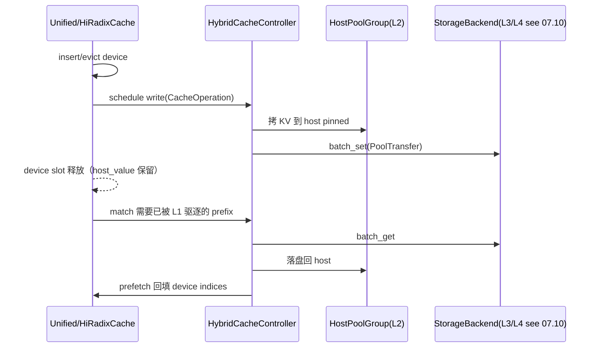

# 07.9 HiCache

## 定位

HiCache 是 07 子系统对"L1→L2→L3 多级"的实现：把 [`07.3 RadixCache`](07.3-radix-cache.md) / [`07.4 UnifiedRadixCache`](07.4-unified-radix-cache.md)/[`07.5 专用缓存`](07.5-specialty-caches.md) 的 device 树外接 host 池（L2）与 storage 后端（L3/L4），实现 KV 跨介质 write-through、evict、prefetch。控制器 `HybridCacheController` 统一调度所有跨层搬运；`hybrid_pool_assembler.StackRegistry` 按模型架构挑出合适的 host 池装配策略。本页是 [`07.10 存储后端`](07.10-storage-backends.md) 与 [`07.6 内存池`](07.6-memory-pools.md) 的中枢。

## 职责

- `HiRadixCache` / `HiMambaRadixCache`：在 Radix/Mamba 树基础上扩 `host_value` 字段、增 host LRU，做"device evict → host 备份"。
- `UnifiedRadixCache.init_hicache`：通过 `attach_hybrid_pool_to_unified_cache` 接 `HostPoolGroup` + `HybridCacheController`。
- `HybridCacheController`：维护 write/load/prefetch 队列，把 `CacheOperation`/`StorageOperation`/`PrefetchOperation` 提交给后端。
- `hybrid_pool_assembler`：根据 kvcache 类型与启用 component 选择 `StackStrategy`（DeepSeekV4 / Mamba / Swa / Dsa / MiniMaxSparse / Plain），并装配 host 池组与控制器。
- `HiCacheStorageConfig`/`PoolTransfer`/`PoolName`：跨层调度的数据契约。
- legacy `managers/cache_controller.HiCacheController`：未做 hybrid 改造的旧路径控制器。

## 关键类与函数

| 名称 | 定义位置 | 说明 |
|---|---|---|
| `HiRadixCache` | `mem_cache/hiradix_cache.py:75` | RadixCache 子类，挂 host LRU 与 cache_controller |
| `HiMambaRadixCache` | `mem_cache/hi_mamba_radix_cache.py:97` | MambaRadixCache 子类，hybrid SSM host 路径 |
| `CacheOperation` | `hybrid_cache/hybrid_cache_controller.py:46` | write/load 任务合并单元 |
| `StorageOperation` | `hybrid_cache/hybrid_cache_controller.py:106` | 通用 storage I/O 任务 |
| `PrefetchOperation` | `hybrid_cache/hybrid_cache_controller.py:121` | 异步预取任务 |
| `HybridCacheController` | `hybrid_cache/hybrid_cache_controller.py:159` | 控制器主体，含 write/load queue、prefetch 调度 |
| `StackStrategy` | `hybrid_cache/hybrid_pool_assembler.py:691` | 装配策略 ABC |
| `_DeepSeekV4Strategy` / `_MambaStrategy` / `_SwaStrategy` / `_DsaStrategy` / `_MiniMaxSparseStrategy` / `_PlainKvStrategy` | `hybrid_cache/hybrid_pool_assembler.py:714` / `:799` / `:871` / `:937` / `:1008` / `:1071` | 六策略实例 |
| `register_stack_strategy` / `_select_strategy` | `hybrid_cache/hybrid_pool_assembler.py:1157` / `:1163` | 策略注册与选择 |
| `attach_hybrid_pool_to_unified_cache` | `hybrid_cache/hybrid_pool_assembler.py:1203` | Unified 树挂 host 池入口 |
| `HiCacheStorageConfig` | `mem_cache/hicache_storage.py:27` | 后端配置 |
| `PoolTransfer` | `mem_cache/hicache_storage.py:93` | 跨池搬运描述 |
| `PoolName` | `mem_cache/hicache_storage.py:58` | 命名池标识 |
| `HiCacheController` | `managers/cache_controller.py:225` | legacy 控制器（被 `HybridCacheController` 继承/替换） |

## 子模块树

- `mem_cache/hiradix_cache.py` — HiRadixCache 主体
- `mem_cache/hi_mamba_radix_cache.py` — HiMamba 主体
- `mem_cache/hybrid_cache/`
  - `hybrid_cache_controller.py` — `HybridCacheController` 与 ops
  - `hybrid_pool_assembler.py` — `StackStrategy` 策略与 host 池组装配
- `mem_cache/hicache_storage.py` — 配置/契约/`HiCacheFile` 默认后端
- `managers/cache_controller.py` — legacy `HiCacheController` 与 `LayerDoneCounter`

## 数据流 / 控制流

write 路径：device evict 时若未备份，控制器把 `node.value` copy 到 `host_value`，再异步 `batch_set` 到 storage。read 路径：match 命中但 `value is None` 时控制器发起 `PrefetchOperation`，由 storage backend `batch_get` 写回 host pinned，再回填 L1，使 forward 能继续。`StackStrategy` 在初始化期决定 host 池如何按 component / layer 切分，对 DeepSeek V4 / DSA 这种共享/压缩布局尤其重要。

## 交叉引用

- 上游: [`07.2 registry`](07.2-base-prefix-cache-registry.md) — `enable_hierarchical_cache` 触发 HiRadix / Unified+HiCache
- 上游: [`07.6 内存池`](07.6-memory-pools.md) — host 池族（L2）
- 下游: [`07.10 存储后端`](07.10-storage-backends.md) — L3/L4 backend
- 相关: [`07.4 UnifiedRadixCache`](07.4-unified-radix-cache.md) — `init_hicache` 入口
- 相关: [`09 PD 分离`](../09-disaggregation/index.md) — PD 传输常借 host 池与 storage 后端
- 相关: [`17 观测`](../17-observability-ops/index.md) — `LayerDoneCounter` 提供层级 timing 事件
- 相关 skill: `.claude/skills/sglang-runtime-context`

## 进一步阅读

- 源码: `python/sglang/srt/mem_cache/hiradix_cache.py`、`mem_cache/hi_mamba_radix_cache.py`、`mem_cache/hybrid_cache/`、`managers/cache_controller.py`
