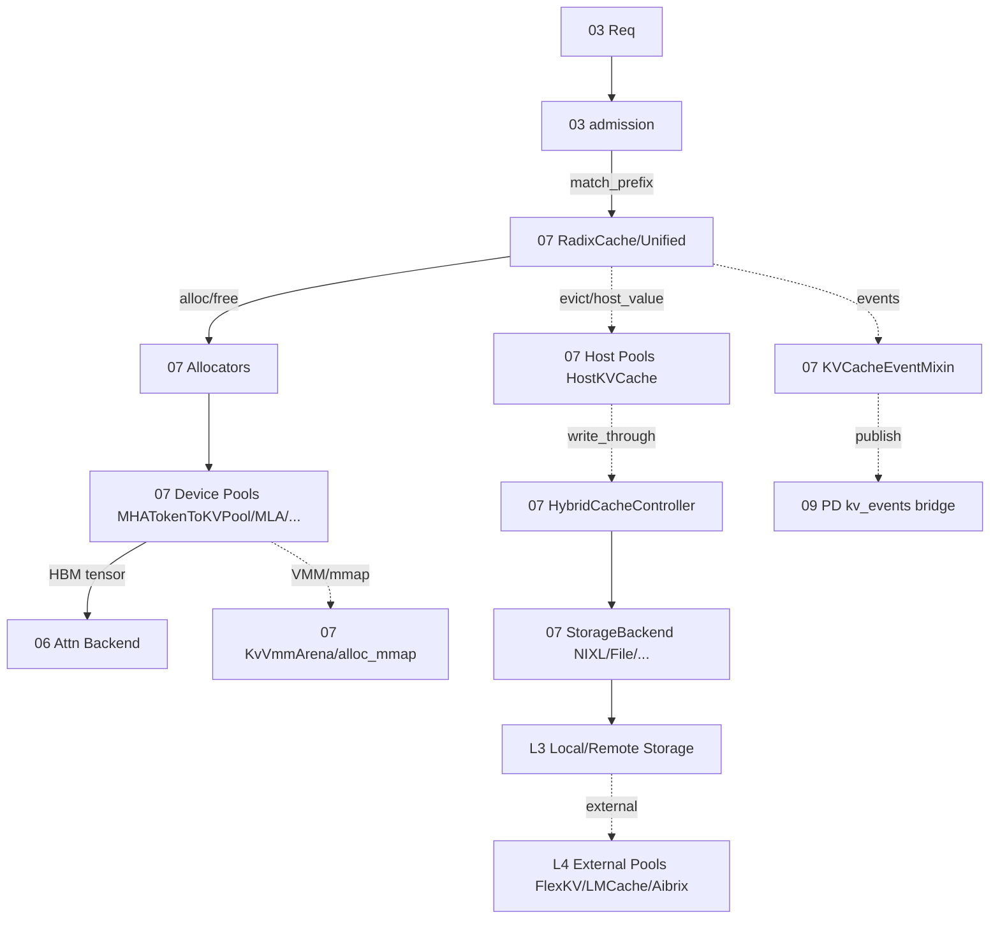

# 07 KV Cache 与内存管理

## 定位

子系统 07 是 SGLang 的"状态面"核心：它管理一次推理过程中所有 KV/SSM 状态的物理内存、磁盘、跨进程存储与逻辑索引，并把"前缀复用"作为一等公民提供给 [`03 编排`](../03-orchestration/index.md) 的准入、调度与淘汰决策。从请求进入 `TokenizerManager` 到 `ModelRunner.forward` 完成 forward，KV 内存池与 Radix 树贯穿整条管线，是 [`04 模型执行`](../04-model-execution/index.md) 的注意力后端与 [`06 Layers`](../06-layers/index.md) 的 `RadixAttention` 的共同地基。它同时是 [`09 PD 分离`](../09-disaggregation/index.md) 的 KV 迁移载体、[`10 投机解码`](../10-speculative/index.md) 的 draft/target 缓存共享对象。

## 职责

- 提供四级缓存层级（device HBM → host pinned → local/remote storage → external pools）的统一抽象。
- 维护基于 Radix 树的前缀复用索引，支持 hit/match/insert/evict/inc_lock_ref。
- 分配设备端 `ReqToTokenPool`、`TokenToKVPool`（MHA/MLA/DSA/Hybrid/Mamba/Sparse/FP4）及对应 allocator。
- 为 hybrid 模型（SWA+Full、SSM+Full、DSA、DeepSeekV4 压缩）提供 `UnifiedRadixCache` 与 component 化的多树共存。
- 提供 HiCache 控制器与可插拔存储后端（file/nixl/mooncake/hf3fs/flexkv/lmcache/aibrix/eic/simm/umbp）。
- 暴露 KV cache 事件流，供 PD 分离与可观测使用。
- 提供 KV cache 尺寸计算、host pool 装配、CUDA VMM/mmap 物理 backing 与 fp8/fp4 dtype 选择。

## 子系统边界图

## 子系统内导航

| 编号 | 页面 | 一句话定位 |
|---|---|---|
| 07.1 | [缓存层级总览](07.1-cache-tiers.md) | L1 HBM→L2 host pinned→L3 storage→L4 external 四级模型 |
| 07.2 | [BasePrefixCache/registry](07.2-base-prefix-cache-registry.md) | 缓存抽象层与 `--radix-cache-backend` 选择链 |
| 07.3 | [RadixCache](07.3-radix-cache.md) | 经典分页 Radix 树实现，HiRadixCache 的父类 |
| 07.4 | [UnifiedRadixCache](07.4-unified-radix-cache.md) | component 化多树，混合模型的统一缓存 |
| 07.5 | [专用缓存](07.5-specialty-caches.md) | SWA/Mamba/PureSWA/Chunk/Cpp/Session 等变体 |
| 07.6 | [内存池](07.6-memory-pools.md) | 设备池（ReqToToken/KVCache）与 host 池 ABC |
| 07.7 | [Allocators](07.7-allocators.md) | 分配器层级：base/paged/token/swa/mamba/hisparse/multi-ended |
| 07.8 | [批分配](07.8-batch-allocation.md) | `alloc_for_extend/decode/spec_decode` 调度入口 |
| 07.9 | [HiCache](07.9-hicache.md) | HiRadixCache/HiMamba/HybridCacheController/StackRegistry |
| 07.10 | [存储后端](07.10-storage-backends.md) | `StorageBackendFactory` 与 file/nixl/mooncake/... |
| 07.11 | [KV configurator/builder](07.11-kv-configurator-builder.md) | 池尺寸计算与 `build_kv_cache` 入口 |
| 07.12 | [KV events](07.12-kv-events.md) | 事件 mixin + PD 跨进程发布 |
| 07.13 | [MM/稀疏/mmap/vmm](07.13-mm-cache-sparsity-mmap-vmm.md) | VLM cache、稀疏算法、VMM/mmap、dtype、evict 策略 |

## 交叉引用

- 上游: [`03 核心编排`](../03-orchestration/index.md) — Scheduler 准入/淘汰调用 RadixCache，[`03.4.1`](../03-orchestration/03.4.1-scheduler-structure.md)
- 上游: [`04 模型执行`](../04-model-execution/index.md) — `ModelRunner` 持有内存池引用，[`04.1`](../04-model-execution/04.1-model-runner.md)
- 下游/被依赖: [`06 Layers`](../06-layers/index.md) — `RadixAttention` 与注意力后端读写 KV 池，[`06.3.1`](../06-layers/06.3.1-attn-backend-abstraction.md)
- 相关: [`09 PD 分离`](../09-disaggregation/index.md) — KV events 是跨进程迁移载体
- 相关: [`10 投机解码`](../10-speculative/index.md) — draft worker 共享/独立 KV 池，[`10.3`](../10-speculative/10.3-spec-utils-allocation.md)
- 相关: [`15 内核`](../15-kernels-hardware/15.2-sgl-kernel-aot.md) — kernel 直接读写池张量

## 进一步阅读

- 源码: `python/sglang/srt/mem_cache/`
- 组件 README: `python/sglang/srt/mem_cache/unified_cache_components/README.md`
