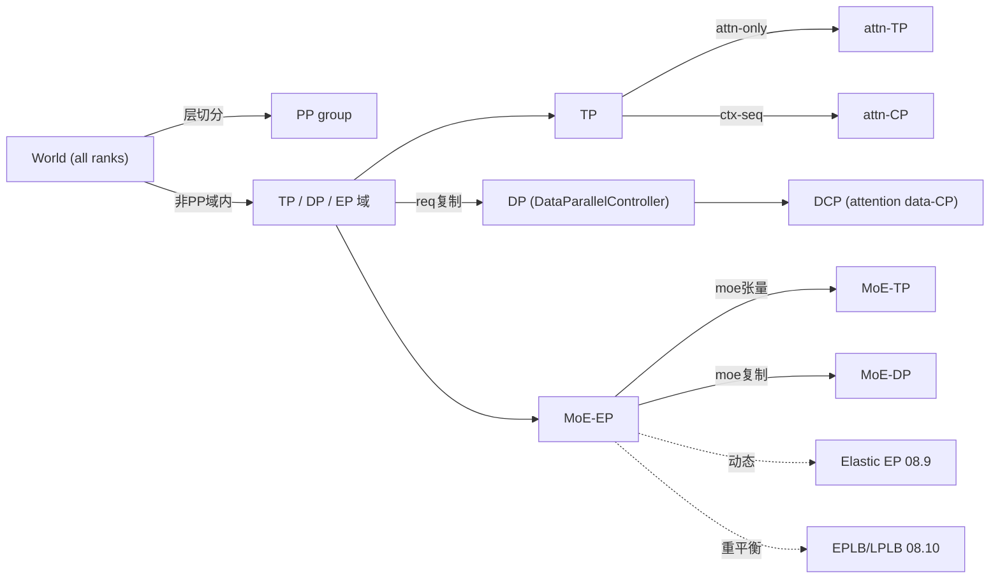

# 08.1 并行分类

## 定位

本页是 08 子系统的概念基础：定义 SGLang 的所有"并行轴"、它们之间的关系图、以及各自在 [`08.2 parallel_state`](08.2-parallel-state.md) 中对应的 `GroupCoordinator` 与 `CacheInitParams` cache group 字段。理解这张表是阅读后续具体实现（[`08.4`](08.4-device-communicators.md)–[`08.12`](08.12-batch-overlap-tbo.md)）的前提。

## 并行轴总表

| 轴 | 全称 | 切分对象 | 典型 group accessor | 关键参数 |
|---|---|---|---|---|
| TP | Tensor Parallel | attention/MLP 张量 | `get_tp_group` | `--tp-size` |
| attn-TP | Attention-TP | 仅注意力张量 | `get_attn_tp_group` | 由 TP/CP 派生 |
| attn-CP | Attention-CP | 上下文 sequence | `get_attn_cp_group` | `--context-path-size`（CP-attention） |
| CP/DCP | Context / Data-CP | 序列维度块 | `get_dcp_group` | `--dp-size` + CP |
| PP | Pipeline Parallel | 层段 | `get_pp_group` | `--pp-size` |
| DP | Data Parallel | 请求复制 | 03 `DataParallelController` | `--dp-size`（独立 attn-MLP） |
| MoE-EP | Expert Parallel | 专家分片 | `get_moe_ep_group` | `--ep-size` |
| MoE-TP | MoE-TP | MoE 张量 | `get_moe_tp_group` | 由 TP/EP 派生 |
| MoE-DP | MoE-DP | 专家复制 | `get_moe_dp_group` | DP on MoE lane |

## 职责

- 给出每个 axis 在 `parallel_state` 中暴露的 group；为 `CacheInitParams`（[`07.2`](07.2-base-prefix-cache-registry.md)）提供 `tp_cache_group`/`attn_cp_cache_group`/`attn_tp_cache_group`/`pp_cache_group` 等用于 KV 树的同步约束。
- 解释 SA-MoE 模型下"attn-TP 与 MoE-EP/MoE-TP/MoE-DP 解耦"的组合方式（如 DeepSeek V3：attention TP + MoE EP）。
- 说明 Elastic EP（[`08.9`](08.9-elastic-ep.md)）与 EPLB/LPLB（[`08.10`](08.10-eplb-lplb.md)）作用于 MoE-EP 轴。

## 关键类与函数

| 名称 | 定义位置 | 说明 |
|---|---|---|
| `GroupCoordinator` | `distributed/parallel_state.py:216` | 所有 axis 的统一抽象 |
| `get_tp_group` | `distributed/parallel_state.py:1730` | TP 组 accessor |
| `get_attn_tp_group` | `distributed/parallel_state.py:1740` | Attention-TP accessor |
| `get_attn_cp_group` | `distributed/parallel_state.py:1747` | Attention-CP accessor |
| `get_dcp_group` | `distributed/parallel_state.py:1758` | DCP/Data-CP accessor |
| `get_moe_dp_group` | `distributed/parallel_state.py:1768` | MoE-DP accessor |
| `get_moe_ep_group` | `distributed/parallel_state.py:1773` | MoE-EP accessor |
| `get_moe_tp_group` | `distributed/parallel_state.py:1778` | MoE-TP accessor |
| `get_pp_group` | `distributed/parallel_state.py:1789` | PP 组 accessor |
| `get_world_group` | `distributed/parallel_state.py:1647` | 全员组 accessor |
| `CacheInitParams` 字段 | `mem_cache/cache_init_params.py:25-28` | `tp_cache_group`/`attn_cp_cache_group`/`attn_tp_cache_group`/`pp_cache_group` |
| `StatelessProcessGroup` | `distributed/utils.py:135` | 无状态小组，跨进程临时构造（PD/elastic 用） |

## 并行轴组合关系

绝大多数模型只组合其中几条轴：纯 TP 模型 — `TP`；DeepSeek V3 — `TP(attn) + MoE-EP`；MLA + 长序列 — 额外加 `attn-CP/DCP`；多副本 — `DP + (TP/EP)`；PD 分离场景中 Decode 端可仅 `TP+DP`，Prefill 端 `TP+EP`。`CacheInitParams` 把 attn-TP/attn-CP/TP/PP 的 process group 传给 [`07.4 UnifiedRadixCache`](07.4-unified-radix-cache.md)，让 KV 树在对应组内同步命中前缀。

## 交叉引用

- 上游: [`08.2 parallel_state`](08.2-parallel-state.md) — accessor 实现细节
- 上游: [`07.2 CacheInitParams`](07.2-base-prefix-cache-registry.md) — cache group 字段
- 相关: [`08.6 DP attention`](08.6-dp-attention.md) / [`08.7 CP/DCP`](08.7-context-parallel-cp-dcp.md) / [`08.8 PP`](08.8-pipeline-parallel.md) / [`08.9 Elastic EP`](08.9-elastic-ep.md) / [`08.10 EPLB/LPLB`](08.10-eplb-lplb.md)
- 相关: [`06.13 LayerCommunicator`](../06-layers/06.13-layer-communicator.md) — Layer 内选择 TP/EP 通信
- 相关: [`16.1 ServerArgs`](../16-config-runtime/16.1-server-args-port-args.md) — `--tp-size`/`--pp-size`/`--ep-size`

## 进一步阅读

- 源码: `python/sglang/srt/distributed/parallel_state.py`、`python/sglang/srt/distributed/utils.py`
