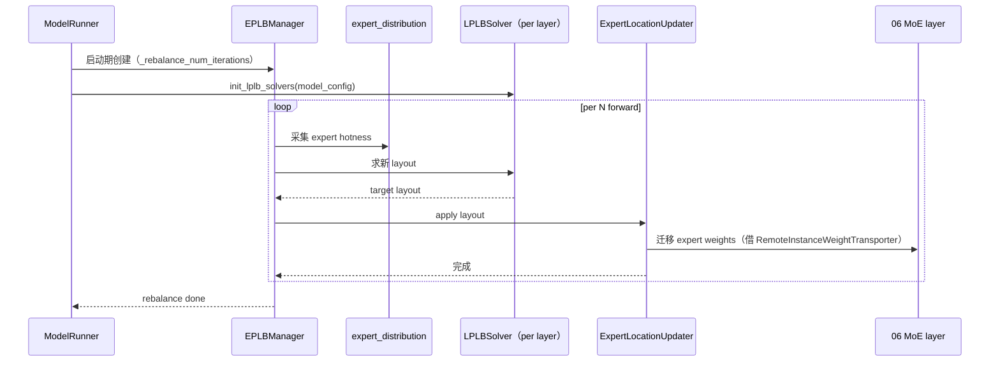

# 08.10 EPLB / LPLB

## 定位

`eplb/` 实现 SGLang 的专家负载均衡：EPLB（Expert-Parallel Load Balancing）周期性重分布 MoE 专家到 EP rank，LPLB（Layer-wise PLB）按层做更细粒度的布局求解。它们在 [`08.9 Elastic EP`](08.9-elastic-ep.md) 扩缩后、EPLBManager 定期 rebalance、`init_lplb_solvers` 启动期初始化时被触发。EPLBManager 与 [`04.5 ModelRunner components`](../04-model-execution/04.5-runner-components.md) 协作，运行期迁移 expert weights 而不打断 forward。

## 职责

- `EPLBManager`：周期 rebalance 主类，调度 `expert_location_updater` + `init_lplb_solvers` + GPU 利用率阈值。
- `LPLBSolver`：单层 LPLB 求解器，按 layer 注册到全局。
- `expert_distribution`：采集 expert hotness 分布，输入布局求解。
- `expert_location_dispatch` / `expert_location_updater`：把新 layout 应用到 MoE layer。
- `init_lplb_solvers`：启动期根据 `ModelConfig` 为每层一个 solver。
- `eplb_algorithms/`：算法库（贪心/聚类等）；`eplb_simulator/`：离线仿真。

## 关键类与函数

| 名称 | 定义位置 | 说明 |
|---|---|---|
| `EPLBManager` | `eplb/eplb_manager.py:28` | 周期 rebalance 主类 |
| `LPLBSolver` | `eplb/lplb_solver.py:78` | 单层 LPLB 求解器 |
| `assert_lplb_supported_model` | `eplb/lplb_solver.py:48` | 校验模型可用 |
| `get_global_lplb_solver` / `set_global_lplb_solver` / `clear_global_lplb_solvers` | `eplb/lplb_solver.py:60` / `:66` / `:72` | 全局 solver 注册表 |
| `init_lplb_solvers` | `model_executor/model_runner_components/moe_ep_setup.py:77` | 启动期初始化 |
| `ExpertDistribution` | `eplb/expert_distribution.py` | expert 负载采集 |
| `ExpertLocation` / `ExpertLocationUpdater` / `expert_location_dispatch` | `eplb/expert_location.py` / `expert_location_updater.py` / `expert_location_dispatch.py` | 新 layout 应用 |
| `eplb_algorithms/` | `eplb/eplb_algorithms/` | 算法库 |
| `eplb_simulator/` | `eplb/eplb_simulator/` | 离线仿真 |
| `remote_instance_weight_transporter` 协同 | `model_executor/model_runner_components/remote_instance_weight_transporter.py:21` | 迁移 expert weights 用（[`08.11`](08.11-weight-sync.md)） |

## 子模块树

- `eplb/eplb_manager.py` — 主类
- `eplb/lplb_solver.py` — LPLB solver 与全局表
- `eplb/expert_distribution.py` — 负载采集
- `eplb/expert_location.py` / `expert_location_updater.py` / `expert_location_dispatch.py` — layout 应用
- `eplb/eplb_algorithms/` — 算法
- `eplb/eplb_simulator/` — 仿真
- 调用点：`model_runner_components/moe_ep_setup.py:77 init_lplb_solvers`、`model_executor/model_runner.py:634 maybe_init_lplb_solvers`

## 数据流 / 控制流

EPLBManager 按 `_rebalance_num_iterations` 周期拉取 expert 分布，调每层 `LPLBSolver` 求 target layout（受 GPU 利用率阈值约束），再让 `ExpertLocationUpdater` 借 [`08.11 weight_sync`](08.11-weight-sync.md) 通路迁移 expert weights。LPLB 求解器在启动期 `init_lplb_solvers` 中根据模型架构为每层注册一个，避免运行期 per-step 求解开销。Elastic EP 扩缩完成后会主动触发一次 rebalance 以适配新 `ep_size`。

## 交叉引用

- 上游: [`08.1 并行分类`](08.1-parallelism-taxonomy.md) — MoE-EP/MoE-DP 概念
- 上游: [`08.9 Elastic EP`](08.9-elastic-ep.md) — 扩缩后强制调用
- 下游: [`06.4 MoE`](../06-layers/06.4.1-moe-module-flow.md) — layer 端应用新 layout
- 相关: [`08.11 weight_sync`](08.11-weight-sync.md) — 权重迁移底座
- 相关: [`04.5 runner_components`](../04-model-execution/04.5-runner-components.md) — ModelRunner 持有 EPLBManager 子组件
- 相关: [`02.2.6 loads/elastic`](../02-server-api/02.2.6-loads-elastic-ep.md) — HTTP 触发点
- 相关: [`17 观测`](../17-observability-ops/index.md) — expert hotness 指标

## 进一步阅读

- 源码: `python/sglang/srt/eplb/`、`python/sglang/srt/model_executor/model_runner_components/moe_ep_setup.py`
