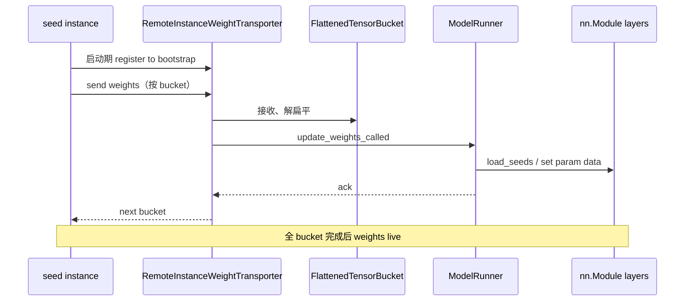

# 08.11 weight_sync

## 定位

`weight_sync/` 与 `RemoteInstanceWeightTransporter` 是 08 子系统的"在线权重迁移"通道：在不重启 server 的前提下，把一份新的 model weights（来自远端 seed instance、EPLB 重布局、checkpoint engine）按 tensor bucket 流式推到 local `nn.Module`。它是 [`08.9 Elastic EP`](08.9-elastic-ep.md) 与 [`08.10 EPLB/LPLB`](08.10-eplb-lplb.md) 的依赖底座，也是 [`14 会话状态`](../14-session-state/index.md) checkpoint_engine 的同源基础设施。

## 职责

- `weight_sync/tensor_bucket.py`：把模型 weights 拆为多 tensor 的扁平 bucket 便于流水化传输。
- `weight_sync/utils.py`：tensor 预处理与 update helper。
- `RemoteInstanceWeightTransporter`：在 ModelRunner init 期注册到 engine info bootstrap，按 `remote_instance_weight_loader_*` server_args 选择 seed/transfer engine/mooncake/nccl 路径。
- 与 `checkpoint_engine` 协作：同源传输协议用于在线权重切换与 state capture。
- 暴露给 EPLBManager / ElasticEPStateManager 调用入口。

## 关键类与函数

| 名称 | 定义位置 | 说明 |
|---|---|---|
| `RemoteInstanceWeightTransporter` | `model_executor/model_runner_components/remote_instance_weight_transporter.py:21` | 在线权重传输主体 |
| `RemoteInstanceWeightTransporter._register_to_engine_info_bootstrap` | `remote_instance_weight_transporter.py:70` | 启动期注册 bootstrap |
| `FlattenedTensorMetadata` | `weight_sync/tensor_bucket.py:8` | 单 tensor 元信息 |
| `FlattenedTensorBucket` | `weight_sync/tensor_bucket.py:19` | 扁平 bucket 主体 |
| `_preprocess_tensor_for_update_weights` | `weight_sync/utils.py:106` | update 前的 dtype/shape 预处理 |
| `remote_instance_weight_loader_*` 配置 | `configs/load_config.py:77-82`、`server_args.py:2594+` | seed/ports/backend/transfer_engine 等 |
| Mooncake 传输 | `device_communicators/mooncake_transfer_engine.py:17`（[`08.4`](08.4-device-communicators.md)） | 可选 transfer engine |
| `CheckpointEngine` | `14 会话状态`（[`14.4`](../14-session-state/14.4-checkpoint-engine.md)） | 与本模块共享传输原语 |

## 子模块树

- `weight_sync/tensor_bucket.py` — 扁平 bucket 数据结构
- `weight_sync/utils.py` — tensor 预处理
- `model_executor/model_runner_components/remote_instance_weight_transporter.py` — 主传输器
- 协作：`device_communicators/mooncake_transfer_engine.py`（[`08.4`](08.4-device-communicators.md)）可选做跨节点传输
- 协作：`checkpoint_engine`（[`14.4`](../14-session-state/14.4-checkpoint-engine.md)）共享原语

## 数据流 / 控制流

启动期 ModelRunner 在 `__init__` 中构造 `RemoteInstanceWeightTransporter`，按 server_args 配置向 seed instance 注册（`remote_instance_weight_loader_seed_instance_ip`/`_service_port`/`_send_weights_group_ports`）。seed 把权重按 `FlattenedTensorBucket` 流式发送，传输 backend 可选 mooncake/nccl 等。本端在 `update_weights` 入口把 bucket 解扁平并 `_preprocess_tensor_for_update_weights` 后写入对应 `nn.Parameter`，期间 forward 暂停或交错进行（由 EPLB/ElasticEP 时序保证）。EPLBManager 触发的 expert 迁移复用同一管道，仅替换子集 tensor。

## 交叉引用

- 上游: [`08.9 Elastic EP`](08.9-elastic-ep.md) — 扩容借传 expert weights
- 上游: [`08.10 EPLB/LPLB`](08.10-eplb-lplb.md) — 重布局时迁移专家
- 下游: [`04.1 ModelRunner`](../04-model-execution/04.1-model-runner.md) — `__init__` 构造 transporter
- 相关: [`14.4 checkpoint_engine`](../14-session-state/14.4-checkpoint-engine.md) — 同源传输
- 相关: [`08.4 设备通信器`](08.4-device-communicators.md) — Mooncake 传输
- 相关: [`05 模型加载`](../05-model-loading/index.md) — seed instance 由加载器产出
- 相关: [`16.1 ServerArgs`](../16-config-runtime/16.1-server-args-port-args.md) — `remote_instance_weight_loader_*`

## 进一步阅读

- 源码: `python/sglang/srt/weight_sync/`、`python/sglang/srt/model_executor/model_runner_components/remote_instance_weight_transporter.py`
