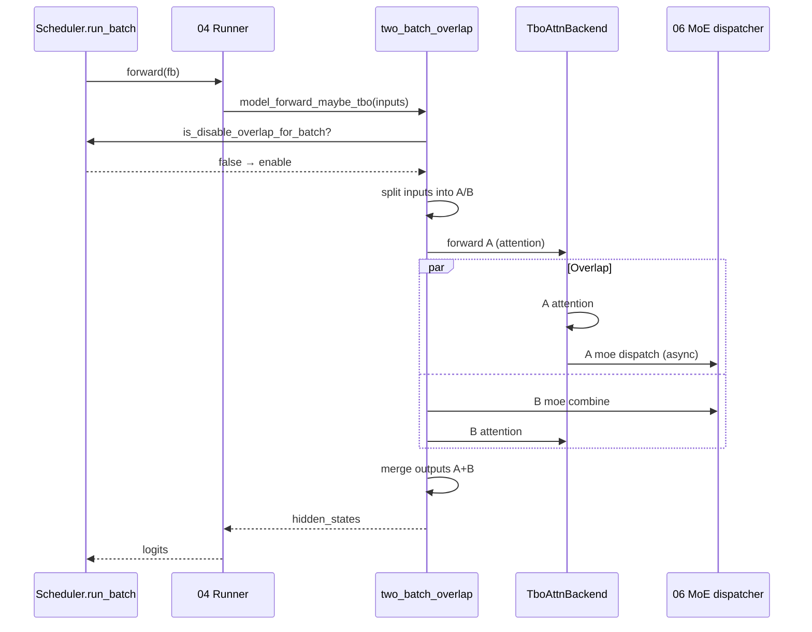

# 08.12 batch_overlap TBO

## 定位

`batch_overlap/` 是 08 子系统的"两批 overlap"实现：在一个 forward step 中把当前 batch 拆成两个子 batch，让一个子 batch 的 attention/moe/通信与另一个子 batch 的计算重叠，掩盖通信延迟。TBO（Two-Batch Overlap）依赖专门的 `TboAttnBackend`（[`06.3.7`](../06-layers/06.3.7-attn-tbo.md)），并由 `Scheduler.is_disable_overlap_for_batch` 决定本步是否启用。SBO（Single-Batch Overlap）走更细粒度的 layer overlap。

## 职责

- `two_batch_overlap.py`：把 `ScheduleBatch` 在 token / sequence 维度拆成两份，分别 forward，再合并输出。
- `TboAttnBackend`：实现两子 batch 的 attention 互相 overlap（[`06.3.7`](../06-layers/06.3.7-attn-tbo.md)）。
- `TboForwardBatchPreparer`：构造两子 batch 的 `ForwardBatch`。
- `TboDPAttentionPreparer`：处理 DP attention 路径下的两子 batch gather。
- `TboCudaGraphRunnerPlugin`：让 TBO 与 CUDA graph replay 共存。
- `operations.py` + `operations_strategy.py`：拆/合策略与算子级 sequence。
- `single_batch_overlap.py`：SBO 的 `SboFlags` / `CombineOverlapArgs` / `DownGemmOverlapArgs`，单 batch 内 combine/down gemm overlap。
- `MaybeTboDeepEPDispatcher`：与 DeepEP MoE dispatch 协作的两子 batch 排队。
- `Scheduler.is_disable_overlap_for_batch`：按 batch 特征跳过 TBO（小 batch、不均衡等）。

## 关键类与函数

| 名称 | 定义位置 | 说明 |
|---|---|---|
| `model_forward_maybe_tbo` | `batch_overlap/two_batch_overlap.py:866` | 主入口：判定 → `_model_forward_tbo` or 落回 non-tbo |
| `_model_forward_tbo` | `batch_overlap/two_batch_overlap.py:898` | 拆分 → 并行 forward → 合并 |
| `_model_forward_tbo_split_inputs` | `batch_overlap/two_batch_overlap.py:935` | 输入拆分逻辑 |
| `_model_forward_tbo_split_inputs_raw` | `batch_overlap/two_batch_overlap.py:985` | 拆分底层 |
| `_model_forward_tbo_merge_outputs` | `batch_overlap/two_batch_overlap.py:1047` | 输出合并 |
| `_model_forward_non_tbo` | `batch_overlap/two_batch_overlap.py:930` | 退化路径 |
| `compute_split_token_index` | `batch_overlap/two_batch_overlap.py:285` | 拆分点计算 |
| `compute_split_indices_for_cuda_graph_replay` | `batch_overlap/two_batch_overlap.py:306` | CUDA graph 路径拆分点 |
| `TboForwardBatchPreparer` | `batch_overlap/two_batch_overlap.py:502` | 子 batch ForwardBatch 构造 |
| `TboDPAttentionPreparer` | `batch_overlap/two_batch_overlap.py:392` | DP attention 子 batch 准备 |
| `TboCudaGraphRunnerPlugin` | `batch_overlap/two_batch_overlap.py:335` | CUDA graph 集成 |
| `MaybeTboDeepEPDispatcher` | `batch_overlap/two_batch_overlap.py:1071` | DeepEP MoE dispatcher 适配 |
| `SboFlags` / `CombineOverlapArgs` / `DownGemmOverlapArgs` | `batch_overlap/single_batch_overlap.py:28` / `:63` / `:75` | SBO 元数据 |
| `OperationsStrategy` | `batch_overlap/operations_strategy.py` | 算子级 overlap 策略 |
| `Scheduler.is_disable_overlap_for_batch` | `managers/scheduler.py:1610` | TBO 跳过判定 |
| `TboAttnBackend` | `layers/attention/tbo_backend.py:11` | 两子 batch 注意力后端（[`06.3.7`](../06-layers/06.3.7-attn-tbo.md)） |

## 子模块树

- `batch_overlap/two_batch_overlap.py` — TBO 主体（拆分/合并/与 cuda graph 集成）
- `batch_overlap/single_batch_overlap.py` — SBO 单 batch overlap
- `batch_overlap/operations.py` — 单步算子 sequence
- `batch_overlap/operations_strategy.py` — 策略对象
- 调用方：`model_executor/runner/*`（[`04.4 Runners`](../04-model-execution/04.4-runners.md)）经 `model_forward_maybe_tbo`
- 协作：`layers/attention/tbo_backend.py:11 TboAttnBackend`（[`06.3.7`](../06-layers/06.3.7-attn-tbo.md)）

## 数据流 / 控制流

`model_forward_maybe_tbo` 是 forward 入口的"前置分流器"：若 batch 满足 TBO 启用条件（`is_disable_overlap_for_batch` 返回 false 且非 CUDA graph replay-as禁用），则把 inputs 在 token 维度按 `compute_split_token_index` 拆成 A/B，让 A 的 attention 与 B 的 MoE combine、B 的 attention 与 A 的 MoE dispatch overlap；否则落回 `_model_forward_non_tbo`。`TboAttnBackend` 内部维护两套 KV 写槽与双 stream，使两子 batch 的 attention 真正并行；`TboCudaGraphRunnerPlugin` 让 capture 期记录拆分模式，replay 时复用。SBO 是更细粒度路径，把 combine gemm 与 down gemm 在单 batch 内 overlap。

## 交叉引用

- 上游: [`06.3.7 TBO attn`](../06-layers/06.3.7-attn-tbo.md) — `TboAttnBackend` 实现
- 上游: [`04.4 Runners`](../04-model-execution/04.4-runners.md) — runner 经 `model_forward_maybe_tbo` 入口
- 上游: [`08.6 DP attention`](08.6-dp-attention.md) — `TboDPAttentionPreparer` 复用 async 原语
- 下游: [`06.4.6 MoE DeepEP`](../06-layers/06.4.6-moe-deepep.md) — `MaybeTboDeepEPDispatcher`
- 相关: [`03.4.9 Scheduler overlap`](../03-orchestration/03.4.9-scheduler-overlap.md) — overlap 调度策略层
- 相关: [`08.2 parallel_state`](08.2-parallel-state.md) — TBO 用的 all-gather 走 GroupCoordinator
- 相关 skill: `.claude/skills/sglang-runtime-context`

## 进一步阅读

- 源码: `python/sglang/srt/batch_overlap/`、`python/sglang/srt/layers/attention/tbo_backend.py`、`python/sglang/srt/managers/scheduler.py`
