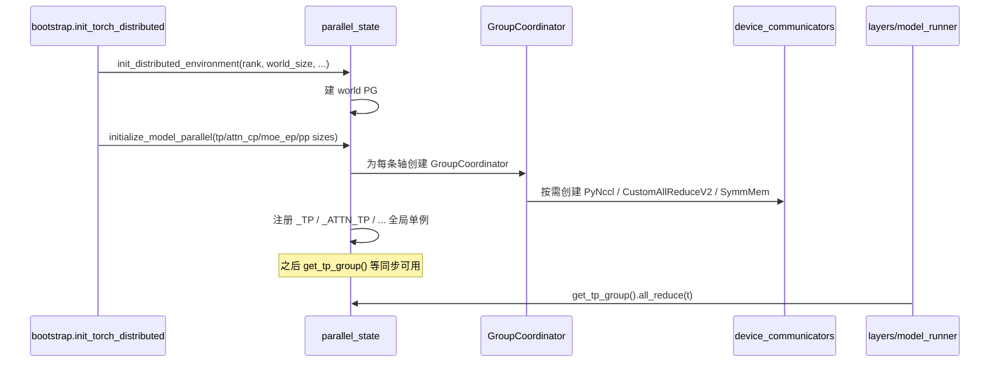

# 08.2 parallel_state

## 定位

`parallel_state.py` 是 08 子系统的"全局并行状态库"。它维护每条并行轴的 `GroupCoordinator`、世界组、graph capture 上下文，并向 [`04 ModelRunner`](../04-model-execution/04.1-model-runner.md)、[`06 Layers`](../06-layers/index.md) 与 [`07 KV Cache`](07-kv-cache/index.md) 暴露同步的 accessor。所有通信算子的调用方都不直接持 PG 句柄，而是经此模块解引用。

## 职责

- `GroupCoordinator`：封装一个 `torch.distributed.ProcessGroup`，提供 send/recv/all_reduce/all_gather/reduce_scatter/all_to_all/broadcast 与 graph_capture 路径。
- 全局单例 `_WORLD` / `_TP` / `_ATTN_TP` / `_ATTN_CP` / `_DCP` / `_MOE_DP` / `_MOE_EP` / `_MOE_TP` / `_PP`，由 `init_distributed_environment` 与 `initialize_model_parallel` 设置。
- `graph_capture`：进入 CUDA graph 捕获时为指定 stream 创建 `GraphCaptureContext`。
- 自定义 allreduce / symmetric memory 开关：`GroupCoordinator.device_communicator` 按 group 类型选 PyNccl / CustomAllReduceV2 / SymmMem。
- `PdmuxStatus`：PD 复用场景下复制一份 prefill TP group。

## 关键类与函数

| 名称 | 定义位置 | 说明 |
|---|---|---|
| `GraphCaptureContext` | `distributed/parallel_state.py:103` | graph 捕获 stream/tensor 携带 |
| `P2PWork` | `distributed/parallel_state.py:108` | send/recv 异步工作句柄 |
| `GroupCoordinator` | `distributed/parallel_state.py:216` | 主类，绑定 device_communicator |
| `GroupCoordinator.send_recv` | `parallel_state.py:1310` | PP P2P 通信 |
| `GroupCoordinator.graph_capture_context` | `parallel_state.py:556` | 进出 graph 捕获 |
| `_register_group` | `parallel_state.py:158` | 注册全局 group accessor |
| `get_world_group` | `parallel_state.py:1647` | 全员组 accessor |
| `get_tp_group` | `parallel_state.py:1730` | TP accessor |
| `get_attn_tp_group` | `parallel_state.py:1740` | attn-TP accessor |
| `get_attn_cp_group` | `parallel_state.py:1747` | attn-CP accessor |
| `get_dcp_group` | `parallel_state.py:1758` | DCP accessor |
| `get_moe_dp_group` | `parallel_state.py:1768` | MoE-DP accessor |
| `get_moe_ep_group` | `parallel_state.py:1773` | MoE-EP accessor |
| `get_moe_tp_group` | `parallel_state.py:1778` | MoE-TP accessor |
| `get_pp_group` | `parallel_state.py:1789` | PP accessor |
| `graph_capture` | `parallel_state.py:1811` | graph 捕获上下文管理器 |
| `init_distributed_environment` | `parallel_state.py:1940` | torch distributed 初始化入口 |
| `initialize_model_parallel` | `parallel_state.py:2043` | 构造所有 axis 的 PG 与 GroupCoordinator |
| `ensure_model_parallel_initialized` | `parallel_state.py:2450` | 幂等包装 |

## 子模块树

- `distributed/parallel_state.py` — GroupCoordinator 与所有 group accessor
- `distributed/parallel_state_wrapper.py:6` — `ParallelState` runtime-context 访问器（[`16.3`](../16-config-runtime/16.3-runtime-context.md)）
- 与 [`08.3 bootstrap`](08.3-bootstrap-init.md) 协作完成初始化

## 数据流 / 控制流

bootstrap 完成后，所有 rank 同时进入"已初始化"态。任何 layer/model 代码经 `get_*_group()` 拿到 `GroupCoordinator`，调用其中的 `all_reduce`/`all_gather` 等。`graph_capture` 让上层在捕获 CUDA graph 时为 communication 提供独立 stream 与 dummy tensor。`GroupCoordinator.device_communicator` 在创建期根据 server_args 决定是否启用 CustomAllReduce/SymmMem，二者 fallback 到 PyNccl。

## 交叉引用

- 上游: [`08.3 Bootstrap`](08.3-bootstrap-init.md) — 调用 `init_distributed_environment` + `initialize_model_parallel`
- 下游: [`08.4 设备通信器`](08.4-device-communicators.md) — 被注入 `GroupCoordinator`
- 下游: [`08.5 comm ops`](08.5-comm-ops.md) — 通过 accessor 调用通信
- 相关: [`07.2 CacheInitParams`](07.2-base-prefix-cache-registry.md) — cache group 取自这里
- 相关: [`06.14 model_parallel DTensor`](../06-layers/06.14-model-parallel-dtensor.md) — 共享同一组 PG
- 相关 skill: `.claude/skills/debug-distributed-hang`、`.claude/skills/sglang-runtime-context`

## 进一步阅读

- 源码: `python/sglang/srt/distributed/parallel_state.py`、`parallel_state_wrapper.py`
