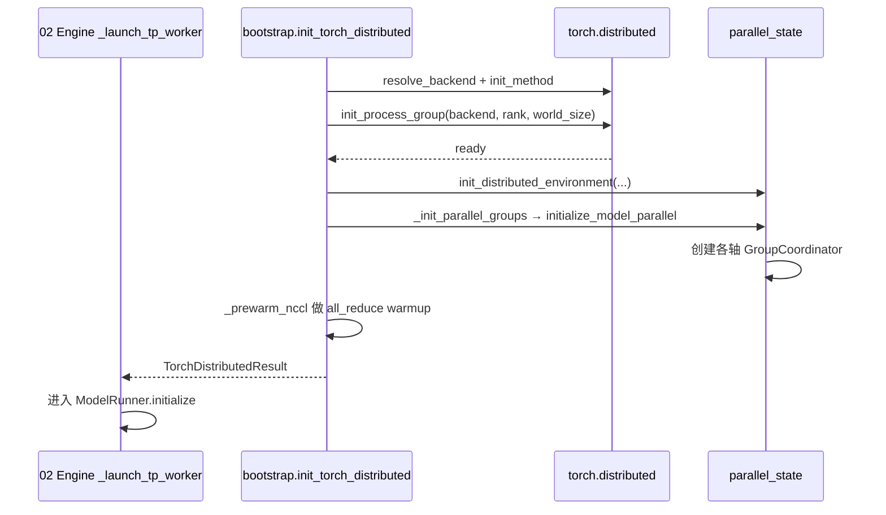

# 08.3 Bootstrap 与初始化

## 定位

`bootstrap.py` 是 08 子系统的"启动器"。在 [`02 Engine`](../02-server-api/02.1-engine.md) 起 scheduler 进程后，每个 rank 第一件事就是 `init_torch_distributed`：解析 backend、设置 TCPStore/init_method、构造 torch distributed PG、预热 NCCL，再调 [`08.2 parallel_state`](08.2-parallel-state.md) 的 `initialize_model_parallel` 切分各 axis 子组。`naive_distributed.py` 提供单 GPU 退化路径；`utils.py` 提供 StatelessProcessGroup、PP 索引计算与全局 TCPStore。

## 职责

- `init_torch_distributed`：根据 `server_args` 与 `gpu_id` 解析 backend（gloo/nccl/xpu/hpu）与 init_method，调 torch `init_process_group`，再 `_init_parallel_groups` + `_prewarm_nccl`。
- `_resolve_backend`：按 platform/gpu 选取 backend 与 device 控制变量。
- `_init_parallel_groups`：把 server_args 中的 TP/PP/DP/EP/CP/DCP 尺寸转换成 `initialize_model_parallel` 入参。
- `_prewarm_nccl`：在初始化末尾做一次小型 all-reduce，避免首步 forward 受 NCCL lazy init 影响。
- `NaiveDistributed`：单进程场景下的占位实现，使非分布式路径编译期统一。
- `set_global_tcp_store`：把 TCPStore 句柄存到模块全局，供 PD/elastic 等场景旁路 torch 通信复用。
- `get_pp_indices`：按 `pp_size`/`pp_rank` 切分 layer 范围。

## 关键类与函数

| 名称 | 定义位置 | 说明 |
|---|---|---|
| `init_torch_distributed` | `distributed/bootstrap.py:51` | 主入口 |
| `_resolve_backend` | `distributed/bootstrap.py:146` | backend/platform 选择 |
| `_resolve_dist_init_method` | `distributed/bootstrap.py:170` | init_method 解析 |
| `_set_all_reduce_flags` | `distributed/bootstrap.py:188` | 设置自定义 AR 标志 |
| `_init_cpu_threads_env` | `distributed/bootstrap.py:194` | CPU 多线程环境 |
| `_init_parallel_groups` | `distributed/bootstrap.py:211` | 调 `initialize_model_parallel` |
| `_prewarm_nccl` | `distributed/bootstrap.py:269` | NCCL 预热 |
| `_check_tp_memory_balance` | `distributed/bootstrap.py:285` | 多卡 TP 显存平衡检查 |
| `TorchDistributedResult` | `distributed/bootstrap.py:44` | 返回结构 |
| `NaiveDistributed` | `distributed/naive_distributed.py:12` | 单进程占位实现 |
| `get_naive_distributed` / `set_naive_distributed` | `naive_distributed.py:105` / `:110` | 全局实例 |
| `set_global_tcp_store` / `get_global_tcp_store` | `distributed/utils.py:23` / `:32` | TCPStore 全局句柄 |
| `get_pp_indices` | `distributed/utils.py:95` | PP layer 切分 |
| `StatelessProcessGroup` | `distributed/utils.py:135` | 无状态 PG，PD/elastic 临时组用 |

## 子模块树

- `distributed/bootstrap.py` — 主启动流程
- `distributed/naive_distributed.py` — 单进程退化
- `distributed/utils.py` — 公共工具（TCPStore、PP 索引、Stateless PG）
- 与 [`08.2 parallel_state`](08.2-parallel-state.md) 的 `init_distributed_environment`/`initialize_model_parallel` 串行协作

## 数据流 / 控制流

bootstrap 在 MP 切分前完成 torch 底层 PG；之后 `_init_parallel_groups` 把上层"逻辑并行轴"切成子 PG 并交给 `parallel_state` 维护。`_prewarm_nccl` 是关键准备步骤：预热 NCCL 内核与 composer，避免 forward 首步 latency spike。`NaiveDistributed` 让 server 在 `--tp-size=1 --dp-size=1` 时仍能跑同一份代码路径。`StatelessProcessGroup` 不绑定 rank，供 PD/Elastic EP 在运行期动态创建临时小组。

## 交叉引用

- 上游: [`02.1 Engine`](../02-server-api/02.1-engine.md) 与 [`03.6 TpModelWorker`](../03-orchestration/03.6-tp-worker.md) — 调用 bootstrap
- 下游: [`08.2 parallel_state`](08.2-parallel-state.md) — bootstrap 的目标
- 下游: [`08.9 Elastic EP`](08.9-elastic-ep.md) — 运行期重入 `initialize_model_parallel`
- 相关: [`08.8 PP`](08.8-pipeline-parallel.md) — `get_pp_indices` 切层
- 相关: [`16.1 ServerArgs`](../16-config-runtime/16.1-server-args-port-args.md) — `--dist-init-method`/`--nccl-init-method`
- 相关 skill: `.claude/skills/sglang-runtime-context`、`.claude/skills/debug-distributed-hang`

## 进一步阅读

- 源码: `python/sglang/srt/distributed/bootstrap.py`、`naive_distributed.py`、`utils.py`
