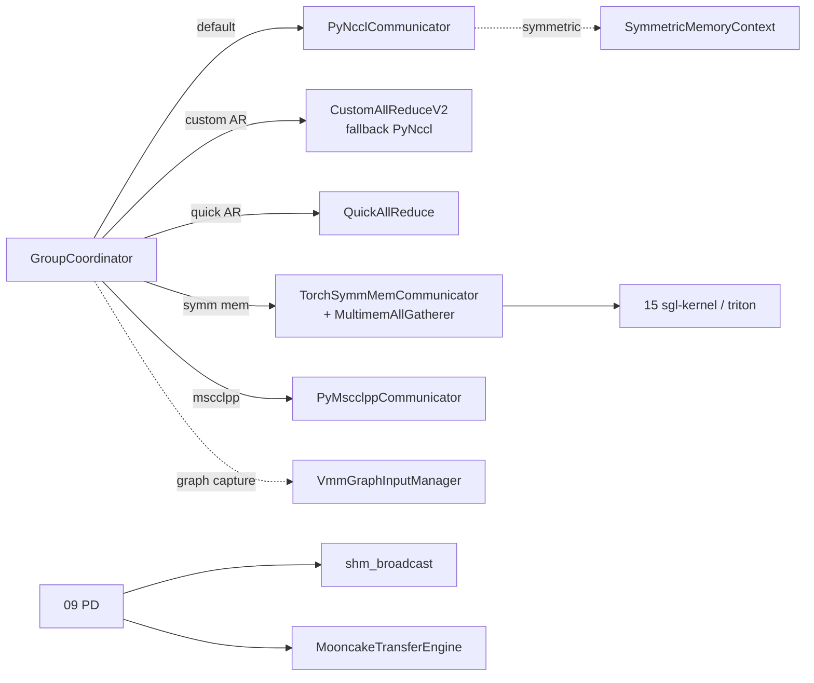

# 08.4 设备通信器

## 定位

`device_communicators/` 是 08 子系统的"底层传输层"。每条 axis 的 `GroupCoordinator` 在初始化期会按 server_args 选一个或多个通信器：默认是 NCCL（`PyNcclCommunicator`），在 NVLink/PCIe 拓扑允许时可叠加 `CustomAllReduceV2`/`QuickAllReduce`/`TorchSymmMemCommunicator`，跨节点用 `PyMscclppCommunicator`，PD 与共享内存场景用 `shm_broadcast`/`MooncakeTransferEngine`。它们都封装为统一接口，由 [`08.2 GroupCoordinator`](08.2-parallel-state.md) dispatch。

## 职责

- `PyNcclCommunicator` + `NCCLLibrary`：对 libnccl 的 ctypes 绑定与 all_reduce / all_gather / send/recv，支持 graph 捕获。
- `pynccl_allocator.SymmetricMemoryContext`：基于 NCCL symmetric memory 的低开销 AR；`prealloc_symmetric_memory_pool` 预申请。
- `CustomAllReduceV2` + `custom_all_reduce_utils`：自研 NVLink/P2P all-reduce；`gpu_p2p_access_check`/`is_full_nvlink` 决定可用性。
- `QuickAllReduce`：单节点小消息快速 AR。
- `PyMscclppCommunicator`：基于 MSCCL++ 的 all-gather/all-reduce，跨节点替代。
- `TorchSymmMemCommunicator` + `MultimemAllGatherer`（`triton_symm_mem_ag.py`）：基于 torch symmetric memory + Hopper multicast 的 all-gather。
- `shm_broadcast.ShmRingBuffer`/`MessageQueue`：单一 producer 多 consumer 的共享内存广播。
- `mooncake_transfer_engine`：Mooncake 传输引擎封装，PD/权重同步用。
- `cuda_wrapper.CudaRTLibrary`：CUDA Runtime ctypes 绑定，给设备查询/IPC 句柄用。
- `vmm_utils.VmmGraphInputManager`：CUDA graph 捕获期管理 VMM 地址映射。
- 平台变体：`hpu_communicator` / `xpu_communicator` / `npu_communicator`。

## 关键类与函数

| 名称 | 定义位置 | 说明 |
|---|---|---|
| `PyNcclCommunicator` | `device_communicators/pynccl.py:29` | NCCL 通信器主体 |
| `NCCLLibrary` | `device_communicators/pynccl_wrapper.py:159` | libnccl ctypes 绑定 |
| `SymmetricMemoryContext` | `device_communicators/pynccl_allocator.py:234` | NCCL symmetric memory 上下文 |
| `get_nccl_mem_pool` | `device_communicators/pynccl_allocator.py:185` | 取共享 mempool |
| `prealloc_symmetric_memory_pool` | `device_communicators/pynccl_allocator.py:410` | 预申请 symmetric pool |
| `CustomAllReduceV2` | `device_communicators/custom_all_reduce_v2.py:89` | 自研 AR v2 |
| `can_use_custom_all_reduce_v2` | `custom_all_reduce_v2.py:410` | 可用性判定 |
| `gpu_p2p_access_check` | `custom_all_reduce_utils.py:248` | P2P 拓扑检查 |
| `is_full_nvlink` | `custom_all_reduce_utils.py:353` | 是否全 NVLink |
| `QuickAllReduce` | `device_communicators/quick_all_reduce.py:52` | 快速 AR |
| `PyMscclppCommunicator` | `device_communicators/pymscclpp.py:22` | MSCCL++ 通信器 |
| `TorchSymmMemCommunicator` | `device_communicators/torch_symm_mem.py:32` | torch symmetric memory |
| `MultimemAllGatherer` | `device_communicators/triton_symm_mem_ag.py:444` | Hopper multicast AG |
| `ShmRingBuffer` / `MessageQueue` | `device_communicators/shm_broadcast.py:33` / `:175` | 共享内存广播 |
| `MooncakeTransferEngine` | `device_communicators/mooncake_transfer_engine.py:17`（全局单例 `_mooncake_transfer_engine`） | Mooncake 传输引擎 |
| `CudaRTLibrary` | `device_communicators/cuda_wrapper.py:77` | CUDA Runtime 绑定 |
| `VmmGraphInputManager` | `device_communicators/vmm_utils.py:430` | graph 捕获 VMM 管理 |
| `HpuCommunicator` / `XpuCommunicator` / `NpuCommunicator` | `device_communicators/{hpu,xpu,npu}_communicator.py` | 平台变体 |

## 子模块树

- `device_communicators/pynccl.py` + `pynccl_wrapper.py` + `pynccl_allocator.py` — NCCL 路径
- `device_communicators/custom_all_reduce_v2.py` + `custom_all_reduce_utils.py` + `custom_all_reduce_ops.py` — Custom AR v2
- `device_communicators/quick_all_reduce.py` — Quick AR
- `device_communicators/pymscclpp.py` — MSCCL++
- `device_communicators/torch_symm_mem.py` + `triton_symm_mem_ag.py` — Symmetric Memory + Multimem
- `device_communicators/shm_broadcast.py` — 单 producer 多 consumer
- `device_communicators/mooncake_transfer_engine.py` — Mooncake
- `device_communicators/cuda_wrapper.py` + `vmm_utils.py` — CUDA Runtime + VMM
- `device_communicators/{hpu,xpu,npu}_communicator.py` — 平台变体
- `device_communicators/all_reduce_utils.py` + `configs/` — 共用工具

## 数据流 / 控制流

`GroupCoordinator` 在创建期按 server_args 与拓扑把若干通信器 attach 到自身，每次 all_reduce/all_gather 时根据开关选最快路径。NCCL 是兜底；CustomAllReduceV2/QuickAllReduce 仅在 NVLink 全连通且消息尺寸合适时启用；SymmMem 路径要求 Hopper+ 与 symmetric pool 预申请。跨节点 PD/权重分摊到 `shm_broadcast`（同节点）+ `mooncake_transfer_engine`（跨节点）。graph 捕获场景由 `VmmGraphInputManager` 记录底层 VMM 地址映射，确保 replay 期 NCCL/symm mem 句柄稳定。

## 交叉引用

- 上游: [`08.2 parallel_state`](08.2-parallel-state.md) — GroupCoordinator 是消费方
- 下游: [`08.5 comm ops`](08.5-comm-ops.md) — 通过算子封装间接调用
- 相关: [`09 PD 分离`](../09-disaggregation/index.md) — PD 使用 shm_broadcast + mooncake
- 相关: [`11 weight_sync`](08.11-weight-sync.md) — Mooncake 与权重同步协同
- 相关: [`15.2 sgl-kernel`](../15-kernels-hardware/15.2-sgl-kernel-aot.md) — 自定义 allreduce 内核
- 相关 skill: `.claude/skills/debug-distributed-hang`

## 进一步阅读

- 源码: `python/sglang/srt/distributed/device_communicators/`
