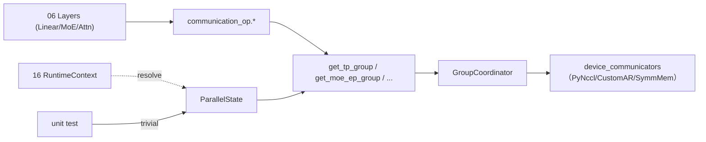

# 08.5 通信算子封装

## 定位

`communication_op.py` 与 `parallel_state_wrapper.ParallelState` 是 08 子系统对"做一次集合通信"的两层薄封装：前者把常用 all-reduce / all-gather / broadcast 形态具名化，使 [`06 Layers`](../06-layers/index.md) 与 [`04 ModelRunner`](../04-model-execution/04.1-model-runner.md) 不必直接访问 `GroupCoordinator`；后者把整个 `parallel_state` 的 access 入口包装成 runtime-context 友好的对象（[`16.3`](../16-config-runtime/16.3-runtime-context.md)），供 frozen-code 与 unit test 间接访问。

## 职责

- `tensor_model_parallel_all_reduce`：对 TP 切分后的局部张量做 all-reduce。
- `tensor_model_parallel_quant_all_reduce`：量化变体（fp8/int8 路径）。
- `tensor_model_parallel_fused_allreduce_rmsnorm`：AR 与 RMSNorm 融合。
- `tensor_model_parallel_all_gather` / `tensor_model_parallel_gather`：TP 路径的 all-gather / gather。
- `attention_tensor_model_parallel_all_reduce` / `moe_tensor_model_parallel_all_reduce`：按 attn/MoE lane 选择不同 group（attn-TP vs MoE-TP）。
- `moe_expert_parallel_all_reduce`：在 MoE-EP 组上 all-reduce。
- `broadcast_tensor_dict`：广播 tensor dict（PD/调度元数据用）。
- `ParallelState` runtime accessor：把 `get_tp_group`/`get_attn_tp_group`/`get_moe_ep_group`/... 包装成可注入的对象，支持 `trivial` 单进程占位。

## 关键类与函数

| 名称 | 定义位置 | 说明 |
|---|---|---|
| `tensor_model_parallel_all_reduce` | `distributed/communication_op.py:18` | TP AR |
| `tensor_model_parallel_quant_all_reduce` | `communication_op.py:23` | 量化 AR |
| `tensor_model_parallel_fused_allreduce_rmsnorm` | `communication_op.py:28` | 融合 AR+RMSNorm |
| `tensor_model_parallel_all_gather` | `communication_op.py:43` | TP all-gather |
| `tensor_model_parallel_gather` | `communication_op.py:50` | TP gather |
| `broadcast_tensor_dict` | `communication_op.py:57` | tensor dict 广播 |
| `attention_tensor_model_parallel_all_reduce` | `communication_op.py:65` | attn-TP AR |
| `attention_tensor_model_parallel_quant_all_reduce` | `communication_op.py:70` | attn-TP 量化 AR |
| `moe_tensor_model_parallel_all_reduce` | `communication_op.py:77` | MoE-TP AR |
| `moe_expert_parallel_all_reduce` | `communication_op.py:82` | MoE-EP AR |
| `ParallelState` | `distributed/parallel_state_wrapper.py:6` | runtime-context 包装器 |
| `ParallelState.trivial` | `parallel_state_wrapper.py:27` | 单进程占位构造 |
| `ParallelState.real` | `parallel_state_wrapper.py:49`（构造 `ParallelState(**kwargs)`） | 真实并行构造 |

## 子模块树

- `distributed/communication_op.py` — 具名算子封装（`from sglang.srt.layers.communicator` 等导入）
- `distributed/parallel_state_wrapper.py` — runtime-context 友好对象
- 调用方：`layers/communicator.py`、`layers/moe/*`、`model_executor/*`

## 数据流 / 控制流

layers 调用方只感知 `communication_op.tensor_model_parallel_all_reduce(t)` 这种具名入口，内部按当前 lane 挑对应 group accessor（attn/MoE/TP/EP），再交 `GroupCoordinator` dispatch 到具体通信器。`ParallelState` 是 runtime-context 解析入口：单元测试用 `ParallelState.trivial()` 注入 size=1 的占位，运行期用 `ParallelState.real(...)` 拉取真实 group。这样既满足 frozen-code 不能直接 import `parallel_state` 单例的约束，又保留测试可注入性。

## 交叉引用

- 上游: [`08.2 parallel_state`](08.2-parallel-state.md) — accessor 实际来源
- 上游: [`08.4 设备通信器`](08.4-device-communicators.md) — 最终执行的传输层
- 下游: [`06.13 LayerCommunicator`](../06-layers/06.13-layer-communicator.md) — 调用方
- 下游: [`16.3 RuntimeContext`](../16-config-runtime/16.3-runtime-context.md) — `ParallelState` 注入域
- 相关: [`08.6 DP attention`](08.6-dp-attention.md) — 使用 attn-TP/CP 系列
- 相关 skill: `.claude/skills/sglang-runtime-context`

## 进一步阅读

- 源码: `python/sglang/srt/distributed/communication_op.py`、`parallel_state_wrapper.py`
