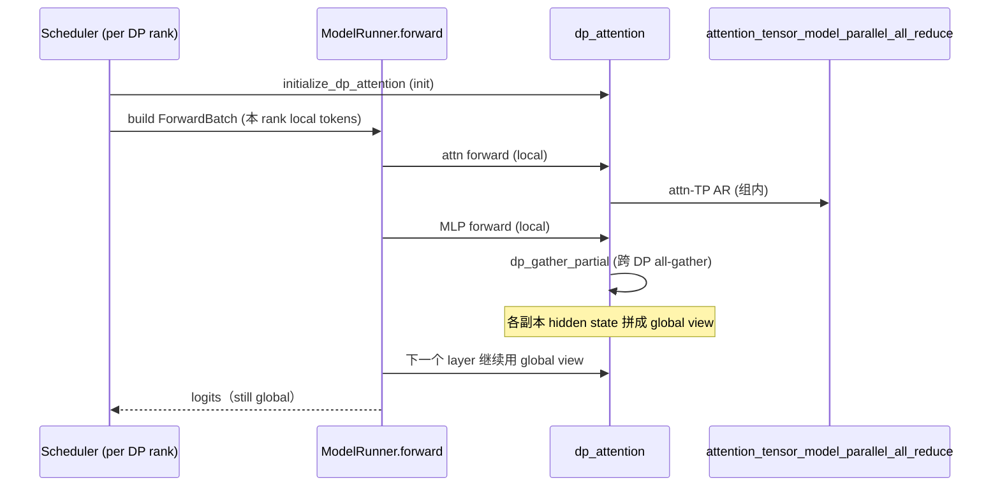

# 08.6 DP attention

## 定位

DP attention 是 SGLang 在"数据并行 + MLP 同步"上的轻量实现：把同一份模型权重复制到 `--dp-size` 个副本，每个副本独立跑 attention+MLP，但在 MLP 后做 all-reduce/all-gather 使所有副本的 hidden state 同步。它避开模型并行的通信开销，又能在 DP 间独立承接请求，显著提升吞吐。`layers/dp_attention.py` 提供 forward 期需要的 buffer/padding/gather 原语；`scheduler_components/dp_attn.py` 的 `SchedulerDPAttnAdapter` 让 [`03 Scheduler`](../03-orchestration/03.4.1-scheduler-structure.md) 与 DP attention 协作。

## 职责

- `DpPaddingMode`：定义 DP 间 batch 不等长时的填充策略（MAX_LEN / SUM_LEN）。
- `_DpGatheredBufferWrapper`：保存 global/local DP buffer 及其元数据（hidden size、num_tokens、dtype、device）。
- `initialize_dp_attention`：在 ModelRunner init 期计算 `attn_dp_size`、`attn_dp_rank` 并锁定 buffer。
- `compute_dp_attention_world_info`：推断出 `dp_size`/`dp_rank`/`attn_dp_size`/`attn_dp_rank`/`attn_tp_size`/`attn_tp_rank`。
- `_dp_gather` 路径选择：`_dp_gather_via_all_reduce` / `_dp_gather_via_all_gather` / `_dp_gather_via_all_gatherv`。
- `is_dp_gatherv_active`：判断当前是否在 variable-length gatherv 路径。
- `SchedulerDPAttnAdapter`：把 MLP-sync 期望与 Scheduler 的 batch 切分连接起来，确保两阶段正确交接。

## 关键类与函数

| 名称 | 定义位置 | 说明 |
|---|---|---|
| `DpPaddingMode` | `layers/dp_attention.py:69` | padding 策略枚举 |
| `_DpGatheredBufferWrapper` | `layers/dp_attention.py:118` | 全局 buffer 持有者 |
| `compute_dp_attention_world_info` | `layers/dp_attention.py:293` | world info 推断 |
| `initialize_dp_attention` | `layers/dp_attention.py:310` | init 期锁定 buffer |
| `dp_gather_partial` / `dp_gather_replicate` / `dp_scatter` | `layers/dp_attention.py:616` / `:624` / `:632` | 三种 gather/scatter 入口 |
| `dp_reduce_scatter_tensor` | `layers/dp_attention.py:654` | reduce-scatter |
| `_dp_gather_via_all_reduce` | `layers/dp_attention.py:422` | AR 路径 |
| `_dp_gather_via_all_gather` | `layers/dp_attention.py:466` | AG 路径 |
| `_dp_gather_via_all_gatherv` | `layers/dp_attention.py:545` | 变长 gatherv |
| `is_dp_gatherv_active` | `layers/dp_attention.py` | gatherv 状态判定（被 `:581` `_dp_gather` 使用） |
| `dp_gather_partial_async` / `dp_reduce_scatterv_async` | `layers/dp_attention.py:708` / `:756` | async 版本（与 TBO 协作，见 [`08.12`](08.12-batch-overlap-tbo.md)） |
| `SchedulerDPAttnAdapter` | `managers/scheduler_components/dp_attn.py:364` | Scheduler 侧适配器 |

## 子模块树

- `layers/dp_attention.py` — DP attention forward 期原语
- `managers/scheduler_components/dp_attn.py` — Scheduler 适配器
- 与 [`08.2 parallel_state`](08.2-parallel-state.md) 的 attn-TP/attn-CP 组配合

## 数据流 / 控制流

DP attention 的关键策略是：attention 阶段只在 attn-TP/attn-CP 组内通信，不跨 DP；MLP 结束的 hidden state 经 `dp_gather_partial` 跨 DP 拼成 global view，使后续层与 sampler 看到全部请求的 logits。padding 模式决定不等长 batch 的处理：`MAX_LEN` 对齐到最长序列、`SUM_LEN` 用变长 gatherv 节省通信。`SchedulerDPAttnAdapter` 让 Scheduler 在 batch 切分前知会 DP attention 当前 step 的 token 分布，避免 forward 期才发现不对齐。

## 交叉引用

- 上游: [`08.1 并行分类`](08.1-parallelism-taxonomy.md) — DP 与 attn-TP 概念
- 上游: [`03.8 DataParallelController`](../03-orchestration/03.8-dp-controller.md) — DP 调度入口
- 下游: [`06 Layers`](../06-layers/index.md) — 使用 `dp_gather_*` 系列
- 相关: [`08.12 TBO`](08.12-batch-overlap-tbo.md) — TBO 复用 async 路径
- 相关: [`08.7 CP/DCP`](08.7-context-parallel-cp-dcp.md) — 同属"减少 TP 通信"轴
- 相关 skill: `.claude/skills/large-class-style`

## 进一步阅读

- 源码: `python/sglang/srt/layers/dp_attention.py`、`python/sglang/srt/managers/scheduler_components/dp_attn.py`
