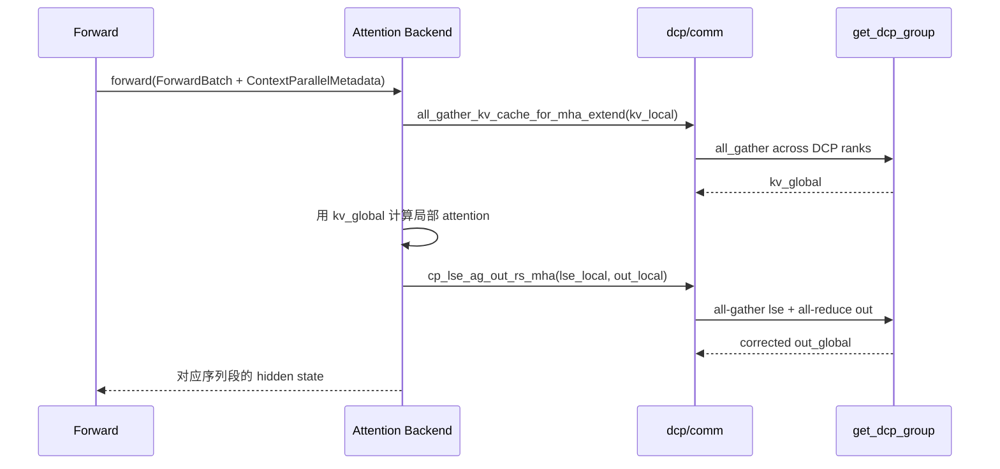

# 08.7 上下文并行 CP/DCP

## 定位

CP/DCP 是 08 子系统在长序列场景下"按序列维度切分 attention"的两条路径：CP（`layers/cp/`）把请求序列切成块分到多个 rank，每 rank 持有局部 KV 与局部 attention 输出，再用 logsumexp 聚合；DCP（`layers/dcp/`）在 DP 之上做类似的 attention-only context 切分。二者与 [`06 Layers 注意力后端`](../06-layers/06.3.1-attn-backend-abstraction.md) 紧密协作，需要后端在 forward 时把局部 KV cache 通过 `all_gather_kv_cache_for_dcp` 共享给跨组 rank。

## 职责

- `layers/cp/`：提供 CP 切分模式（zigzag / interleave / padding）与 `ContextParallelMetadata`。
- `layers/dcp/comm.py`：实现 `all_gather_kv_cache_for_dcp` 与 logsumexp 聚合 `cp_lse_ag_out_rs_mha`/`cp_lse_ag_out_rs_mla`。
- `ContextParallelMetadata`：携带每个 forward 的切分信息（local_seq_len、cum_seq_len、cu_seqlens）。
- 与 attention 后端协作：后端在 extend 阶段调 `all_gather_kv_cache_for_mha_extend` / `all_gather_kv_cache_for_mla_extend` 把切片 KV 拼回完整视图。

## 关键类与函数

| 名称 | 定义位置 | 说明 |
|---|---|---|
| `ContextParallelMetadata` 等 | `layers/cp/utils.py:32-33` | CP 元数据集合（同文件还有 `InterleaveContextParallelMetadata`、`ZigzagContextParallelMetadata`） |
| `is_glm_dsa_cache_layer_split_enabled` | `layers/cp/utils.py:51` | GLM DSA cache layer split 判定 |
| `get_glm_dsa_cp_layer_shard_info` | `layers/cp/utils.py:67` | GLM DSA CP 分片信息 |
| `ZigzagCp` / `InterleaveCp` / `PaddingCp` | `layers/cp/{zigzag,interleave,padding}.py` | 三种 CP 切分实现 |
| `cp_lse_ag_out_rs_mha` | `layers/dcp/comm.py:77` | MHA 的 logsumexp AG + output RS |
| `cp_lse_ag_out_rs_mla` | `layers/dcp/comm.py:106` | MLA 的 logsumexp 聚合 |
| `all_gather_kv_cache_for_dcp` | `layers/dcp/comm.py:277` | 跨 DCP 组 all-gather KV cache |
| `all_gather_kv_cache_for_mha_extend` | `layers/dcp/comm.py:172` | MHA extend 期 KV cache AG |
| `all_gather_kv_cache_for_mla_extend` | `layers/dcp/comm.py:238` | MLA extend 期 KV cache AG |
| `all_gather_q_for_mla_decode` | `layers/dcp/comm.py:221` | MLA decode 期 query AG |
| `dcp_enabled` / `get_attention_dcp_world_size` / `get_attention_dcp_rank` | `layers/dcp/comm.py:44` / `:50` / `:58` | DCP 上下文访问 |
| 与组协作 | `parallel_state.get_dcp_group` | 取 DCP 组（[`08.2`](08.2-parallel-state.md)） |

## 子模块树

- `layers/cp/` — Context Parallel 模板与三种切分
  - `base.py`、`zigzag.py`、`interleave.py`、`padding.py`、`utils.py`
- `layers/dcp/` — Data-Context Parallel 通信实现
  - `comm.py`（all-gather KV/Q、lse 聚合）、`layout.py`、`metadata.py`、`planner.py`

## 数据流 / 控制流

CP/DCP 的关键点：每个 DCP rank 持有自己那段 KV，但 attention 计算需要全局 KV，所以 extend 阶段先 `all_gather_kv_cache_for_*_extend`；然后各 rank 算自己那段 query 的 partial attention 输出与 logsumexp，再用 `cp_lse_ag_out_rs_mha` 把各段输出按 logsumexp 权重合并为正确 hidden state。MLA 与 MHA 聚合公式不同，故有 mha/mla 双路。`Scheduler` 通过 `ContextParallelMetadata` 把切分信息带入 forward，attention 后端据此选择 join gather 路径。

## 交叉引用

- 上游: [`08.1 并行分类`](08.1-parallelism-taxonomy.md) — CP/DCP 概念
- 上游: [`08.2 parallel_state`](08.2-parallel-state.md) — `get_dcp_group`/`get_attn_cp_group`
- 下游: [`06.3 attention 后端`](../06-layers/06.3.1-attn-backend-abstraction.md) — 调用 `all_gather_kv_cache_*`
- 相关: [`06.7 context parallel cp`](../06-layers/06.7-context-parallel-cp.md) — CP 的 layers 视角
- 相关: [`07.4 UnifiedRadixCache`](07.4-unified-radix-cache.md) — `attn_cp_cache_group` 用于 KV 树
- 相关 skill: `.claude/skills/debug-distributed-hang`

## 进一步阅读

- 源码: `python/sglang/srt/layers/cp/`、`python/sglang/srt/layers/dcp/`
