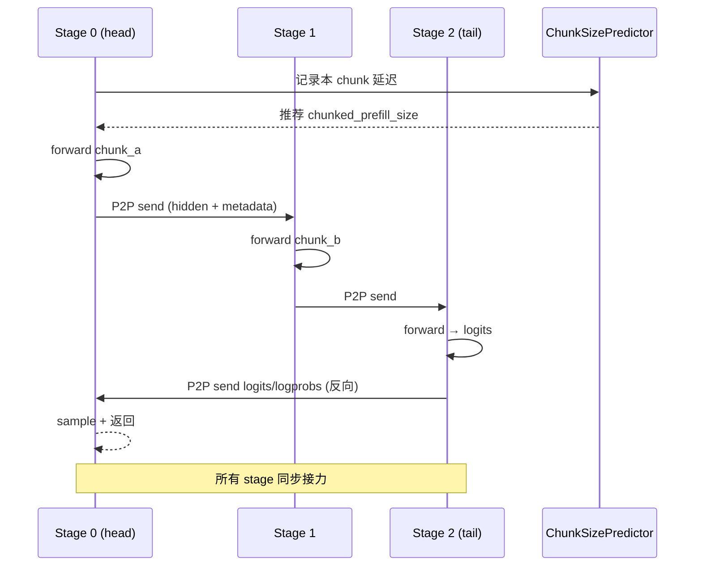

# 08.8 流水并行

## 定位

PP（Pipeline Parallel）把模型的 layer 段分布到多个 rank 上，每个 rank 只持有若干层。[`03 Scheduler`](../03-orchestration/03.4.1-scheduler-structure.md) 通过 `SchedulerPPMixin` 把"完整 forward"切成多个 stage 的接力：rank 0 跑首段并把 hidden state 经 `P2PWork.send_recv` 发给下一个 rank，依次传到末段产出 logits。`ChunkSizePredictor` 用历史 forward 时延拟合多项式，把 `chunked_prefill_size` 动态调到目标 latency。

## 职责

- `SchedulerPPMixin`：在 Scheduler 中管理 stage 边界、P2P 传输、intermediate batch metadata、与 PP group 协同的 step。
- `ChunkSizePredictor`：实时估计 stage 内 chunk 延迟，避免末段空等。
- `P2PWork` 封装（[`08.2`](08.2-parallel-state.md)）：异步 send/recv tensor dict。
- `_pp_can_skip_output_comm`：当 batch 只在某一段有效时跳过输出通信。
- `_calculate_rank_ranges`：[`02 Engine`](../02-server-api/02.1-engine.md) 起 scheduler 时计算每个 rank 属于哪个 PP/TP 域。

## 关键类与函数

| 名称 | 定义位置 | 说明 |
|---|---|---|
| `SchedulerPPMixin` | `managers/scheduler_pp_mixin.py:66` | Scheduler PP 适配 mixin |
| `PPBatchMetadata` | `managers/scheduler_pp_mixin.py:62` | 跨 stage 的 batch 元信息 |
| `_pp_can_skip_output_comm` | `managers/scheduler_pp_mixin.py:49` | 输出通信跳过判定 |
| `ChunkSizePredictor` | `managers/scheduler_pp_mixin.py:1445` | 动态 chunk size 预测 |
| `GroupCoordinator.send_recv` | `parallel_state.py:1310` | PP P2P 通信（[`08.2`](08.2-parallel-state.md)） |
| `P2PWork` | `parallel_state.py:108` | P2P 异步工作句柄 |
| `get_pp_group` | `parallel_state.py:1789` | PP 组 accessor |
| `get_pp_indices` | `distributed/utils.py:95` | 层切分 |
| `_calculate_rank_ranges` | `entrypoints/engine.py:1401` | 启动期 rank 域划分 |

## 子模块树

- `managers/scheduler_pp_mixin.py` — PP mixin 主体（+1500 行）
- 调用方：`managers/scheduler.py`（[`03.4.1`](../03-orchestration/03.4.1-scheduler-structure.md)）
- 协作：`entrypoints/engine.py` 的 rank 切分、`parallel_state` 的 P2P、`CacheInitParams.pp_rank/pp_size`（[`07.2`](07.2-base-prefix-cache-registry.md)）

## 数据流 / 控制流

head scheduler 决定 batch 与 chunked_prefill size，先跑首段，把中间 hidden state 经 `P2PWork.send_recv` 传给下一段；每段在自己的 `ModelRunner` 中 forward 当前 layer range；tail 段产出 logits 后再反传。`PPBatchMetadata` 把 forward 期 batch 上下文（input_ids、positions、注意 mask 等）随 P2P 同步。`ChunkSizePredictor` 在 background 拟合 `chunk_size → latency`，使各段在目标延迟下尽可能不空等。`_calculate_rank_ranges` 在 Engine 启动期决定每 rank 是否为 head/tail/middle，并据此 spawn scheduler 进程。

## 交叉引用

- 上游: [`08.1 并行分类`](08.1-parallelism-taxonomy.md) — PP 概念
- 上游: [`02.1 Engine`](../02-server-api/02.1-engine.md) — `_calculate_rank_ranges` 切分源头
- 下游: [`04.1 ModelRunner`](../04-model-execution/04.1-model-runner.md) — 各 stage 仅跑自己层段
- 相关: [`03.4.1 Scheduler`](../03-orchestration/03.4.1-scheduler-structure.md) — SchedulerPPMixin 被混入
- 相关: [`07.2 CacheInitParams`](07.2-base-prefix-cache-registry.md) — `pp_rank`/`pp_size` 字段
- 相关 skill: `.claude/skills/debug-distributed-hang`

## 进一步阅读

- 源码: `python/sglang/srt/managers/scheduler_pp_mixin.py`、`python/sglang/srt/distributed/utils.py`、`python/sglang/srt/entrypoints/engine.py`
