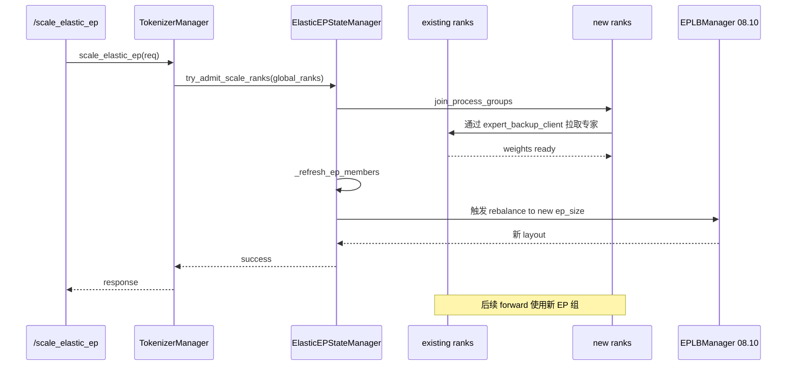

# 08.9 Elastic EP

## 定位

Elastic EP 让 SGLang 在运行期动态扩缩 MoE-EP 组：当新增或退出 rank 时，无需重启即把 `--ep-size` 从 N 变到 M，重平衡专家分布并恢复 forward。`elastic_ep/` 提供状态管理器，`entrypoints/elastic_ep.py` 暴露 HTTP `/scale_elastic_ep`，经 `TokenizerManager` 触发；`06` MoE layer 在扩缩后用新组重建 dispatcher。

## 职责

- `ElasticEPStateManager`：维护扩缩 cohort、scale ranks、live parallel groups、健康状态、rebalance 与 recover 流程。
- `register_scale_cohort` / `try_admit_scale_ranks` / `try_recover_ranks`：扩容 admission 与故障 recover。
- `entrypoints/elastic_ep.py:scale_elastic_ep`：HTTP 入口，转 `TokenizerManager.scale_elastic_ep`。
- `MooncakeTransferEngine`/专家备份：扩容时把新 rank 拉起所需 expert weights。
- 与 [`08.10 EPLB`](08.10-eplb-lplb.md) 协作：扩缩完成后触发 rebalance 以匹配新 EP size。

## 关键类与函数

| 名称 | 定义位置 | 说明 |
|---|---|---|
| `scale_elastic_ep` (HTTP) | `entrypoints/elastic_ep.py:16` | `/scale_elastic_ep` 路由 |
| `register_scale_cohort` | `elastic_ep/elastic_ep.py:24` | 注册扩容 cohort |
| `ElasticEPState` | `elastic_ep/elastic_ep.py:42` | 单 cohort 状态 |
| `ElasticEPStateManager` | `elastic_ep/elastic_ep.py:75` | 全局状态机 |
| `elastic_expanded_world_enabled` | `elastic_ep/elastic_ep.py:305` | 是否已启用 expanded world |
| `_refresh_ep_members` | `elastic_ep/elastic_ep.py:328` | 刷新 EP 成员 |
| `_iter_live_parallel_groups` | `elastic_ep/elastic_ep.py:339` | 取当前在用 group |
| `try_admit_scale_ranks` | `elastic_ep/elastic_ep.py:383` | admission 流程 |
| `try_recover_ranks` | `elastic_ep/elastic_ep.py:392` | 故障恢复流程 |
| `join_process_groups` | `elastic_ep/elastic_ep.py:426` | 新 rank 加入现有 PG |
| `maybe_recover_ep_ranks` | `elastic_ep/elastic_ep.py:441` | 故障时 EP recover |
| `maybe_rebalance_after_rank_fault` | `elastic_ep/elastic_ep.py:509` | 故障后重平衡 |
| `expert_backup_manager.py` / `expert_backup_client.py` | `elastic_ep/` | 扩容时备份/拉取专家 |
| `tokenizer_manager.scale_elastic_ep` | `03 TokenizerManager` | 入口转发（[`03.3.5`](../03-orchestration/03.3.5-tm-control-mixin.md)） |

## 子模块树

- `elastic_ep/elastic_ep.py` — 状态机主体
- `elastic_ep/expert_backup_manager.py` — 旧 rank 备份侧
- `elastic_ep/expert_backup_client.py` — 新 rank 拉取侧
- `entrypoints/elastic_ep.py` — HTTP 路由
- 调用方：`TokenizerManager.scale_elastic_ep` + `ModelRunner` 重建 group

## 数据流 / 控制流

扩容流程：HTTP 触发后，admission 把新 rank 加入 world group 与待扩 cohort，新 rank 经 `expert_backup_client` 从老 rank 拷贝所需 expert weights；完成后调用 [`08.2 parallel_state`](08.2-parallel-state.md) 的初始化路径重建 EP-PG，并触发 [`08.10 EPLB`](08.10-eplb-lplb.md) 在新 `ep_size` 下重新分布专家。故障路径走 `try_recover_ranks` + `maybe_rebalance_after_rank_fault`，保证剩余 rank 能继续推理。

## 交叉引用

- 上游: [`08.1 并行分类`](08.1-parallelism-taxonomy.md) — MoE-EP 概念
- 上游: [`08.2 parallel_state`](08.2-parallel-state.md) — 重建 PG
- 上游: [`02.2.6 load/elastic`](../02-server-api/02.2.6-loads-elastic-ep.md) — HTTP 入口登记
- 下游: [`08.10 EPLB/LPLB`](08.10-eplb-lplb.md) — 扩缩后 rebalance
- 下游: [`06.4 MoE`](../06-layers/06.4.1-moe-module-flow.md) — layer 期消费新 EP 组
- 相关: [`08.11 weight_sync`](08.11-weight-sync.md) — 扩容常借 weight_sync 通路
- 相关 skill: `.claude/skills/debug-distributed-hang`

## 进一步阅读

- 源码: `python/sglang/srt/elastic_ep/`、`python/sglang/srt/entrypoints/elastic_ep.py`
