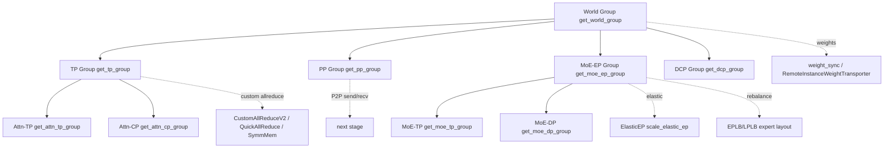

# 08 分布式与并行

## 定位

子系统 08 是 SGLang 的"并行轴管理层"。它把 [`04 ModelRunner`](../04-model-execution/04.1-model-runner.md) 与 [`06 Layers`](../06-layers/index.md) 的单 GPU 视角扩展到多 GPU、多节点、多进程：定义各并行组的拓扑、初始化 NCCL/自定义通信器、提供 all-reduce/all-gather/broadcast 算子封装、并实现 DP attention、CP/DCP、流水并行、Elastic EP、EPLB/LPLB、在线权重同步与两批 overlap 等高级特性。本子系统是 [`09 PD 分离`](../09-disaggregation/index.md) 与多实例部署的基础设施。

## 职责

- 维护 `parallel_state` 的 `GroupCoordinator` 与各全局 group accessor（TP/PP/DP/EP/CP/DCP/Attn-TP/Attn-CP/MoE-TP/MoE-DP/MoE-EP）。
- 在 `bootstrap.init_torch_distributed` 中初始化 torch distributed、解析 backend、预热 NCCL、调用 `initialize_model_parallel`。
- 提供设备通信器：PyNccl、CustomAllReduceV2、QuickAllReduce、PyMscclpp、TorchSymmMem、shm_broadcast、Mooncake、CUDA VMM 等。
- 把通信原语封装成 `communication_op` 与 `parallel_state_wrapper.ParallelState` runtime-context 访问器。
- 实现 DP attention、上下文并行（CP/DCP）、流水并行（PP mixin）、弹性 EP、专家负载均衡（EPLB/LPLB）、在线权重同步、TBO 双批 overlap。

## 并行轴总览图

## 子系统内导航

| 编号 | 页面 | 一句话定位 |
|---|---|---|
| 08.1 | [并行分类](08.1-parallelism-taxonomy.md) | TP/PP/DP/EP/CP/DCP/attn-TP/attn-CP/MoE-* 概念与并发轴 |
| 08.2 | [parallel_state](08.2-parallel-state.md) | `GroupCoordinator` 与各 group accessor |
| 08.3 | [Bootstrap 与初始化](08.3-bootstrap-init.md) | `init_torch_distributed` → `_init_parallel_groups` |
| 08.4 | [设备通信器](08.4-device-communicators.md) | `device_communicators/` 全家族 |
| 08.5 | [通信算子封装](08.5-comm-ops.md) | `communication_op` 与 `ParallelState` 包装 |
| 08.6 | [DP attention](08.6-dp-attention.md) | 数据并行注意力 + MLP 同步 |
| 08.7 | [上下文并行 cp/dcp](08.7-context-parallel-cp-dcp.md) | `layers/cp`、`layers/dcp` 与 attn 后端 |
| 08.8 | [流水并行](08.8-pipeline-parallel.md) | `SchedulerPPMixin` + P2P + ChunkSizePredictor |
| 08.9 | [Elastic EP](08.9-elastic-ep.md) | `/scale_elastic_ep` + `ElasticEPStateManager` |
| 08.10 | [EPLB/LPLB](08.10-eplb-lplb.md) | 专家负载均衡与 `init_lplb_solvers` |
| 08.11 | [weight_sync](08.11-weight-sync.md) | 在线权重同步与 `RemoteInstanceWeightTransporter` |
| 08.12 | [batch_overlap TBO](08.12-batch-overlap-tbo.md) | 两批 overlap 与 `TboAttnBackend` |

## 交叉引用

- 上游: [`04 模型执行`](../04-model-execution/index.md) — ModelRunner init 调 boot/init_model_parallel
- 上游: [`06 Layers`](../06-layers/index.md) — MoE/Attention 直接消费通信算子
- 下游: [`09 PD 分离`](../09-disaggregation/index.md) — PD 复用 parallel_state 与通信器
- 相关: [`07 KV Cache`](../07-kv-cache/index.md) — 部分并行组共享 KV 池（attn_cp_cache_group 等）
- 相关: [`15 内核与硬件`](../15-kernels-hardware/15.2-sgl-kernel-aot.md) — 自定义 allreduce 内核在 sgl-kernel
- 相关: [`02 server api`](../02-server-api/index.md) — `/scale_elastic_ep` HTTP 入口

## 进一步阅读

- 源码: `python/sglang/srt/distributed/`、`python/sglang/srt/layers/cp/`、`python/sglang/srt/layers/dcp/`、`python/sglang/srt/elastic_ep/`、`python/sglang/srt/eplb/`、`python/sglang/srt/weight_sync/`、`python/sglang/srt/batch_overlap/`
- 相关 skill: `.claude/skills/debug-distributed-hang`、`.claude/skills/sglang-runtime-context`
