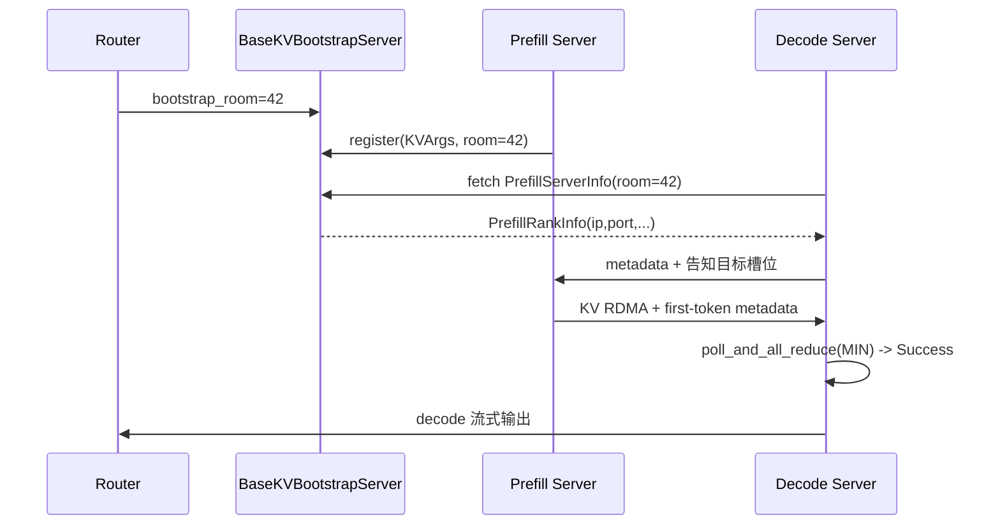

# 09.1 PD 分离概念

## 定位

本页给出分离式推理的顶层概念：把一次推理切成 prefill 与 decode 两段、由独立 server 各自承担，通过 bootstrap room 会合与 `TransferBackend` 传输 KV。整套抽象由 [`disaggregation/utils.py`](../../python/sglang/srt/disaggregation/utils.py) 的三个枚举与 `disaggregation/base/`、`disaggregation/common/` 的契约定义。

## 职责

- 定义一个 server 在 PD 拓扑中的角色：`DisaggregationMode`（NULL/PREFILL/DECODE）。
- 选择 KV 传输管道：`TransferBackend`（Mooncake/Mori/Nixl/Ascend/Fake）。
- 用 `get_kv_class` 工厂按后端 + 角色元组派发 Manager/Sender/Receiver/BootstrapServer/KVArgs 五件套。
- 把 `bootstrap_room` 作为跨 server 的会合 token，prefill 写、decode 读。

## 关键类与函数

| 名称 | 定义位置 | 说明 |
|---|---|---|
| `DisaggregationMode` | `disaggregation/utils.py:68` | `NULL`/`PREFILL`/`DECODE` 三态；`to_engine_type` 给 transfer engine 用 |
| `TransferBackend` | `disaggregation/utils.py:509` | 五个后端枚举，对应 `disaggregation/<name>/` 模块 |
| `KVClassType` | `disaggregation/utils.py:517` | `KVARGS`/`MANAGER`/`SENDER`/`RECEIVER`/`BOOTSTRAP_SERVER` 五件套类型 |
| `get_kv_class` | `disaggregation/utils.py:526` | 按 `(TransferBackend, KVClassType)` 派发对应类，带 `@overload` 类型提示 |
| `StateType` | `disaggregation/base/conn.py:17` | 附加态类型：`MAMBA`/`SWA`/`DSA`/`MINIMAX_INDEX_K`/`SWA_RING`/`C128_STATE` |

## 会合协议

每个请求由 router 生成一个全局唯一 `bootstrap_room`，prefill 与 decode server 都向同一个 `BaseKVBootstrapServer`（HTTP）登记；prefill 把 `KVArgs`（含 `kv_data_ptrs`、`kv_head_num`、`page_size`、`pp_rank`、`prefill_start_layer` 等）登记到 bootstrap server，decode 拉取 `PrefillServerInfo` 并经 `_resolve_rank_mapping` 计算 TP/CP/PP 目标 rank。此后双方脱离 bootstrap server，直接经 transfer backend 的 RDMA/IPC 通道传 KV 与首 token 元数据。

## 数据流 / 控制流

- prefill side: forward → 写 `MetadataBuffers`（首 token id/logprob/hidden/DSA topk）→ `BaseKVSender.send(kv_indices)` → `poll()` 返回 `KVPoll.Success`。
- decode side: `BaseKVReceiver.register_to_bootstrap` → `init(prefill_dp_rank)` → `send_metadata` 回告 decode 槽位 → `poll()` 等 KV 到齐 → `ScheduleBatch.prepare_for_prebuilt` 进入后续 extend。
- 非 KV 的附加状态（Mamba/SWA/DSA/C128）按 `StateType` 经 `state_data_ptrs` 一并传，见 [09.6](09.6-disagg-utils.md)。

## 交叉引用

- 详见: [09.2 base 连接抽象](09.2-base-conn.md)、[09.3 common 连接实现](09.3-common-conn.md)、[09.4 transfer 后端](09.4-transfer-backends.md)
- 上游: [`03.4.1 Scheduler 结构`](../03-orchestration/03.4.1-scheduler-structure.md) — `Scheduler` 用 `DisaggregationMode` 选 event loop
- 相关: [`07 KV Cache`](../07-kv-cache/index.md)、[`08 分布式`](../08-distributed/index.md)

## 进一步阅读

- 源码: `python/sglang/srt/disaggregation/utils.py`、`python/sglang/srt/disaggregation/base/`
