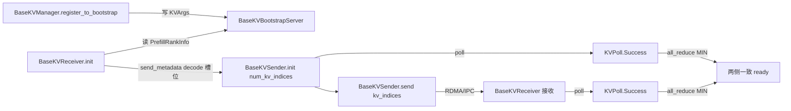

# 09.2 base 连接抽象

## 定位

`disaggregation/base/conn.py` 是 PD 分离的"契约层"：它定义所有传输后端共用的 `KVArgs`/`KVPoll` 状态机与 `BaseKVManager/Sender/Receiver/BootstrapServer` 四个抽象基类。`Mooncake`/`Nixl`/`Mori`/`Ascend`/`Fake` 后端都继承这一层，详见 [09.4](09.4-transfer-backends.md)。本页只描述 base 层本身。

## 职责

- 用 `KVArgs` 把参与传输的 GPU/主机内存地址、TP/CP/PP 拓扑、层范围、MLA 压缩比等打包成跨后端统一契约。
- 用 `KVPoll` 五态机（`Failed`/`Bootstrapping`/`WaitingForInput`/`Transferring`/`Success`）让 sender/receiver 通过 poll 推进。
- 用 `BaseKVTransferMetric` 暴露可选的传输延迟/分配延迟/字节数度量。
- 用 `BaseKVBootstrapServer` 抽象 room 会合点。

## 关键类与函数

| 名称 | 定义位置 | 说明 |
|---|---|---|
| `StateType` | `disaggregation/base/conn.py:17` | 附加态类型枚举：Mamba/SWA/DSA/`SWA_RING`/`C128_STATE` 等 |
| `KVTransferMetric` | `disaggregation/base/conn.py:30` | `transfer_latency_s`/`alloc_latency_s`/`transfer_total_bytes` |
| `KVArgs` | `disaggregation/base/conn.py:38` | 跨后端搬运契约：kv/aux/state 指针、`page_size`、`pp_rank`、`prefill_start_layer`/`prefill_end_layer`、`mla_compression_ratios` |
| `KVPoll` | `disaggregation/base/conn.py:84` | 五态机常量 |
| `BaseKVManager` | `disaggregation/base/conn.py:92` | 持有 transfer states；`register_to_bootstrap` 登记到会合点 |
| `BaseKVSender` | `disaggregation/base/conn.py:110` | `init`/`send`/`poll`/`failure_exception`/`get_transfer_metric`/`abort` |
| `BaseKVReceiver` | `disaggregation/base/conn.py:178` | `init`/`send_metadata`/`poll`/`failure_exception` |
| `BaseKVBootstrapServer` | `disaggregation/base/conn.py:237` | 按 `bootstrap_room` 维护 prefill→decode 会合表 |

注意：`register_to_bootstrap`（`:105`）是 `BaseKVManager` 的方法，不是 receiver 的；receiver 侧通过 `init(prefill_dp_rank)` 在收到会合信息后置 `WaitingForInput`。

## 子模块树

- `disaggregation/base/__init__.py` — re-export 五件套供 `get_kv_class` 使用
- `disaggregation/base/conn.py` — 本页全部抽象
- `disaggregation/common/conn.py` — 通用实现，见 [09.3](09.3-common-conn.md)

## 数据流 / 控制流

`BaseKVSender.send(kv_indices, state_indices)` 与 `BaseKVReceiver.send_metadata(kv_indices, aux_index, state_indices, decode_prefix_len)` 的索引命名是契约：sender 给出 prefill 池内的 page 索引，receiver 回告 decode 池内的落点索引，让 sender 知道把数据写到目标 pool 的哪里。`pop_decode_prefix_len`/`should_send_kv_chunk` 提供分块传输的默认策略，后端可覆盖。

## 交叉引用

- 详见: [09.3 common 连接实现](09.3-common-conn.md)、[09.4 transfer 后端](09.4-transfer-backends.md)
- 上游: [09.1 PD 概念](09.1-pd-concept.md) — `get_kv_class` 派发本页抽象
- 相关: [`08.2 parallel_state`](../08-distributed/08.2-parallel-state.md) — `KVArgs.engine_rank` 与 TP/CP 组
- 相关: [`07 KV Cache`](../07-kv-cache/index.md) — `kv_data_ptrs` 指向 `TokenToKVPool`

## 进一步阅读

- 源码: `python/sglang/srt/disaggregation/base/conn.py`
