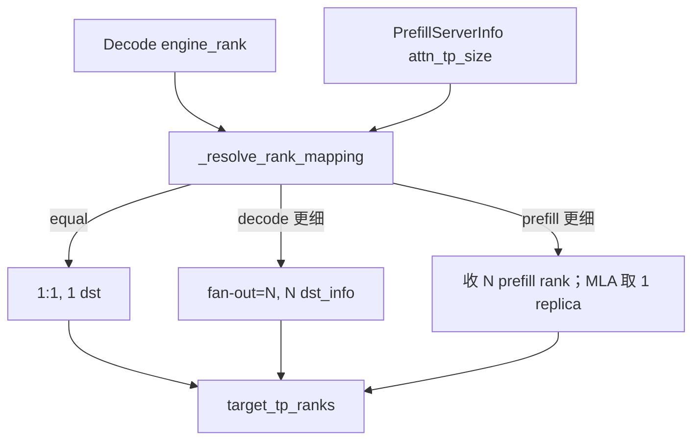

# 09.3 common 连接实现

## 定位

`disaggregation/common/conn.py` 是所有真实传输后端共享的"通用实现层"：它在 [09.2](09.2-base-conn.md) 的抽象之上提供 `CommonKVManager/Sender/Receiver/BootstrapServer` 四件套与 `PrefillServerInfo`/`PrefillRankInfo` 拓扑描述，并完成跨 TP/CP/PP 的 rank 映射。Mooncake/Mori/Nixl/Ascend 都直接继承 common 类，只覆写传输相关方法。

## 职责

- 维护 `prefill_info_table`：decode 侧按 `bootstrap_addr` 缓存 `PrefillServerInfo`。
- 在 `_resolve_rank_mapping` 中计算 prefill↔decode 的 TP/CP/PP rank 映射，处理异构 TP（prefill_tp ≠ decode_tp）的 fan-out 与 MLA replica。
- 经 `CommonKVBootstrapServer` 收集所有 prefill rank 的 `PrefillRankInfo`，组装为 `PrefillServerInfo` 返回给 decode。
- 用 `KVTransferError`（带 `bootstrap_room` 与 `is_from_another_rank`）统一失败语义。
- 提供 chunked 传输与 `aux_data`（首 token 元数据）打包/解包（见 [09.6](09.6-disagg-utils.md) 的 `TransferKVChunk`）。

## 关键类与函数

| 名称 | 定义位置 | 说明 |
|---|---|---|
| `KVTransferError` | `common/conn.py:50` | 失败异常，携带 `bootstrap_room`/`failure_reason`/`is_from_another_rank` |
| `PrefillServerInfo` | `common/conn.py:67` | prefill 拓扑快照：`attn_tp_size`/`attn_cp_size`/`pp_size`/`page_size`/`kv_cache_dtype`/`follow_bootstrap_room` 及解析后的 `target_tp_ranks`/`target_cp_ranks`/`target_pp_ranks` |
| `PrefillRankInfo` | `common/conn.py:109` | 单个 prefill rank 的 `rank_ip`/`rank_port` |
| `CommonKVManager` | `common/conn.py:118` | 通用 manager；`try_ensure_parallel_info`/`_resolve_rank_mapping` 在此 |
| `CommonKVSender` | `common/conn.py:978` | 通用 sender：chunk plan、aux 数据打包、`get_transfer_metric` |
| `CommonKVReceiver` | `common/conn.py:1160` | 通用 receiver：metadata 接收、watermark、`disconnect_endpoint` |
| `CommonKVBootstrapServer` | `common/conn.py:1435` | 会合服务器：聚合 `PrefillRankInfo`、按 `bootstrap_room` 唤醒 |
| `TransferKVChunk` | `common/utils.py:18` | 单 chunk 描述（page 范围/aux/状态索引） |

## rank 映射与 MLA replica

`_resolve_rank_mapping`（`common/conn.py:485`）处理三种 TP 关系，是异构 PD 的核心：

- `decode_tp == prefill_tp`：1:1，`target_tp_ranks=[engine_rank % tp_size]`。
- `decode_tp > prefill_tp`（decode 切更细）：一个 prefill rank 喂多个 decode rank，fan-out = `decode_tp // prefill_tp`，`required_dst_info_num` 相应放大。
- `decode_tp < prefill_tp`（prefill 切更细）：一个 decode rank 要从多个 prefill rank 收齐。对非 MLA 模型必须收齐全部；对 MLA 模型因吸收矩阵可压缩，只取一份"replica"即可正确，但仍需对其余 prefill rank 发 dummy 请求让 KVPoll 翻转——这就是"MLA replica factor"。

CP 映射断言 `decode_cp_size == 1`；CP>1 仅出现在 prefill 端，decode 侧 `target_cp_ranks = range(prefill_cp_size)` 全收。PP 映射按 `prefill_start_layer`/`prefill_end_layer` 把层分片对齐。

## 交叉引用

- 上游: [09.2 base 抽象](09.2-base-conn.md)、[09.1 PD 概念](09.1-pd-concept.md)
- 下游: [09.4 transfer 后端](09.4-transfer-backends.md) — 后端继承本页类
- 下游: [09.6 disagg utils](09.6-disagg-utils.md) — `TransferKVChunk`/CP/Mamba 切片
- 相关: [`08.2 parallel_state`](../08-distributed/08.2-parallel-state.md)、[`07 KV Cache`](../07-kv-cache/index.md)

## 进一步阅读

- 源码: `python/sglang/srt/disaggregation/common/conn.py`、`python/sglang/srt/disaggregation/common/utils.py`
