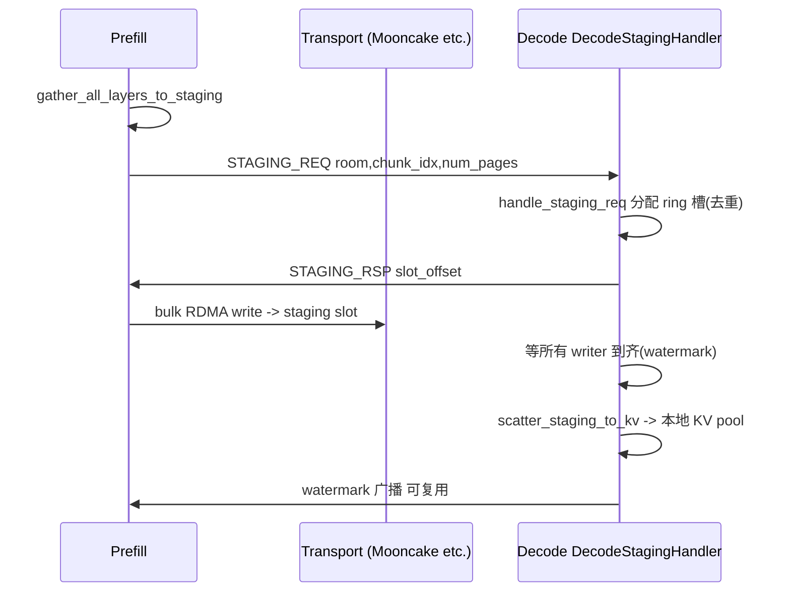

# 09.4 Transfer 后端与 staging handler

## 定位

`disaggregation/<name>/conn.py` 是 [09.3](09.3-common-conn.md) 通用类的具体后端实现；staging handler/`staging_buffer.py` 则是异构 TP 下把零散 per-token RDMA 聚成 bulk 传输的通用提速层，由 `SGLANG_DISAGG_STAGING_BUFFER` 开关激活，可被所有后端复用。

## 职责

- 各后端实现 `Manager/Sender/Receiver/BootstrapServer` 四件套，对接真实传输引擎。
- staging handler 隔离 staging scatter 生命周期，提供 prefill 侧 buffer 注册、decode 侧 ring allocator、watermark 广播、按 chunk 分配与去重。
- decode 侧与 [`08 分布式`](../08-distributed/index.md) 的 `mooncake_transfer_engine.py` 协作：Mooncake 后端经 `get_mooncake_transfer_engine()` 取全局单例，做 NVLink/RDMA 内存注册。

## 关键类与函数

| 名称 | 定义位置 | 说明 |
|---|---|---|
| `MooncakeTransferEngine` | `distributed/device_communicators/mooncake_transfer_engine.py:104` | 全局传输引擎单例，`get_mooncake_transfer_engine()` |
| `MoriKVManager/Sender/Receiver/BootstrapServer` | `disaggregation/mori/conn.py:302/1389/1641/1790` | Mori 后端，含 `BatchTransferPlan`/`GroupedIndexPlan` |
| `NixlKV*` | `disaggregation/nixl/conn.py`（位置待核） | Nixl 后端，`check_status`/`update_status` |
| `AscendKV*` | `disaggregation/ascend/conn.py:21/182/186/190` | Ascend 后端，复用 Mooncake，走 D2D 通道 |
| `FakeKVSender/Receiver` | `disaggregation/fake/`（位置待核） | 单进程测试用，不发实际 KV |
| `DecodeStagingContext` | `common/staging_handler.py:31` | decode 侧 staging 上下文（allocator/room_receivers） |
| `PrefillStagingContext` | `common/staging_handler.py:40` | prefill 侧（buffers/remote_watermarks/prefetch 去重） |
| `DecodeStagingHandler` | `common/staging_handler.py:56` | decode scatter 生命周期；`create`/`num_writers_for`/register watermark |
| `StagingTransferInfo` | `common/staging_handler.py:450` | 单次传输元数据 |
| `PrefillStagingStrategy` | `common/staging_handler.py:492` | prefill chunk/layer 发送策略 |
| `init_staging_buffers` | `common/staging_handler.py:604` | prefill 侧建 N 个 `StagingBuffer` 并注册到 transport |
| `init_staging_allocator` | `common/staging_handler.py:633` | decode 侧建 ring `StagingAllocator` 并注册 |
| `handle_staging_req` | `common/staging_handler.py:657` | decode 收 `STAGING_REQ` 按需分配并回 `STAGING_RSP`，按 (room,chunk) 去重 |

## staging 流程

prefill 在 forward 期间用 `gather_all_layers_to_staging` 把多层多 head 切片聚到一段连续 GPU 内存，发 `STAGING_REQ` 告 decode"我要写第 chunk_idx"；decode 在 `handle_staging_req` 里分配 ring 槽位并回 `STAGING_RSP`；收齐所有 writer 后 `scatter_staging_to_kv` 把数据散到自己 KV 池。watermark 广播让 prefill 知道 decode 已经消费完哪段、可复用。

## 交叉引用

- 上游: [09.3 common 连接](09.3-common-conn.md)、[09.5 staging buffer 内核](09.5-staging-buffer-handler.md)
- 相关: [`08 分布式`](../08-distributed/index.md) — `mooncake_transfer_engine` 单例
- 相关: [`15 内核`](../15-kernels-hardware/index.md) — Triton fused gather/scatter 见 [09.5](09.5-staging-buffer-handler.md)
- 相关: [`07 KV Cache`](../07-kv-cache/index.md) — staging 数据最终散回 `TokenToKVPool`

## 进一步阅读

- 源码: `python/sglang/srt/disaggregation/{mooncake,nixl,mori,ascend,fake}/`、`python/sglang/srt/disaggregation/common/staging_handler.py`
- 引擎: `python/sglang/srt/distributed/device_communicators/mooncake_transfer_engine.py`
