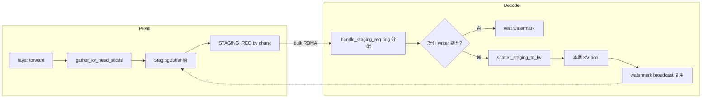

# 09.5 Staging Buffer 与 Triton 融合内核

## 定位

`disaggregation/common/staging_buffer.py` 实现 staging 层的物理 buffer 与两个 Triton fused kernel：`_fused_gather_to_staging_kernel` 与 `_fused_scatter_from_staging_kernel`。本页在 [09.4](09.4-transfer-backends.md) 概述之上，进一步展开内核机制与 prefill/decode 两侧的节奏控制。当 `prefill_attn_tp_size != decode_attn_tp_size` 时，逐 token RDMA 会产生 O(tokens × layers) 小请求；staging 把它降到 O(layers) 或 O(1)，是异构 TP 能用的关键。

## 职责

- `StagingBuffer`（prefill 侧）：预分配整段 GPU 内存，按 layer × per_layer_elems 切分，支持 `custom_mem_pool`（Mooncake NVLink allocator）。
- `StagingAllocator`（decode 侧）：环形分配器，按 chunk 申请/释放，跨 room 复用。
- 两个 Triton kernel：fused 把多层多层级的"取页索引→算偏移→load/store"压到单次 launch。
- `compute_head_slice_params`/`compute_staging_layout`/`resolve_total_kv_heads`：算每 rank 的 head 切片范围与 staging 布局。
- Tanh-fallback：`SGLANG_STAGING_USE_TORCH` 时退回 `_gather_all_layers_torch`/`_scatter_staging_to_kv_torch`，便于核验正确性。

## 关键类与函数

| 名称 | 定义位置 | 说明 |
|---|---|---|
| `_fused_gather_to_staging_kernel` | `common/staging_buffer.py:32` | prefill: 按 `page_indices` 把每层每 head 切片聚到 staging 连续区 |
| `_fused_scatter_from_staging_kernel` | `common/staging_buffer.py:70` | decode: 按 writer_head_offsets 把 staging 散回各层本地 pool |
| `StagingBuffer` | `common/staging_buffer.py:117` | prefill 侧 buffer，含 `get_ptr`/`get_size` 给 transport 注册 |
| `StagingAllocator` | `common/staging_buffer.py:161` | decode 侧环形分配器，`alloc(num_pages)`/`free` |
| `gather_all_layers_to_staging` | `common/staging_buffer.py:461` | 选 Triton/torch 路径执行 prefill 聚合 |
| `scatter_staging_to_kv` | `common/staging_buffer.py:649` | 选 Triton/torch 路径执行 decode 散射 |
| `compute_head_slice_params` | `common/staging_buffer.py:686` | 按 `total_kv_heads`/`decode_tp` 算本 rank head 切片 |
| `compute_staging_layout` | `common/staging_buffer.py:722` | 算每 layer 元素数、布局 |

## 内核与节奏控制

`_fused_gather_to_staging_kernel` 用 `program_id(0)=layer_id`、`program_id(1)=block_id` 并行；每个 block 算 `t_idx=offsets//ELEMS_PER_TOKEN` → `page_id=t_idx//PAGE_SIZE` → `pool_token=page*PAGE_SIZE+intra`，再把 `layer_ptr[pool_token*stride + head_offset + e_idx]` 存到 staging 的 `[layer_id*per_layer_elems + offset]`。scatter kernel 用 `prog_id//NUM_LAYERS_X2=writer_id`、`prog_id%NUM_LAYERS_X2=layer_kv_id`，按 decode 侧每 writer 的 `head_offset` 反向散回本地 pool。

节奏控制：prefill 侧在 GPU forward 的每层结束后逐步 `gather_kv_head_slices`，再由 `PrefillStagingStrategy` 决定按 chunk 发 `STAGING_REQ`；decode 侧 `DecodeStagingHandler` 必须等所有 writer 到齐（`num_writers_for = prefill_tp // decode_tp`）再 scatter，否则 head 缺失。watermark + condition variable 让 prefill 知道某 chunk 已被消费、staging 槽可重用，从而 pipeline 下一 chunk。

## 交叉引用

- 上游: [09.4 transfer 后端](09.4-transfer-backends.md) — handler 调用本页 kernel/buffer
- 相关: [`15.4 jit_kernel`](../15-kernels-hardware/15.4-jit-kernel.md) — 同属 Triton JIT 家族
- 相关: [`07 KV Cache`](../07-kv-cache/index.md) — staging 终点/起点即 `TokenToKVPool`

## 进一步阅读

- 源码: `python/sglang/srt/disaggregation/common/staging_buffer.py`
- 开关: `SGLANG_DISAGG_STAGING_BUFFER`、`SGLANG_STAGING_USE_TORCH`、`SGLANG_DISAGG_STAGING_BUFFER_SIZE_MB`
