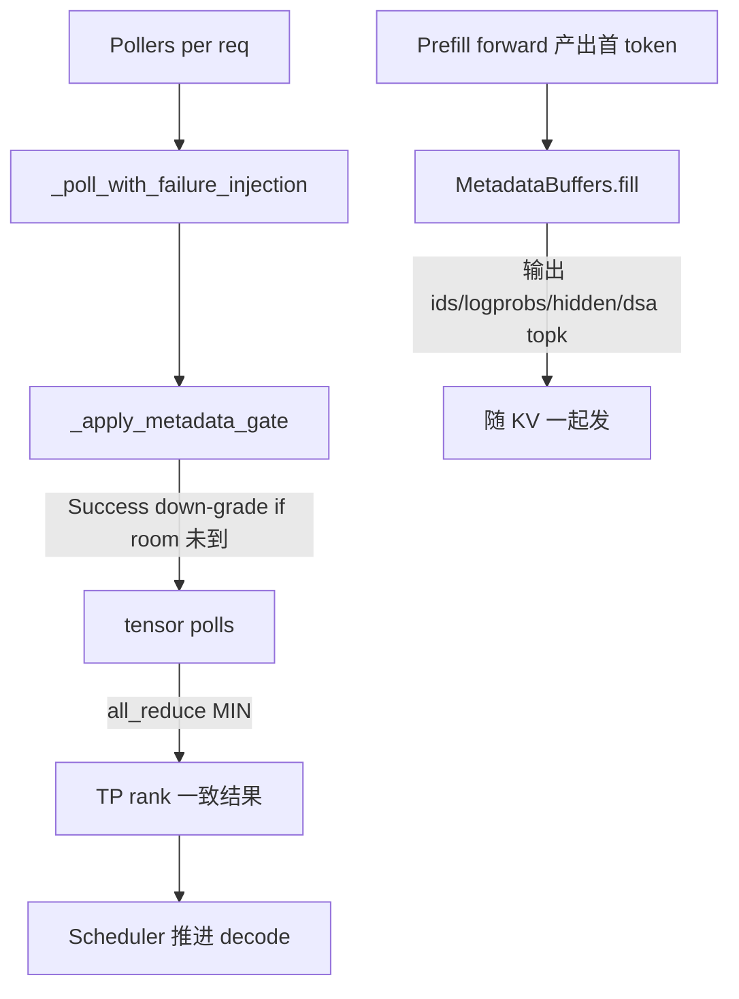

# 09.6 Disaggregation utils

## 定位

`disaggregation/utils.py` 是 PD 分离侧的"工具与状态层"：它聚合跨后端的轮询/同步、首 token 元数据缓冲、CP/Mamba/DSA 附加态切片与 `KVArgs` 装配。`SchedulerDisaggregationPrefillMixin`/`DecodeMixin` 都重度调用本模块（见 [09.9](09.9-scheduler-disagg-mixins.md)）。

## 职责

- `poll_and_all_reduce` 族：把各 sender/receiver 的 poll 结果在 TP/CP gloo 组上取 MIN，注入失败测试与"元数据未到"门控。
- `MetadataBuffers`：在 prefill 侧 GPU/CPU 上预分配首 token 的 `output_ids`/`output_token_logprobs_*`/`output_top_logprobs_*`/`output_hidden_states`/`output_dsa_topk_indices`/`bootstrap_room` 验证槽，逐请求填入后随 KV 一起搬。
- `ReqToMetadataIdxAllocator`：把请求映射到 metadata buffer 槽位的简单池。
- CP/Mamba/DSA 切片：`_get_cp_rank_page_bounds`/`page_indices_to_cp_rank_page_indices`/`filter_kv_indices_for_cp_rank` 把 prefill 端 CP>1 的页索引按 cp rank 切分；`compute_mamba_state_slice_blocks`/`append_state_component`/`setup_state_kv_args` 处理 Mamba/DSA 等附加态的按 rank 切片与 KVArgs 装填。
- `is_mla_backend`/`prepare_abort`/`is_aborted` 等辅助。

## 关键类与函数

| 名称 | 定义位置 | 说明 |
|---|---|---|
| `poll_and_all_reduce` | `disaggregation/utils.py:129` | poll + gloo MIN；含 `_poll_with_failure_injection` |
| `poll_and_all_reduce_attn_cp_tp_group` | `disaggregation/utils.py:151` | 同时在 attn_cp_cpu_group 与 attn_tp_cpu_group 做 reduce |
| `poll_and_all_reduce_with_staging` | `disaggregation/utils.py:171` | staging 路径专用变体 |
| `ReqToMetadataIdxAllocator` | `disaggregation/utils.py:207` | 简单 deque 池，`alloc`/`free`/`available_size` |
| `MetadataBuffers` | `disaggregation/utils.py:230` | 预分配首 token metadata 张量族，含 `fill/get_metadata`/bootstrap_room 验证 |
| `_apply_metadata_gate` | `disaggregation/utils.py:111` | 把 `Success` 降级为 `Transferring` 直到 `bootstrap_room` 到位 |
| `_get_cp_rank_page_bounds` | `disaggregation/utils.py:639` | 给定 page 列表算每个 cp rank 的页边界 |
| `page_indices_to_cp_rank_page_indices` | `disaggregation/utils.py:649` | 页索引 → 各 cp rank 归属 |
| `filter_kv_indices_for_cp_rank` | `disaggregation/utils.py:695` | 过滤出本 cp rank 应收的页 |
| `compute_mamba_state_slice_blocks` | `disaggregation/utils.py:740` | Mamba state 按 rank 切块 |
| `append_state_component` | `disaggregation/utils.py:812` | 往 KVArgs 追加一个 state 组件 |
| `setup_state_kv_args` | `disaggregation/utils.py:831` | 把所有附加态打包装进 `KVArgs.state_*` |

## 数据流 / 控制流

`MetadataBuffers` 的设备选择很微妙：默认 CPU；NPU 走 `device=npu` 经 D2D；Mooncake custom mem pool 时特例为 CPU（注释指出 NVLink transport bug 未消前不上 cuda）；`SGLANG_MOONCAKE_CUSTOM_MEM_POOL=INTRA_NODE_NVLINK` 时上 cuda。`bootstrap_room` 张量用于 decode 侧校验收到的元数据确实属于本 room——`_apply_metadata_gate` 据此把"看似 Success 但 room 还没落"的请求降级，防止某 rank 提前 commit。

## 交叉引用

- 上游: [09.1 PD 概念](09.1-pd-concept.md)、[09.9 scheduler mixin](09.9-scheduler-disagg-mixins.md)
- 下游: [09.2 base 抽象](09.2-base-conn.md) — `KVArgs` 契约由本页装配
- 相关: [`08 分布式`](../08-distributed/index.md) — gloo group、CP/TP 组
- 相关: [`07 KV Cache`](../07-kv-cache/index.md) — Mamba/DSA pool

## 进一步阅读

- 源码: `python/sglang/srt/disaggregation/utils.py`
