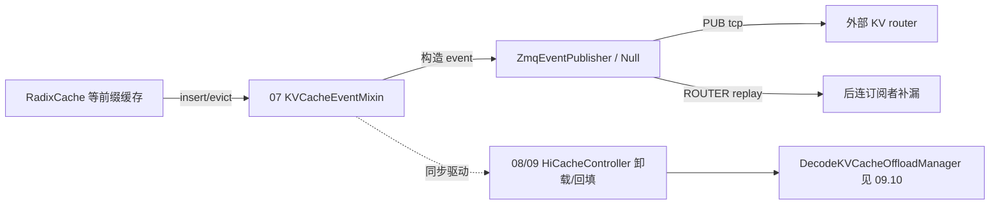

# 09.7 KV 事件桥

## 定位

`disaggregation/kv_events.py` 是 PD 分离/HiCache 的 KV cache 事件总线：把"某个 KV block 被存到哪种介质、被哪个 lora、含哪些 token"抽象成可发布/订阅的事件流，供内部 HiCache 控制器与外部 router/KV router 消费。它与 [`07 KV Cache`](../07-kv-cache/index.md) 的 `KVCacheEventMixin`（`mem_cache/events.py`）联动——后者在 radix cache insert/evict 时发布本页定义的 `BlockStored`/`BlockRemoved`。

## 职责

- 定义事件本体：`BlockStored`/`BlockRemoved`/`AllBlocksCleared`，含 `block_hashes`/`parent_block_hash`/`token_ids`/`block_size`/`lora_id`/`medium`。
- 用 `StorageMedium` 枚举标记事件涉及的存储层：`GPU`(L1 HBM)、`CPU`(L2 pinned)、`DISK`(L3 NVMe)、`EXTERNAL`(L4 共享/远程 pool，如 Mooncake)。
- `EventPublisher` 抽象 + `NullEventPublisher`/`ZmqEventPublisher` 两实现：后者带内存 replay buffer 与 ROUTER 回放，支持 at-least-once 与单调序。
- `select_kv_publisher_dp_rank` 处理 DP attention 下每 rank 各自 publisher，事件标注 `attn_dp_rank`。
- `OffloadedState` 描述被 HiCache 卸载的 block 的 `prefill_len`/`inc_len`/`last_hash`。

## 关键类与函数

| 名称 | 定义位置 | 说明 |
|---|---|---|
| `StorageMedium` | `disaggregation/kv_events.py:82` | `GPU`/`CPU`/`DISK`/`EXTERNAL` 四层介质 |
| `OffloadedState` | `disaggregation/kv_events.py:91` | 卸载 block 的 prefill/inc 长 + last_hash |
| `BlockStored` | `disaggregation/kv_events.py:108` | 存 event：hashes/parent/tokens/size/lora_id/medium |
| `BlockRemoved` | `disaggregation/kv_events.py:117` | 删 event：hashes/medium |
| `AllBlocksCleared` | `disaggregation/kv_events.py:122` | 全清 event |
| `KVEventBatch` | `disaggregation/kv_events.py:126` | 一批事件封装 |
| `EventPublisher` | `disaggregation/kv_events.py:130` | 抽象 `publish`/`shutdown` |
| `NullEventPublisher` | `disaggregation/kv_events.py:157` | 默认空实现 |
| `ZmqEventPublisher` | `disaggregation/kv_events.py:167` | PUB/ROUTER + replay buffer |
| `KVEventsConfig`/`EventPublisherFactory` | `disaggregation/kv_events.py:405/445` | 配置与工厂 |

## 总线拓扑

`ZmqEventPublisher` 把事件入队后由独立线程发 PUB；订阅者掉线后可向 ROUTER 端点回放请求（按 8 字节大端序号），publisher 维护 `buffer_steps` 步的重放缓冲。`attn_dp_rank` 字段让多 DP rank 事件可区分归属。

## 交叉引用

- 上游: [`07 KV Cache`](../07-kv-cache/index.md) — `KVCacheEventMixin` 发布本页事件
- 下游: [09.10 decode KV 卸载](09.10-decode-kv-offload.md) — HiCache 控制通过 event 驱动
- 相关: [`08 分布式`](../08-distributed/index.md) — Mooncake 作为 `EXTERNAL` 介质
- 相关: [`17 可观测`](../17-observability-ops/index.md) — 事件流作为外部观测源

## 进一步阅读

- 源码: `python/sglang/srt/disaggregation/kv_events.py`、`python/sglang/srt/mem_cache/events.py`
