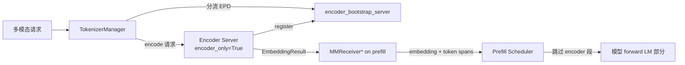

# 09.8 Encoder server / gRPC

## 定位

在 EPD（Encode-Prefill-Decode）模式下，多模态编码被拆到独立的 encoder server：它只跑 vision/audio encoder，产出 embedding；prefill server 直接消费这些 embedding 跳过 encoder 段。本页覆盖 `disaggregation/encode_server.py`（HTTP/FastAPI）与 `disaggregation/encode_grpc_server.py`（gRPC），以及 `launch_server.py` 如何按 `encoder_only` 分发。

## 职责

- `launch_server.run_server` 按 `server_args.encoder_only` + `grpc_mode` 选 HTTP 或 gRPC encoder 启动路径。
- encoder server 装载 encoder-only 模型，提供 `/encode` 接口，输出 `EmbeddingResult`；缓存到 `MultiModalStaticCache`。
- gRPC server 实现 `SglangEncoder` 服务 + 标准 health check（`EncoderHealthServicer`），供 K8s 探针。
- `encode_receiver.py` 在 prefill 侧接收 embedding：`EncoderBootstrapServer` 让 encoder 动态注册；`MMReceiverHTTP/MMReceiverGrpc/MMReceiverRDMA` 三种传输；`MooncakeEmbeddingPool` 支持 GPU-direct RDMA 零拷贝。
- tokenizer_manager 在 `--encoder-only` 时建 `encoder_bootstrap_server`，请求经 `_handle_epd_disaggregation_encode_request` 走分离路径。

## 关键类与函数

| 名称 | 定义位置 | 说明 |
|---|---|---|
| `run_server` encoder 分支 | `python/sglang/launch_server.py:17` | `encoder_only` → 选 `serve_grpc_encoder` 或 `encode_server.launch_server` |
| `SGLangEncoderServer` | `disaggregation/encode_grpc_server.py:73` | gRPC servicer 实现 |
| `EncoderHealthServicer` | `disaggregation/encode_grpc_server.py:42` | `grpc.health.v1` 探针服务 |
| `serve_grpc_encoder` | `disaggregation/encode_grpc_server.py`（位置待核） | 启动 gRPC server + reflection |
| `MMEncoder` / `launch_encoder` | `disaggregation/encode_server.py`（位置待核） | encoder worker 装载与生命周期 |
| `EncoderBootstrapServer` | `disaggregation/encode_receiver.py:52` | encoder 动态注册会合点 |
| `EmbeddingData`/`MultiModalEmbeddingData` | `disaggregation/encode_receiver.py:350/469` | embedding 描述与多模态聚合 |
| `MMReceiverBase`/`MMReceiverHTTP`/`MMReceiverGrpc` | `disaggregation/encode_receiver.py:1410/1998/2194` | prefill 侧接收策略 |
| `MooncakeEmbeddingPool` | `disaggregation/encode_receiver.py:1220` | 持久 GPU 缓冲池，支持 RDMA 直写 |
| `create_mm_receiver` | `disaggregation/encode_receiver.py:2375` | 按 `encoder_transfer_backend` 选 receiver |

## 数据流 / 控制流

gRPC 路径下，prefill 侧用 `_grpc_encode_request`/`_grpc_send_request` 发请求、`_grpc_scheduler_receive_url` 让 encoder 把 embedding 推到 prefill 接收端口；HTTP 路径下走 aiohttp。RDMA 模式（Mooncake GPU-direct）下 `MMReceiverRDMARequest` 不传 ZMQ payload，encoder 直接写到预注册的 `MooncakeEmbeddingPool` GPU 槽，prefill 经 `_slice_embedding_buffer` 原地切视图，省一次 D2D copy。

## 交叉引用

- 上游: [`02 服务入口`](../02-server-api/index.md) — `--encoder-only`/`--encoder-urls` 参数
- 上游: [`03.3 TokenizerManager`](../03-orchestration/03.3.1-tokenizer-manager.md) — `_handle_epd_disaggregation_encode_request`
- 相关: [`08 分布式`](../08-distributed/index.md) — Mooncake RDMA pool 校准
- 相关: [`12 多模态`](../12-multimodal/index.md) — encoder 模型与 `MultiModalStaticCache`

## 进一步阅读

- 源码: `python/sglang/srt/disaggregation/encode_server.py`、`python/sglang/srt/disaggregation/encode_grpc_server.py`、`python/sglang/srt/disaggregation/encode_receiver.py`
- 启动分发: `python/sglang/launch_server.py:17`
