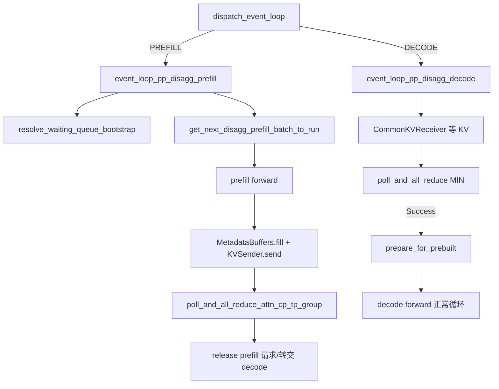

# 09.9 Scheduler disaggregation mixin

## 定位

PD 分离的调度逻辑挂在 `Scheduler` 的两个 mixin 上：`SchedulerDisaggregationPrefillMixin`（prefill 侧）与 `SchedulerDisaggregationDecodeMixin`（decode 侧，实为 `ScheduleBatchDisaggregationDecodeMixin`，作用于 `ScheduleBatch`）。它们在 `pp_size>1` 且分离式启用时由 `event_loop_pp_disagg_prefill`/`event_loop_pp_disagg_decode` 替代 normal/overlap event loop。

## 职责

- prefill mixin：在 forward 前后驱动 bootstrap 会合、`KVSender` 发送、`MetadataBuffers.fill`；维护 `PrefillBootstrapQueue`；在等待队列里 `resolve_waiting_queue_bootstrap`、`has_bootstrapped_waiting_req`；构造下一批 `get_next_disagg_prefill_batch_to_run`；可选 `maybe_prefetch_staging_for_batch` 预发 `STAGING_REQ`。
- decode mixin（ScheduleBatch）：`prepare_for_prebuilt` 把已收 KV 的请求直接配成 `PREBUILT` 批，跳过常规 extend 处理；与 `maybe_cache_unfinished_req` 协作。
- 两条 event loop：`event_loop_pp_disagg_prefill`（`scheduler_pp_mixin.py:177`）、`event_loop_pp_disagg_decode`（`:361`）分别编排 prefill/decode 帧。
- `Scheduler` 经继承链（`scheduler.py:303`，`SchedulerDisaggregationDecodeMixin`/`PrefillMixin` + `SchedulerMultiplexMixin`）把这些能力挂上。

## 关键类与函数

| 名称 | 定义位置 | 说明 |
|---|---|---|
| `Scheduler` 继承链 | `managers/scheduler.py:303` | 多 mixin：含 disagg decode/prefill |
| `ScheduleBatchDisaggregationDecodeMixin` | `disaggregation/decode_schedule_batch_mixin.py:23` | `prepare_for_prebuilt` 等 batch 级方法 |
| `SchedulerDisaggregationPrefillMixin` | `disaggregation/prefill.py:422` | prefill scheduler 方法族 |
| `PrefillBootstrapQueue` | `disaggregation/prefill.py:106` | prefill 侧 bootstrap 队列与 finalize |
| `maybe_prefetch_staging_for_batch` | `disaggregation/prefill.py:427` | 提前发 `STAGING_REQ` 让 decode 在 GPU forward 期间分配 |
| `resolve_waiting_queue_bootstrap` | `disaggregation/prefill.py:438` | 准入前清理失败/完結请求 |
| `get_next_disagg_prefill_batch_to_run` | `disaggregation/prefill.py:479` | prefill 下一批构造 |
| `event_loop_pp_disagg_prefill` | `managers/scheduler_pp_mixin.py:177` | prefill 帧 |
| `event_loop_pp_disagg_decode` | `managers/scheduler_pp_mixin.py:361` | decode 帧 |
| `dispatch_event_loop` 选择 | `managers/scheduler.py:4461/4468` | 按 disagg 模式选上述两条 loop |

## 控制流

prefill server 冻结 decode 状态切换：它只跑 prefill forward、发完 KV 即释放请求（`should_force_retry`/`maybe_release_metadata_buffer`），不维护长生命 decode 批；decode server 收齐 KV 后用 `prepare_for_prebuilt` 把请求配成已就绪 extend，进入正常 decode event loop。失败路径由 `handle_bootstrap_failure`/`prepare_abort` 处理，配合 `_poll_with_failure_injection` 做容错测试。

## 交叉引用

- 上游: [09.1 PD 概念](09.1-pd-concept.md)、[09.6 disagg utils](09.6-disagg-utils.md)
- 上游: [`03.4.1 Scheduler 结构`](../03-orchestration/03.4.1-scheduler-structure.md)、[`03.4.3 事件循环`](../03-orchestration/03.4.3-scheduler-event-loop.md)
- 相关: [14.5 multiplex](../14-session-state/14.5-multiplex.md) — `Scheduler` 同链上的另一个 mixin
- 相关: [`07 KV Cache`](../07-kv-cache/index.md)、[`08 分布式`](../08-distributed/index.md)

## 进一步阅读

- 源码: `python/sglang/srt/disaggregation/prefill.py`、`python/sglang/srt/disaggregation/decode_schedule_batch_mixin.py`、`python/sglang/srt/managers/scheduler_pp_mixin.py`
