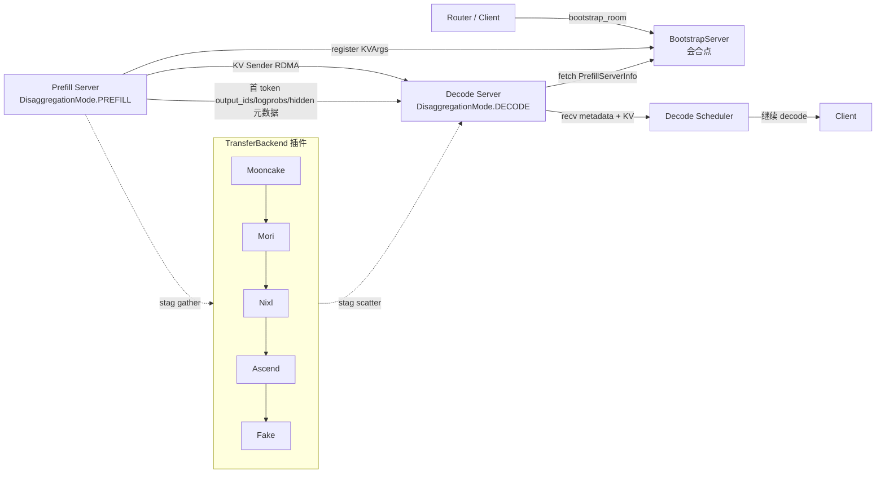

# 09 分离式推理（Disaggregation）

## 子系统定位

分离式推理把一次 LLM 推理拆到多组 worker 上协作完成：prefill server 算完 prompt 的 KV，再通过 RDMA/共享内存把 KV 流与首 token 元数据搬到 decode server 继续自回归解码；encoder server 把多模态编码结果送给 prefill。SGLang 用一套 bootstrap room（"会合房间"）协议让两侧 TP/CP/PP rank 互找、用插件化 `TransferBackend`（Mooncake/Nixl/Mori/Ascend/Fake）做实际 KV 搬运，并复用 [`07 KV Cache`](../07-kv-cache/index.md) 的内存池与 [`08 分布式`](../08-distributed/index.md) 的并行组。本子系统覆盖 PD 概念、base/common 连接抽象、各后端实现、staging buffer 融合内核、disagg utils、KV 事件桥、encoder 分离、Scheduler mixin 与 decode 侧 HiCache 卸载。

## PD 会合总览

prefill 完成 forward 后，`SchedulerDisaggregationPrefillMixin` 把首 token 的 output_ids、logprobs、hidden states 写进 `MetadataBuffers`，建立 `CommonKVSender`，按 `bootstrap_room` 找到 decode 侧 rank 的 `PrefillRankInfo`，发起 KV 流；decode 侧 `CommonKVReceiver` 在 `register_to_bootstrap` 后 poll 直到所有 TP rank 收齐（`poll_and_all_reduce` 取 MIN），再进入正常 extend 配套。

## 子系统导航

- [09.1 PD 分离概念](09.1-pd-concept.md) — `DisaggregationMode`/`TransferBackend`/`KVClassType` 与会合协议
- [09.2 base 连接抽象](09.2-base-conn.md) — `StateType`/`KVArgs`/`KVPoll`/`BaseKVManager/Sender/Receiver/BootstrapServer`
- [09.3 common 连接实现](09.3-common-conn.md) — `CommonKVManager`/`PrefillServerInfo`/rank 映射/MLA replica
- [09.4 transfer 后端](09.4-transfer-backends.md) — Mooncake/Nixl/Mori/Ascend/Fake 与 staging_handler
- [09.5 staging buffer 与 Triton 内核](09.5-staging-buffer-handler.md) — 融合 gather/scatter 内核与节奏控制
- [09.6 disagg utils](09.6-disagg-utils.md) — `MetadataBuffers`/`poll_and_all_reduce`/CP/Mamba state 切片
- [09.7 KV 事件桥](09.7-kv-events-bridge.md) — `BlockStored`/`BlockRemoved`/`StorageMedium` 事件总线
- [09.8 encoder server / gRPC](09.8-encode-server-grpc.md) — EPD 编码分离与 `launch_server` 分发
- [09.9 scheduler disagg mixin](09.9-scheduler-disagg-mixins.md) — Prefill/Decode mixin 与 `event_loop_pp_disagg_*`
- [09.10 decode KV 卸载](09.10-decode-kv-offload.md) — decode 侧 L2 host pool + `HiCacheController`

## 交叉引用

- 上游: [`02 服务入口`](../02-server-api/index.md) — PD router 注入 `bootstrap_room`
- 上游: [`03 编排`](../03-orchestration/index.md) — `Scheduler` 继承 disagg mixin
- 下游: [`07 KV Cache`](../07-kv-cache/index.md) — `KVArgs.kv_data_ptrs` 引用内存池
- 下游: [`08 分布式`](../08-distributed/index.md) — TP/CP/PP 组与 `mooncake_transfer_engine`
- 相关: [`15 内核`](../15-kernels-hardware/index.md) — staging Triton fused kernel
- 相关 skill: `.claude/skills/sglang-runtime-context`

## 进一步阅读

- 源码: `python/sglang/srt/disaggregation/`
- 启动分发: `python/sglang/launch_server.py:17`
