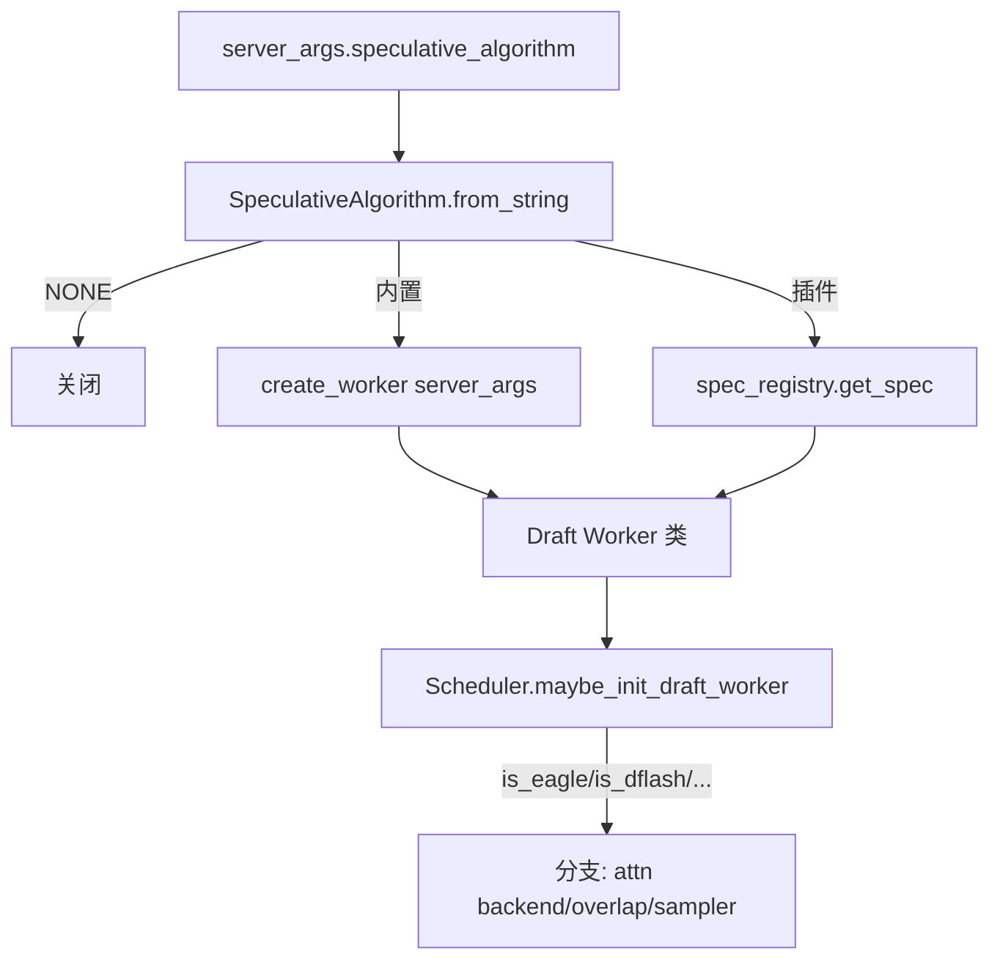

# 10.1 算法总览

## 定位

`speculative/spec_info.py` 的 `SpeculativeAlgorithm` 枚举与 `speculative/spec_registry.py` 的注册表，是 SGLang 投机解码的算法入口。所有内置算法与通过 `SpeculativeAlgorithm.register` 注入的插件算法，都暴露统一的 `is_*()` / `create_worker(server_args)` 接口，让 scheduler 与 tp_worker 无需 `isinstance` 分支即可统一调度。

## 职责

- 用单一枚举同时表达内置与自定义算法，`from_string` 先查内置再查注册表。
- `create_worker(server_args)` 按算法返回 draft worker 类：`EAGLEWorkerV2`/`MultiLayerEagleWorkerV2`/`DFlashWorkerV2`/`DSparkWorkerV2`/`FrozenKVMTPWorkerV2`/`NGRAMWorker`/`StandaloneWorkerV2`。
- `is_eagle()`/`is_dflash_family()`/`is_ngram()`/`is_frozen_kv_mtp()` 等谓词驱动 attention backend、overlap、采样行为分支。
- `SpecInput`/`SpecInputType` 抽象 draft/verify 的输入载体（树/序列/extend）。

## 内置算法

| 算法 | worker | 要点 |
|---|---|---|
| `EAGLE` | `EAGLEWorkerV2`（`eagle_worker_v2.py:1021`） | 单层 draft，吃 target hidden + last token，自回归生成树/序列，target 一次 verify |
| `EAGLE3` | `EAGLEWorkerV2` 复用 | 多层 hidden 捕获 + 更深 draft，见 [10.5](10.5-multi-layer-eagle.md) |
| `DFLASH` / `DSPARK` | `DFlashWorkerV2`（`dflash_worker_v2.py:150`）/ `DSparkWorkerV2` | DeepSeek 家族的"下一代投机解码"，融合 KV materialize 与 draft sampler；`is_dflash_family` |
| `FROZEN_KV_MTP` | `FrozenKVMTPWorkerV2`（`frozen_kv_mtp_worker_v2.py:640`） | 冻结 KV 的 multi-token prediction；`is_eagle` 把它归为 eagle 族 |
| `NGRAM` | `NGRAMWorker`（`ngram_worker.py:41`） | 无 draft 模型，从 n-gram 语料/外部语料取候选，见 [10.6](10.6-ngram-corpus-embedding.md) |
| `STANDALONE` | `StandaloneWorkerV2`（`standalone_worker_v2.py:133`） | draft 独立 scheduler/进程，解耦 target |
| `NONE` | — | 关闭投机 |

## 关键类与函数

| 名称 | 定义位置 | 说明 |
|---|---|---|
| `SpeculativeAlgorithm` | `speculative/spec_info.py:30` | 枚举 + `from_string`/`register`/`create_worker`/`is_*` |
| `SpecInputType` | `speculative/spec_info.py:295` | draft/verify 输入类型 |
| `SpecInput` | `speculative/spec_info.py:308` | 输入载体抽象基类 |
| `spec_scale_global_num_tokens` | `speculative/spec_info.py:354` | 把 draft 预算折算到全局 token 数 |
| `create_dummy_verify_input` | `speculative/spec_info.py:371` | 构造空 verify 输入（关闭 spec 路径用） |
| `CustomSpecAlgo` / `register_algorithm` / `get_spec` | `speculative/spec_registry.py:25/213/246` | 插件注册机制 |

## 数据流 / 控制流

## 交叉引用

- 详见: [10.2 draft worker](10.2-draft-worker-runner.md)、[10.4 验证与采样](10.4-verify-sampling.md)、[10.5 多层 EAGLE](10.5-multi-layer-eagle.md)
- 上游: [`03.4.1 Scheduler`](../03-orchestration/03.4.1-scheduler-structure.md) — `spec_algorithm` 字段
- 相关: [`04.4 Runners`](../04-model-execution/04.4-runners.md) — draft cuda graph runner
- 相关 skill: `.claude/skills/speculative-naming`

## 进一步阅读

- 源码: `python/sglang/srt/speculative/spec_info.py`、`python/sglang/srt/speculative/spec_registry.py`
