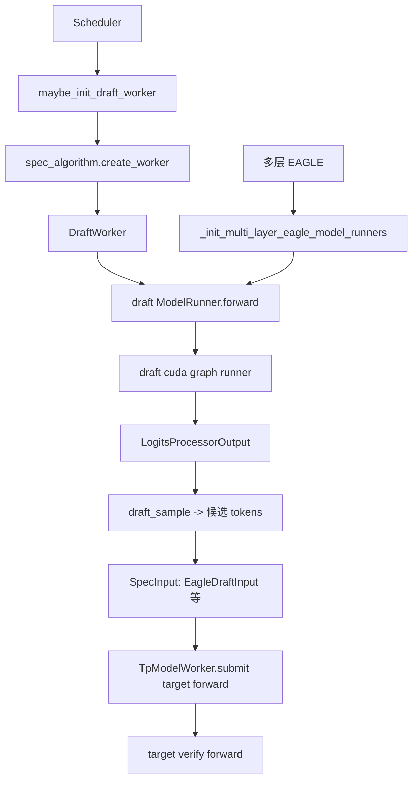

# 10.2 Draft worker 与 runner

## 定位

draft worker 是投机解码中负责"提议候选 token"的一侧：它由 `Scheduler.maybe_init_draft_worker` 在初始化期按 `spec_algorithm.create_worker` 创建，持有自己的 ModelRunner（或与 target 共享），并在采样后回填 target 的 hidden/last token 继续自回归。target 侧的 `TpModelWorker` 也在此页：多层 EAGLE 时它会装配额外的多层 draft runner 与 target 共用 KV pool/attention。

## 职责

- `maybe_init_draft_worker`：若 `spec_algorithm` 非 NONE 则构造 draft worker，处理 `speculative_draft_load_format`、ngram 的 `ExternalCorpusManager`。
- `TpModelWorker._init_multi_layer_eagle_model_runners`：多层 EAGLE 模式下，在 target 侧装配一组 cheap runner 让多层 hidden 捕获与 draft extend 在同一 forward 完成。
- draft `ModelRunner.forward`：走自己的 cuda graph runner（`EAGLEDraftCudaGraphRunner`、`MultiLayerEagleDraftExtendCudaGraphRunner`、`FrozenKVMTPCudaGraphRunner`），产出 `LogitsProcessorOutput` → draft sample。
- `BaseSpecWorker`/`EagleDraftWorkerBase` 统一 forward/draft_sample/report_metrics 接口；`DraftWorkerBundle`/`build_draft_tp_worker` 在解耦/standalone 路径下组装备用 draft worker。
- draft 采样后构造 `EagleDraftInput`/`DFlashDraftInputV2`/`NgramVerifyInput` 等 `SpecInput` 交给 target verify。

## 关键类与函数

| 名称 | 定义位置 | 说明 |
|---|---|---|
| `Scheduler.maybe_init_draft_worker` | `managers/scheduler.py:773` | 按 `spec_algorithm.create_worker` 建 draft worker，ngram 时建 `ExternalCorpusManager` |
| `TpModelWorker._init_multi_layer_eagle_model_runners` | `managers/tp_worker.py:407` | 多层 EAGLE target 侧 runner 装配，调用于 `:280` |
| `BaseSpecWorker` | `speculative/base_spec_worker.py:45` | forward/draft_sample/verify_input 统一接口 |
| `EagleDraftWorkerBase` | `speculative/base_spec_worker.py:15` | draft 侧抽象 |
| `EagleDraftWorker` / `EAGLEWorkerV2` | `speculative/eagle_worker_v2.py:120/1021` | EAGLE draft + 整体 worker |
| `MultiLayerEagleDraftWorker` / `MultiLayerEagleWorkerV2` | `speculative/multi_layer_eagle_worker_v2.py:89/610` | 多层 EAGLE，见 [10.5](10.5-multi-layer-eagle.md) |
| `DFlashWorkerV2` | `speculative/dflash_worker_v2.py:150` | DFlash draft+采样器（`_DflashDraftSampler`） |
| `NGRAMWorker` | `speculative/ngram_worker.py:41` | n-gram draft |
| `EAGLEDraftCudaGraphRunner` | `speculative/eagle_draft_cuda_graph_runner.py:76` | draft decode cuda graph |
| `EAGLEDraftExtendCudaGraphRunner` | `speculative/eagle_draft_extend_cuda_graph_runner.py:78` | draft extend cuda graph |
| `build_draft_tp_worker` / `DraftWorkerBundle` | `speculative/draft_worker_common.py:57/28` | standalone/decoupled draft 装配 |

## 数据流 / 控制流

多层 EAGLE 下，target `TpModelWorker` 在 `:280` 处触发 `_init_multi_layer_eagle_model_runners`，让多层 draft extend runner 与 target 共享一次 KV pool forward（见 [10.5](10.5-multi-layer-eagle.md)）。普通单层 EAGLE 时 draft runner 独立 forward、复用 target 已算 hidden。

## 交叉引用

- 上游: [10.1 算法总览](10.1-algorithms-overview.md)、[10.7 scheduler 集成](10.7-scheduler-integration.md)
- 上游: [`03.6 TpModelWorker`](../03-orchestration/03.6-tp-worker.md)、[`04.1 ModelRunner`](../04-model-execution/04.1-model-runner.md)
- 下游: [10.5 多层 EAGLE](10.5-multi-layer-eagle.md)、[10.6 ngram](10.6-ngram-corpus-embedding.md)
- 相关: [`07 KV Cache`](../07-kv-cache/index.md) — draft/target 池共享

## 进一步阅读

- 源码: `python/sglang/srt/speculative/eagle_worker_v2.py`、`python/sglang/srt/speculative/multi_layer_eagle_worker_v2.py`、`python/sglang/srt/speculative/base_spec_worker.py`
