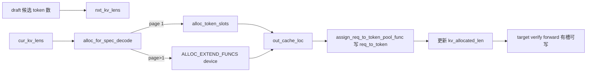

# 10.3 spec utils 与投机内存分配

## 定位

`speculative/spec_utils.py` 是投机解码的"通用工具与 re-export 层"：它把分散在 `kernels/ops/speculative/` 的 cache locs 内核、`mem_cache/allocation.py` 的 token pool 分配函数、以及 spec 相关辅助函数聚到一处，供 draft/verify worker 与 scheduler 调用。本页还覆盖 target/draft 共用槽位预留的核心 `alloc_for_spec_decode`。

## 职责

- re-export 投机内核：`assign_extend_cache_locs`/`generate_draft_decode_kv_indices`/`get_target_cache_loc`/`get_src_tgt_cache_loc`/`filter_finished_cache_loc_kernel`/`align_evict_mask_to_page_size`/`fill_accept_out_cache_loc_func` 等。
- re-export 内存分配：`assign_req_to_token_pool`、`assign_req_to_token_pool_func`（实现在 `mem_cache/allocation.py`）。
- 提供 `spec_need_hidden_states`/`resolve_num_tokens_per_req` 等查询，驱动 overlap 与采样分支。
- `alloc_for_spec_decode`：在 verify 前，为 batch 里每个请求按 `nxt_kv_lens` 预留 target KV pool 槽位，并写回 `req_to_token_pool`。

## 关键类与函数

| 名称 | 定义位置 | 说明 |
|---|---|---|
| `assign_req_to_token_pool` (re-export) | `speculative/spec_utils.py:41` → `mem_cache/allocation.py:498` | 把 out_cache_loc 写入 req_to_token 矩阵 |
| `assign_req_to_token_pool_func` (re-export) | `speculative/spec_utils.py:44` → `mem_cache/allocation.py:532` | 上述底层内核版 |
| `alloc_for_spec_decode` | `mem_cache/allocation.py:575` | target/draft slot 预留核心 |
| `assign_extend_cache_locs` | `kernels/ops/speculative/cache_locs`（经 spec_utils re-export） | 算 extend 段 cache loc |
| `generate_draft_decode_kv_indices` | 同上 | draft decode 的 kv 索引 |
| `get_target_cache_loc` / `get_src_tgt_cache_loc` | 同上 | 取 target/draft 源/目的 loc |
| `fill_accept_out_cache_loc_func` | `kernels/ops/speculative/eagle`（经 spec_utils re-export） | accept 后把命中 token 压到队首 loc |
| `align_evict_mask_to_page_size` | 同上 | 把 evict mask 对齐 page |

## alloc_for_spec_decode 流程

verify 前需要把所有 draft 候选 token 的位置都先在 target KV pool 申请好，否则 target forward 写不下。`alloc_for_spec_decode` 接收 `cur_kv_lens`/`nxt_kv_lens` 与 `num_needed_tokens`：

- page_size==1：直接 `alloc_token_slots(num_needed_tokens)`。
- page_size>1：经 `ALLOC_EXTEND_FUNCS[device]`（含 npu 变体）按页扩展，保证同请求页连续。
- 拿到 `out_cache_loc` 后调 `assign_req_to_token_pool_func` 把它写进 `req_to_token`（这是对共享张量的写——不能与上一批 forward 重叠，[10.7](10.7-scheduler-integration.md) 的 `_forward_isolation` 由此而来）。
- 最后更新每个 req 的 `kv.kv_allocated_len`。

## 交叉引用

- 上游: [10.2 draft worker](10.2-draft-worker-runner.md)、[10.4 验证与采样](10.4-verify-sampling.md)
- 上游: [`07 KV Cache`](../07-kv-cache/index.md) — `token_to_kv_pool_allocator`/`req_to_token_pool`
- 下游: [10.7 scheduler 集成](10.7-scheduler-integration.md) — `req_to_token` 写入需 isolation
- 相关: [`15.4 jit_kernel`](../15-kernels-hardware/15.4-jit-kernel.md) — cache_locs 内核

## 进一步阅读

- 源码: `python/sglang/srt/speculative/spec_utils.py`、`python/sglang/srt/mem_cache/allocation.py`、`python/sglang/kernels/ops/speculative/`
