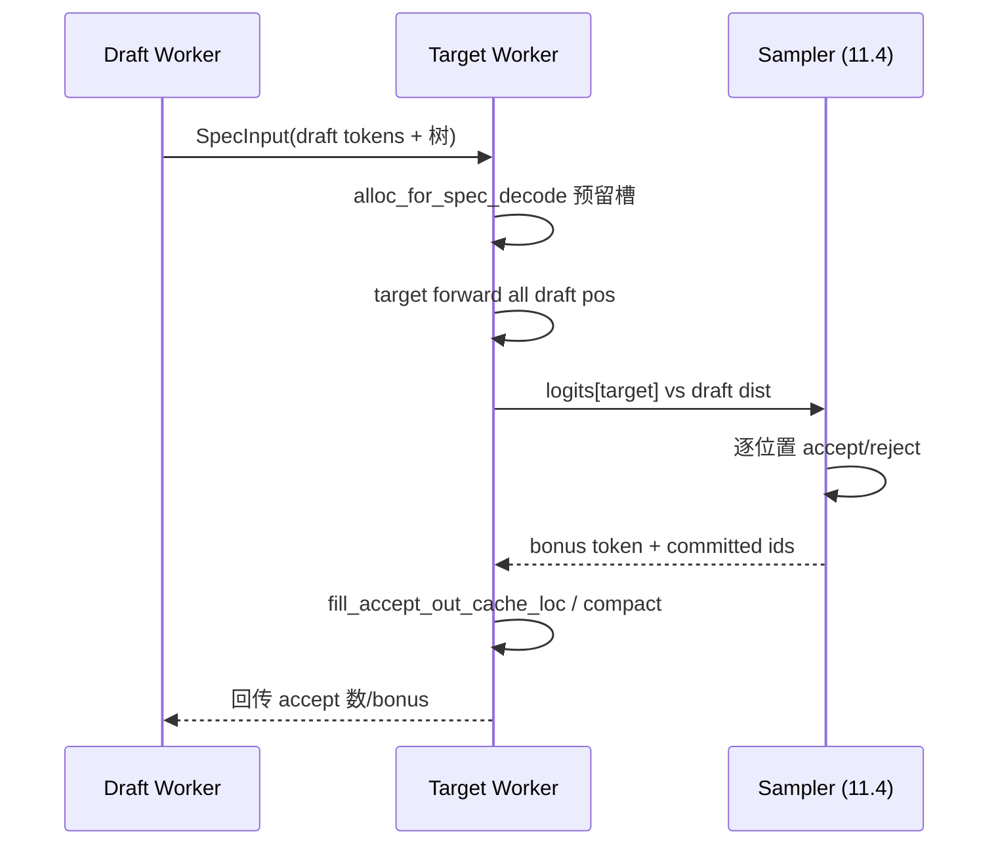

# 10.4 验证与采样

## 定位

verify 是投机解码的"裁决步"：target 模型在一次 forward 里同时对所有 draft 候选位置算 logits，sampler 据每个位置的 draft 分布与 target 分布做接受/拒绝，拒绝处用 target 分布重采（bonus token）。本页描述这条路径，以及它与 [`11 采样控制`](../11-sampling-control/index.md) 的 sampler 在 `repeat`/ penalties 上的协作。

## 职责

- target `ModelRunner.forward` 在 verify 模式下输入含 draft token 的批，输出覆盖每个候选位置的 `LogitsProcessorOutput`。
- verify 输入构造：`EagleVerifyInput`/`DFlashVerifyInput`/`NgramVerifyInput` 描述树/序列结构；`RaggedVerifyLayout`（`ragged_verify.py:46`）把变长请求压成 ragged 张量，减少 padding。
- 采样：draft 的"提议分布"与 target 的"验证分布"做 speculative sampling——逐位置比较，连续接受直到首个不匹配，再在该处按 `target − draft`（按温度/受限）重采。
- 接受结果回写：`fill_accept_out_cache_loc_func` 把接受 token 压到队首 `out_cache_loc`、`_compact_accept_to_front`/`_finalize_accept_tree_path` 规整。
- 与 sampler 协作：`SamplingBatchInfo` 在 verify 批上携带 repeat penalties；`_forward_isolation` 用 forward-only 替换 sampling_info 防止多次 init 累加 penalty。

## 关键类与函数

| 名称 | 定义位置 | 说明 |
|---|---|---|
| `EagleVerifyInput` | `speculative/eagle_info.py:18` | EAGLE verify 输入 |
| `DFlashVerifyInput` | `speculative/dflash_info.py:23` | DFlash verify 输入 |
| `NgramVerifyInput` | `speculative/ngram_info.py:12` | ngram verify 输入 |
| `RaggedVerifyLayout` | `speculative/ragged_verify.py:46` | ragged 压缩布局 |
| `build_ragged_target_verify_geometry` | `speculative/ragged_verify.py:213` | 算 target verify 几何 |
| `run_eagle_verify` | `speculative/eagle_worker_common.py:431` | 跑 target verify + accept/reject |
| `_finalize_accept_tree_path` | `speculative/eagle_worker_common.py:376` | 树形 accept 终化 |
| `_compact_accept_to_front` | `speculative/eagle_worker_common.py:408` | 接受 token 压队首 |
| `eagle_sample` | `speculative/eagle_utils.py`（位置待核） | draft 侧采样 |
| `compute_spec_v2_logprobs` | `layers/logprob_processor.py`（经 ngram_worker import） | spec v2 logprob 合并 |

## 数据流 / 控制流

接受策略：单序列算法按位置线性接受直到首个不匹配；树形算法（EAGLE 树/DFlash）按 `reconstruct_indices_from_tree_mask` 重建掩码、选最长接受路径。拒绝处的 bonus token 既来自 target 分布，又受当前 `SamplingBatchInfo` 的 repeat/grammar mask 约束——因此 spec + grammar 同时存在时 SGLang 选择关闭 overlap（见 [10.7](10.7-scheduler-integration.md) 的 `is_disable_overlap_for_batch`）。

## 交叉引用

- 上游: [10.2 draft worker](10.2-draft-worker-runner.md)、[10.3 分配](10.3-spec-utils-allocation.md)
- 下游: [`11.4 Sampler`](../11-sampling-control/11.4-sampler-layer.md) — accept/reject 调 sampler
- 下游: [10.7 scheduler 集成](10.7-scheduler-integration.md) — spec+grammar 关 overlap
- 相关: [`04.1 ModelRunner`](../04-model-execution/04.1-model-runner.md) — `ModelRunner.sample`

## 进一步阅读

- 源码: `python/sglang/srt/speculative/eagle_worker_common.py`、`python/sglang/srt/speculative/ragged_verify.py`、`python/sglang/srt/layers/logprob_processor.py`
