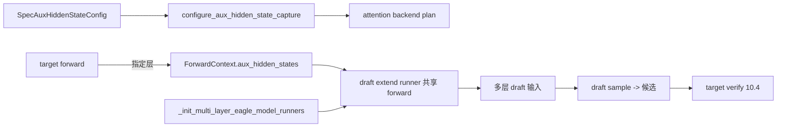

# 10.5 多层 EAGLE

## 定位

EAGLE3 / 多层 EAGLE 让 draft 模型复用 target 的多个中间层 hidden state 作为输入，大幅提升接受率与候选多样性。这要求 target forward 在指定层把 hidden 暴露给 draft，并由 draft extend runner 在同一 forward 里完成多层 draft 输入装配。本页描述捕获配置与多层 draft runner 装配，补全 [10.2](10.2-draft-worker-runner.md) 跳过的多层细节。

## 职责

- `SpecAuxHiddenStateConfig` 描述要在 target 哪些层捕获、用什么降采样/聚合，由 `resolve_spec_aux_hidden_state_config` 按 `spec_algorithm` 派发。
- attention backend 经 `configure_aux_hidden_state_capture` 在 plan 期把捕获点接到 forward；target forward 写入 `ForwardContext.aux_hidden_states`。
- `TpModelWorker._init_multi_layer_eagle_model_runners` 建一组 cheap draft extend runner，与 target 共享 KV pool，让多层 hidden 捕获 + draft extend 在一次 forward 完成。
- `MultiLayerEagleDraftExtendCudaGraphRunner` / `MultiLayerEagleMultiStepDraftExtendCudaGraphRunner` 是对应 cuda graph runner。
- `multi_layer_eagle_utils.py` 提供 draft 输入构造、`get_draft_input_from_target_hidden_dim` 等。

## 关键类与函数

| 名称 | 定义位置 | 说明 |
|---|---|---|
| `SpecAuxHiddenStateConfig` | `model_runner_components/spec_aux_hidden_state.py:17` | 捕获层与采样配置（msgspec Struct） |
| `resolve_spec_aux_hidden_state_config` | `model_runner_components/spec_aux_hidden_state.py:26` | 按 algorithm/config 派发捕获方案 |
| `_resolve_eagle_aux_hidden_state` | `model_runner_components/spec_aux_hidden_state.py:50` | EAGLE/EAGLE3 捕获点解析 |
| `_resolve_dflash_aux_hidden_state` | `model_runner_components/spec_aux_hidden_state.py:97` | DFlash 捕获点解析 |
| `configure_aux_hidden_state_capture` | `model_runner_components/attention_backend_setup.py:39` | 把捕获点注入 attention backend |
| `TpModelWorker._init_multi_layer_eagle_model_runners` | `managers/tp_worker.py:407` | 多层 draft runner 装配 |
| `MultiLayerEagleDraftWorker` / `MultiLayerEagleWorkerV2` | `speculative/multi_layer_eagle_worker_v2.py:89/610` | 多层 EAGLE worker |
| `MultiLayerEagleDraftExtendCudaGraphRunner` | `speculative/multi_layer_eagle_draft_extend_cuda_graph_runner.py:111` | extend 单步 draft graph |
| `MultiLayerEagleMultiStepDraftExtendCudaGraphRunner` | `speculative/multi_layer_eagle_draft_extend_cuda_graph_runner.py:447` | 多步 draft graph |

## 数据流 / 控制流

多层 EAGLE 的关键省时点：draft 不必"自己 forward 完整一遍拿 hidden"，而是与 target 同一次 forward 共享 KV pool 与部分算子，只在 target 暴露的若干层之后跑 cheap draft 头。这使得 EAGLE3 的额外开销接近常数，接受率却显著上升。捕获层数、是否做 GQA 聚合等由 `SpecAuxHiddenStateConfig` 决定，DFlash 与 EAGLE 各有 `_resolve_*_aux_hidden_state` 派发。

## 交叉引用

- 上游: [10.2 draft worker](10.2-draft-worker-runner.md)、[10.1 算法总览](10.1-algorithms-overview.md)
- 下游: [`04.1 ModelRunner`](../04-model-execution/04.1-model-runner.md) — `aux_hidden_states` 经 `ForwardContext`
- 下游: [`04.5 runner components`](../04-model-execution/04.5-runner-components.md)
- 相关: [`06 Layers`](../06-layers/index.md) — attention backend 捕获点

## 进一步阅读

- 源码: `python/sglang/srt/model_executor/model_runner_components/spec_aux_hidden_state.py`、`python/sglang/srt/speculative/multi_layer_eagle_worker_v2.py`、`python/sglang/srt/speculative/multi_layer_eagle_utils.py`
