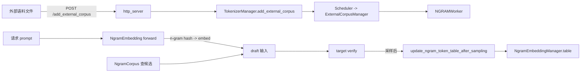

# 10.6 n-gram 语料与 embedding

## 定位

n-gram 投机解码不需要 draft 模型：它从预建的 n-gram 语料里按上下文查候选续 token，作为"提议"喂给 target verify。SGLang 把语料建在 C++/TVM 内核（`jit_kernel/ngram_corpus.py`）+ Python `speculative/cpp_ngram/ngram_corpus.py`，把 embedding lookup 做成 layer（`NgramEmbedding`），并支持运行时经 HTTP 端点挂载/卸载外部语料。本页覆盖这四块与 Scheduler/ModelRunner 的集成点。

## 职责

- `NgramCorpus`（`speculative/cpp_ngram/ngram_corpus.py`）+ `get_ngram_corpus_cls()`（`jit_kernel/ngram_corpus.py:27`）：核心语料结构，按 n-gram 哈希查候选。
- `NgramEmbedding`（`layers/n_gram_embedding.py:11`）：把 token 序列经 n-gram 哈希映射到 embedding，作为 draft 输入；支持 `over_embedding_m/k/n` 多重 n-gram。
- `NgramEmbeddingManager`（`model_runner_components/ngram_embedding_manager.py:22`）：维护 token table、forward 前准备、采样后更新（`update_ngram_token_table_after_sampling`）。
- `ExternalCorpusManager`（`speculative/external_corpus_manager.py:23`）+ 端点 `/add_external_corpus`（`http_server.py:913`）：运行时挂载/卸载/列举外部语料，去往 tokenizer_manager → scheduler → ngram worker。

## 关键类与函数

| 名称 | 定义位置 | 说明 |
|---|---|---|
| `NgramEmbedding` | `layers/n_gram_embedding.py:11` | n-gram → embedding 的 nn.Module，含 `word_embeder` (VocabParallel) 与多层 n-gram |
| `NgramEmbeddingManager` | `model_runner_components/ngram_embedding_manager.py:22` | table 维护 + `prepare_for_forward` + `update_ngram_token_table_after_sampling:149` |
| `Scheduler.ngram_embedding_manager` | `managers/scheduler.py:1306` | 引用 runner 的 manager；`:2795 prepare_for_forward` |
| `NgramCorpus` | `speculative/cpp_ngram/ngram_corpus.py`（位置待核） | 语料查找 |
| `get_ngram_corpus_cls` / `_to_csr` | `jit_kernel/ngram_corpus.py:27/15` | JIT 内核版语料类工厂 + CSR 转换 |
| `NGRAMWorker` | `speculative/ngram_worker.py:41` | n-gram draft worker，复用 `eagle_sample` |
| `ExternalCorpusManager` | `speculative/external_corpus_manager.py:23` | 外部语料生命周期 |
| `/add_external_corpus` | `entrypoints/http_server.py:913` | HTTP 端点 |
| `/remove_external_corpus` `/list_external_corpora` | `entrypoints/http_server.py:938/956` | 卸载/列举 |

## 数据流 / 控制流

`NgramEmbedding` 在 forward 里把 input_ids 按 `over_embedding_k` 与 `over_embedding_n` 做多重 n-gram 哈希，取对应 embedding 段拼接，输出 draft 隐态。`NgramEmbeddingManager` 在每轮 forward 前 `prepare_for_forward` 把当前 token table 拷到设备，采样后 `update_ngram_token_table_after_sampling` 把新生成 token 写回——这相当于"在线学习"的语料。外部语料通过端点注入后，与在线 table 合并供 `NGRAMWorker.lookup` 查找。

## 交叉引用

- 上游: [10.1 算法总览](10.1-algorithms-overview.md)、[10.2 draft worker](10.2-draft-worker-runner.md)
- 下游: [`02 服务入口`](../02-server-api/index.md) — `/add_external_corpus` 端点
- 下游: [`15.4 jit_kernel`](../15-kernels-hardware/15.4-jit-kernel.md) — `jit_kernel/ngram_corpus.py`
- 相关: [`04.5 runner components`](../04-model-execution/04.5-runner-components.md) — `NgramEmbeddingManager`

## 进一步阅读

- 源码: `python/sglang/srt/layers/n_gram_embedding.py`、`python/sglang/srt/model_executor/model_runner_components/ngram_embedding_manager.py`、`python/sglang/srt/speculative/cpp_ngram/`、`python/sglang/jit_kernel/ngram_corpus.py`
