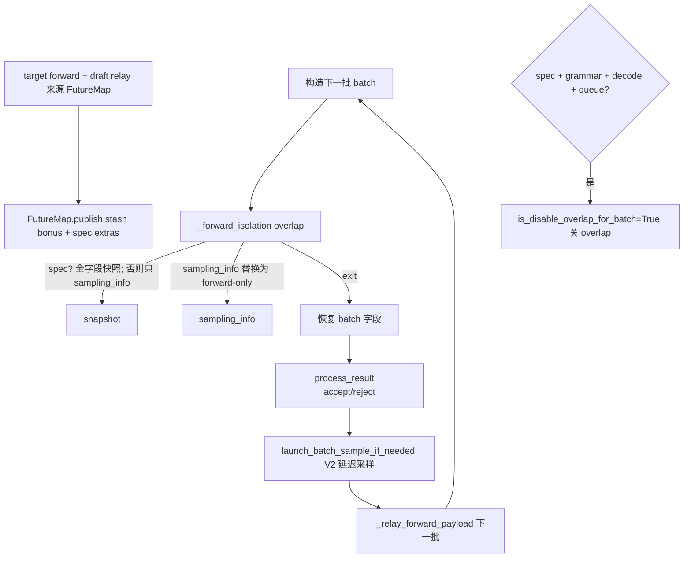

# 10.7 Scheduler 与投机集成

## 定位

投机解码与 overlap（draft forward 与上一批 target forward 并发）耦合很深，需要 Scheduler 在事件循环里做"中途快照/恢复"与"跨迭代 GPU relay"。本页覆盖 Scheduler 上 spec 相关的几个关键点：`_forward_isolation` 的 mid-forward 事务、`FutureMap` 的跨迭代 relay、spec+grammar 关闭 overlap 的判定、延迟采样 `launch_batch_sample_if_needed`。

## 职责

- `_forward_isolation`（contextmanager）：给 `ScheduleBatch` 做 mid-forward 快照，让 Spec V2 在 forward 中途改 `forward_mode`/`input_ids`/`seq_lens`/`spec_info` 后可恢复；同时把 `sampling_info` 换成 forward-only 副本防 penalty 双累加；overlap 时把 (batch, snapshot) 钉入 `batch_record_buf` 保命 GPU 张量。
- `FutureMap`（`overlap_utils.py:232`）：跨迭代的 stash/publish 通道，relay `bonus_tokens` 与 spec extras（hidden/topk），让下一迭代的 draft 输入从上一迭代 GPU 私有 stream 直接拿。
- `_relay_forward_payload`：把 batch_result 的 future_indices 或 req_pool_indices 对应的 stash relay 给下一批。
- `is_disable_overlap_for_batch`：当 `spec + grammar + decode + result_queue 非空` 时关 overlap（暂未支持 spec+grammar+overlap 三者并存）。
- `launch_batch_sample_if_needed`：Spec V2 把采样延迟到下一迭代发起，先让 target forward 跑完再据 accept 决定采样范围。
- `maybe_init_draft_worker`（`scheduler.py:773`，见 [10.2](10.2-draft-worker-runner.md)）在整个集成之上。

## 关键类与函数

| 名称 | 定义位置 | 说明 |
|---|---|---|
| `_forward_isolation` | `managers/scheduler.py:3228` | batch 事务快照/恢复 contextmanager |
| `FutureMap` | `managers/overlap_utils.py:232` | 跨迭代 stash/publish + relay spec extras |
| `ResolvedConfidence` / `ConfidenceRelay` | `managers/overlap_utils.py:122/153` | FutureMap 内部 stash payload |
| `_relay_forward_payload` | `managers/scheduler.py:3499` | 把 stash relay 给下一批 |
| `is_disable_overlap_for_batch` | `managers/scheduler.py:1610` | spec+grammar 关 overlap 判定 |
| `launch_batch_sample_if_needed` | `managers/scheduler.py:3514` | V2 延迟采样发起 |
| `Scheduler.maybe_init_draft_worker` | `managers/scheduler.py:773` | 创建 draft worker 入口 |

## 控制流

overlap 路径下，上一批 target forward 在私有 stream 跑、draft forward 在主 stream 跑，二者通过 `FutureMap` 的 device Event 同步：draft 在下一迭代 `publish_ready` 等 `seq_lens` D2H 完成后从 FutureMap 拉 `bonus_tokens`/`gather_spec_extras`。非 spec 路径 FutureMap 只 relay `bonus_tokens`，spec_algo 决定 extras 形状而非 payload 形状——这让同一套机制服务所有算法。`_forward_isolation` 的 `batch_record_buf` 把张量钉两迭代，防止 caching allocator 在 forward stream 还没消费完就回收。

## 交叉引用

- 上游: [`03.4.3 事件循环`](../03-orchestration/03.4.3-scheduler-event-loop.md)、[`03.4.9 overlap`](../03-orchestration/03.4.9-scheduler-overlap.md)
- 上游: [10.2 draft worker](10.2-draft-worker-runner.md)、[10.4 验证与采样](10.4-verify-sampling.md)
- 下游: [`11.4 Sampler`](../11-sampling-control/11.4-sampler-layer.md) — penalties 与 forward-only sampling_info
- 下游: [`15.4 jit_kernel`](../15-kernels-hardware/15.4-jit-kernel.md) — `gather_spec_extras`
- 相关 skill: `.claude/skills/speculative-naming`

## 进一步阅读

- 源码: `python/sglang/srt/managers/scheduler.py`、`python/sglang/srt/managers/overlap_utils.py`
