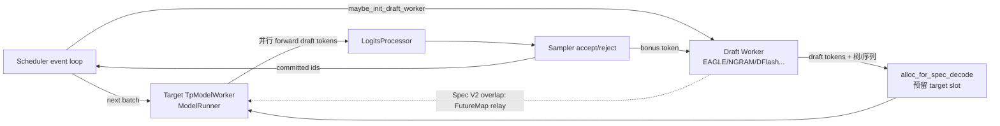

# 10 投机解码（Speculative Decoding）

## 子系统定位

投机解码用一个轻量 draft 模型/语料预测若干候选 token，再用目标（target）模型一次性并行 verify， Accepted token 直接吞下、被拒处重新采样，从而把多次串行 decode 折叠成一次 forward。SGLang 的 `speculative/` 子系统容纳算法注册、draft worker、target 验证、slot 预留、EAGLE 多层、n-gram 语料、与 Scheduler overlap 集成等全部能力，并与 [`07 KV Cache`](../07-kv-cache/index.md) 的内存池、[`11 采样控制`](../11-sampling-control/index.md) 的 sampler、[`15 内核`](../15-kernels-hardware/index.md) 的投机内核紧密协作。

## draft + target + verify 总览

draft worker 既可作为 TpModelWorker 的变体（共享 KV pool），也可独立运行（Standalone/Decoupled）。target 在一次 forward 里同时对所有 draft 位置算 logits，sampler 据各位置分布做接受/拒绝；接受的 bonus token 在下一轮再喂回 draft，形成 relay。

## 子系统导航

- [10.1 算法总览](10.1-algorithms-overview.md) — EAGLE/EAGLE3/DFlash/DSpark/Spec V2/NGRAM/MTP 与注册表
- [10.2 draft worker / runner](10.2-draft-worker-runner.md) — `maybe_init_draft_worker`、多层 EAGLE runner、draft forward
- [10.3 spec utils 与分配](10.3-spec-utils-allocation.md) — `spec_utils.py` re-export 与 `alloc_for_spec_decode`
- [10.4 验证与采样](10.4-verify-sampling.md) — target forward over draft、accept/reject、与 sampler 协作
- [10.5 多层 EAGLE](10.5-multi-layer-eagle.md) — aux hidden 捕获与 `SpecAuxHiddenStateConfig`
- [10.6 n-gram 语料与 embedding](10.6-ngram-corpus-embedding.md) — `NgramEmbedding`/语料/外部语料端点
- [10.7 scheduler 集成](10.7-scheduler-integration.md) — `_forward_isolation`/`FutureMap`/relay/overlap 关闭条件

## 交叉引用

- 上游: [`03 编排`](../03-orchestration/index.md) — `Scheduler.maybe_init_draft_worker`
- 下游: [`07 KV Cache`](../07-kv-cache/index.md) — target/draft 共享或独立池
- 下游: [`11.4 Sampler`](../11-sampling-control/11.4-sampler-layer.md) — accept/reject 采样
- 下游: [`15.4 jit_kernel`](../15-kernels-hardware/15.4-jit-kernel.md) — ngram corpus/cache_locs 内核
- 相关: [`04 模型执行`](../04-model-execution/index.md) — draft ModelRunner.forward
- 相关 skill: `.claude/skills/speculative-naming`

## 进一步阅读

- 源码: `python/sglang/srt/speculative/`
- 内核: `python/sglang/kernels/ops/speculative/`、`python/sglang/jit_kernel/ngram_corpus.py`
