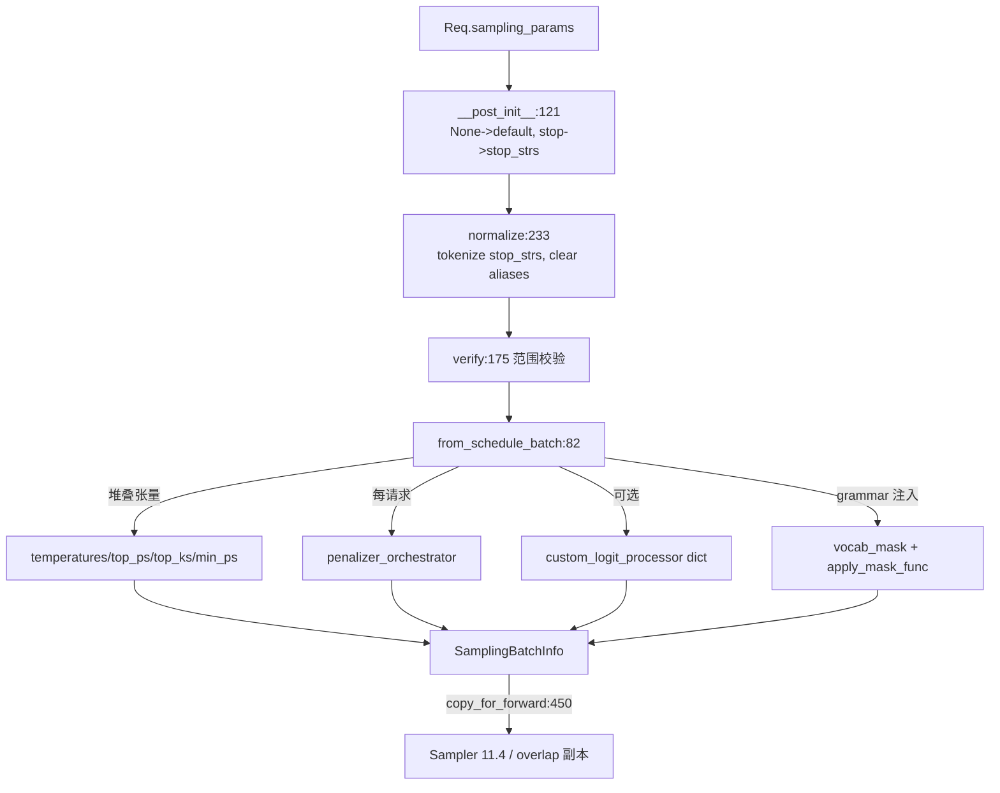

# 11.1 采样参数与 SamplingBatchInfo

## 定位

`SamplingParams` 与 `SamplingBatchInfo` 是采样控制链的数据契约层。前者是面向 API 调用者的"每请求"参数（`msgspec.Struct`，经 ZMQ IPC 序列化），后者是面向前向的"每 batch"张量集合（`dataclasses.dataclass`），由 `from_schedule_batch` 从一批 `Req` 装配而来，供 `Sampler.forward` 与 `GrammarManager` 消费。

## 职责

- `SamplingParams`：定义 temperature/top_k/top_p/min_p/penalty/stop/json_schema 等字段，`verify` 做范围校验，`normalize` 把 `stop`/`stop_regex` 翻成 tokenizer 相关的 `stop_strs` 并计算 `stop_str_max_len`。
- `SamplingBatchInfo`：把一批请求相同语义的标量参数堆叠成 GPU 张量；托管 `penalizer_orchestrator`、`custom_logit_processor`、`vocab_mask`/`apply_mask_func`、`logit_bias` 与确定性采样的 `sampling_seed`。
- 维护批级生命周期：`filter_batch`（裁剪）、`merge_batch`（合并）、`copy_for_forward`（overlap 模式下预累积 penalty 后摘除 orchestrator 引用）。

## 关键类与函数

| 名称 | 定义位置 | 说明 |
|---|---|---|
| `SamplingParams` | `sampling/sampling_params.py:75` | `msgspec.Struct`，API 端采样参数 |
| `SamplingParams.verify` | `sampling/sampling_params.py:175` | 范围校验，含 grammar 互斥检查 |
| `SamplingParams.normalize` | `sampling/sampling_params.py:233` | stop/regex tokenize 与 alias 清理 |
| `raise_if_tokenizer_required` | `sampling/sampling_params.py:45` | `skip_tokenizer_init` 下禁用依赖 tokenizer 的特性 |
| `SamplingBatchInfo` | `sampling/sampling_batch_info.py:24` | 批级采样数据容器 |
| `SamplingBatchInfo.from_schedule_batch` | `sampling/sampling_batch_info.py:82` | 从 `ScheduleBatch.reqs` 装配 SBI |
| `SamplingBatchInfo.update_regex_vocab_mask` | `sampling/sampling_batch_info.py:236` | 调 grammar.allocate/fill/move_vocab_mask |
| `SamplingBatchInfo.apply_logits_bias` | `sampling/sampling_batch_info.py:280` | 把 penalty/grammar/logit_bias 一次性压进 logits |
| `SamplingBatchInfo.update_penalties` | `sampling/sampling_batch_info.py:263` | overlap 模式预累积 additive/scaling penalty |
| `SamplingBatchInfo.filter_batch` | `sampling/sampling_batch_info.py:299` | 按 keep_indices 裁剪批 |
| `SamplingBatchInfo.merge_batch` | `sampling/sampling_batch_info.py:385` | 合并两个 SBI（含 penalty/custom processor/logit_bias） |
| `SamplingBatchInfo.copy_for_forward` | `sampling/sampling_batch_info.py:450` | 预累积后返回去掉 orchestrator 的副本 |
| `merge_bias_tensor` | `sampling/sampling_batch_info.py:456` | logit_bias 等偏置张量合并 helper |

## 子模块树

- `sampling/` — 采样数据与逻辑
  - `sampling_params.py` — API 参数定义与校验/归一化
  - `sampling_batch_info.py` — 批级装配与生命周期
  - `penaltylib/` — 见 [11.2](11.2-penalty-lib.md)
  - `custom_logit_processor.py` — 见 [11.3](11.3-custom-logit-processor.md)

## 数据流 / 控制流

`from_schedule_batch` 先把每个 `Req.sampling_params` 的标量字段 `torch.tensor(...)` 到 device，再用 `is_all_greedy`/`need_top_*_sampling` 等布尔汇总决定 `Sampler.forward` 走哪条分支；同时构造 `BatchedPenalizerOrchestrator`，每个 penalizer 自检 `_is_required`，避免无 penalty 时的开销。custom logit processor 按 `processor_str` 哈希分组合并，配一个 `bool` mask 标记哪些请求归属该处理器。`apply_logits_bias` 是压入 logits 的总入口：先 additive（overlap 累积或 orchestrator.apply）、再 scaling（repetition）、再 vocab mask、再 logit_bias。

## 交叉引用

- 下游: [11.4 Sampler 层](11.4-sampler-layer.md) — `Sampler.forward` 消费 SBI
- 下游: [11.2 penalty 库](11.2-penalty-lib.md) — `penalizer_orchestrator` 实现
- 下游: [11.3 自定义 logit processor](11.3-custom-logit-processor.md) — `custom_logit_processor` 字段来源
- 下游: [11.5.6 GrammarManager](11.5.6-constrained-grammar-manager.md) — 注入 `grammars`/`vocab_mask`
- 上游: [`03.9 schedule_batch`](../03-orchestration/03.9-schedule-batch.md) — `Req`/`ScheduleBatch` 来源
- 相关: [`02.3.2 openai chat`](../02-server-api/02.3.2-openai-base-chat-completions.md) — 把 HTTP 请求翻成 `SamplingParams`

## 进一步阅读

- 源码: `python/sglang/srt/sampling/sampling_params.py`、`python/sglang/srt/sampling/sampling_batch_info.py`
